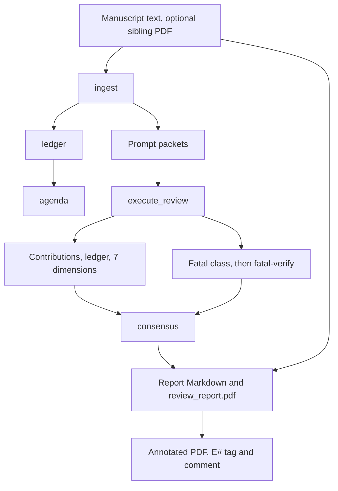
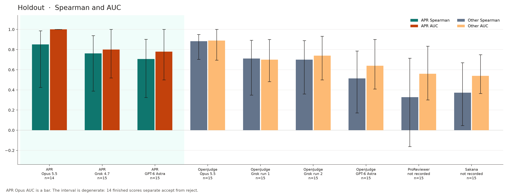

English | [Simplified Chinese](README.zh-CN.md)

# AutoPaperReview

AutoPaperReview (APR) is a local pipeline that reviews a manuscript. It has two uses, and each one is a separate run:

- **[Review report](#track-a)** is the default. After `init`, a normal `run` writes a seven-dimension review with an evidence ledger, a contributions audit, and a fatal-flaw check. The outputs are a Markdown report, `review_report.pdf` when reportlab is installed, and an annotated manuscript PDF.
- **[Venue score and benchmark](#track-b)** is optional and off by default. A `holistic` forecast plus a `rate` stage with `apr-fusion-v1` produces the `forecast-k1` rank. The holdout table measures only that rank.


The right half comes from the optional benchmark track.

Version `0.1.10`, alpha. Python 3.10–3.13. MIT license. APR doesn't replace a human reviewer.

<a id="track-a"></a>

## Review report

This is the default use, and it doesn't compute a venue score. For the forecast and the holdout numbers, see [Venue score and benchmark](#track-b).

### What you get

| Piece | What it is |
| --- | --- |
| Contributions and ledger | The claims the manuscript makes, the evidence it offers, and what's still missing. |
| Seven dimension scores | Originality, importance, claims supported, experimental soundness, writing, community value, and prior-work context. The bands are 2/4/6/8/10. |
| Fatal-flaw check | APR keeps a label such as leakage or an unfair baseline only when the excerpt is in the paper **and** a second call, `fatal-verify`, agrees that the excerpt states that class. The `missing_closest_neighbor` label comes from related-work search, not from that call. |
| Review report | `review_report.md`, next to `review.toml`. With reportlab installed, the same stage also writes `review_report.pdf`. |
| Bilingual option | Set `bilingual = true` on `execute_review` and on `report` to write `en` and `zh-Hans` in one file. Export fails if a pair is missing. |
| Annotated original PDF | The annotator highlights each cited evidence item, tags it in the margin (`E1`, `E2`, …), and adds a PDF comment from `APR reviewer`. |
| Related work, if you add the stage | Keyword and metadata search (arXiv, OpenAlex, Semantic Scholar). The search doesn't send manuscript prose. |

The default judgments are `contributions`, `ledger`, `dimensions`, and `fatal`. `init` uses `DeterministicManuscriptAdapter`, so the first local run needs no API key and no `holistic` judgment.

### Synthetic preview

The figure and the excerpt come from the invented tracking note in `examples/synthetic/`. The note isn't a submission, and it isn't one of the holdout papers. The run uses `FixtureReviewAdapter`: the sentences are that fixture's review, rendered by the real report stage. The example doesn't run `rate` or compute `forecast-k1`. The report states that it assigns no overall 0–10 score. The ICLR "reject" line in the fixture is a written venue conclusion stored on the package.


The highlight marks evidence `E1`. From the package, the annotator writes this PDF comment:

> **E1** · Weakness 1 (critical)
>
> A first-time reader can easily read 'image-level split' as a normal train/test split. It is not.
>
> Highlighted on page 1.

The same id also appears in the second issue, the question, the seven dimension scores, and the fixture's ICLR reject and TMLR major-revision notes. The margin tag points into the evidence index, and the comment says which point the evidence supports.

The report cites the same id for the required revision. The generated file repeats each section in `zh-Hans`, and [the Chinese page](README.zh-CN.md) shows that wording. The following abbreviated English excerpt comes from `review_report.md` after `autopaperreview run examples/synthetic/review.toml`:

```markdown
## Weaknesses

- The evaluation does not establish sequence independence, so the deployment claim is unsupported. [E1]

## Dimension Scores

- claims_supported — 2.0/10 [E1]
  The deployment claim is not supported by the reported split or uncertainty.
- experimental_soundness — 2.0/10 [E1]
  Image-level split of eight temporally related images is not an independent test.

### I001  (critical, blocking)

> Eight temporally related images from one specimen were randomly divided at image level.

Why this matters: the eight images are temporally related and come from one specimen,
so the test images are near-duplicates of the training images. The generalization
and deployment claims do not follow.

Required action: Use specimen- or sequence-level holdout and report results on a
genuinely independent test set.
```

<a id="comparison"></a>

### What a score does not give you

A Spearman value doesn't tell an author what to revise. On the benchmark holdout, APR isn't more accurate than OpenJudge on every metric. The following table shows what the APR package adds, and what three other codebases document differently:

| | APR | OpenJudge paper review | ProReviewer | Sakana reviewer |
| --- | --- | --- | --- | --- |
| Evidence-grounded quote | Quote, evidence id, and a required action. If a major issue has no quote, the export gate can fail the export. | Review prose. The public pipeline doesn't store a quote-to-span contract. | Review log of claims, questions, and notes. The project page links log lines back to the paper. | Free-text strengths and weaknesses from extracted PDF text. |
| Numbered PDF markers and comment pop-ups | Yes. Margin tag `E#`, highlight, and a PDF comment authored by `APR reviewer`. | Not in the public paper-review pipeline. | Not in the public repository. The demo traces log entries, not PDF pop-ups. | Not in `perform_review`. |
| Second check before a fatal label | Yes. `fatal-verify` must agree that the excerpt states the class. `missing_closest_neighbor` comes from related-work search, not from that call. | The criticality grader reclassifies correctness findings, including false positives. The contract differs. | Not described as a second excerpt check. | Not described. |
| Rank from a probability over official ratings | Yes. One call, three seats, probabilities on 1/3/5/6/8/10, rank = mean expected rating. | Integer score 1–6. | Not described. | Ensemble of integer overall scores in the published reviewer. Not a probability vector. |
| Venue scale | ICLR bins from the 1–6 decision. Format profiles `iclr2027` and `aaai2027` (page limit, anonymity). AAAI is format only. | Optional venue **name** on a discipline rubric. The published score is 1–6, not the ICLR bin set. | Not a pinned ICLR/AAAI format profile. | The published prompt follows a NeurIPS-style form (soundness, presentation, contribution, overall, confidence). |
| Bilingual export | `en` and `zh-Hans` in one file. Export fails if a pair is missing. | One language per run, `en` or `zh`. | Not described. | Not described. |
| Related work without sending the manuscript | Keyword and id/title/DOI lookups. Prose stays local. A provider that fails doesn't add a cap. | Bibliography check against CrossRef. The skill also names arXiv and DBLP. It sends reference metadata, not a five-family related-work search. | Not described. | Not described. |
| Confidentiality guard for a public repository | `scripts/check_confidentiality.py` rejects review workdirs, page images, and submission-id patterns. | Not part of that project. | Not part of that project. | Not part of that project. |

### Quickstart

1. Install the package. The `pdf` extra installs PyMuPDF and reportlab, which produce the annotated manuscript and `review_report.pdf`. The `visual` extra installs page rendering for the format check. Without these extras, you still get the Markdown and JSON outputs.

```bash
python3 -m venv .venv
source .venv/bin/activate
pip install -e ".[pdf,visual]"
```

2. Create a project. `init` writes a deterministic adapter, prompt files, and `review.toml`. Keep real manuscripts in a gitignored directory such as `reviews/`, `workdir/`, `papers/`, or `uploads/`.

```bash
autopaperreview init reviews/my-paper --project-id my-paper --title "My paper review"
```

3. Replace `reviews/my-paper/manuscript.txt` with your manuscript. To call a model, edit the `execute_review` stage as in the following example. `OpenAICompatibleAdapter` calls an OpenAI-compatible chat API. The Pipeline section shows how the stages connect.

   - The key stays in the environment, in `APR_MODEL_API_KEY` by default. APR doesn't write it into the TOML, the request log, or the stage signature.
   - The `deny` network policy still allows a loopback server. A remote host needs `allow_remote = true`, `requires_network = true`, and `network_policy = "allow"`. The run manifest then records that the manuscript left the machine.
   - `base_url` is the API root (`…/v1`), not a URL with the key in its query string.
   - The model timeout defaults to 7200 seconds.

```toml
[project]
network_policy = "allow"

[[stages]]
id = "review"
type = "execute_review"
depends_on = ["prompt_packets", "ledger"]
[stages.params]
adapter = "autopaperreview.model_exec:OpenAICompatibleAdapter"
base_url = "https://api.example.com/v1"
model = "your-model-id"
api_key_env = "APR_MODEL_API_KEY"
allow_remote = true
requires_network = true
bilingual = true
judgments = ["contributions", "ledger", "dimensions", "fatal"]

[[stages]]
id = "report"
type = "report"
depends_on = ["consensus"]
[stages.params]
bilingual = true
```

Leave `holistic` and `rate` out of this file unless you want the [venue score](#track-b). `cheap = true` is a rank-only shortcut: it skips the contributions, ledger, dimension, and fatal-flaw judgments.

4. Optional: add a format check or related-work search. `init` doesn't add these stages. For the format check, set `profile` to `iclr2027` or `aaai2027`.

```toml
[[stages]]
id = "pages"
type = "render_pages"
depends_on = ["ingest"]
[stages.params]
profile = "iclr2027"

[[stages]]
id = "format"
type = "format_check"
depends_on = ["pages"]
[stages.params]
profile = "iclr2027"
```

For related-work search, add the `search` stage. Search runs only if the TOML includes it. When it's present, `novelty` and `rate` must depend on it. Live search needs `network_policy` set to `metadata_only` or `allow`. If every provider fails, the status is `degraded` and the score doesn't drop. `venue` takes the same values as `profile` and loads that venue's deadline file. It doesn't change the rating scale in the review text.

```toml
[[stages]]
id = "search"
type = "related_work_search"
depends_on = ["ingest"]
[stages.params]
venue = "aaai2027"
mode = "live"
requires_network = true
```

5. Run the pipeline. A second run reuses each stage whose signature still matches.

```bash
autopaperreview validate reviews/my-paper/review.toml
autopaperreview run reviews/my-paper/review.toml
```

The synthetic example runs without an API key:

```bash
PYTHONPATH=src python3 -m autopaperreview validate examples/synthetic/review.toml
PYTHONPATH=src python3 -m autopaperreview run examples/synthetic/review.toml
```

6. Annotate the PDF. When `report` runs with PyMuPDF installed and `manuscript.pdf` next to the text, that stage already writes `annotated_manuscript.pdf`. To annotate later without another model call, run:

```bash
autopaperreview annotate reviews/my-paper/review.toml --pdf path/to/manuscript.pdf
```

To color highlights by the Strengths, Weaknesses, and Questions in the Markdown, and not only by the claims on the package, pass `--review`. By default, `annotate` writes `<run>/annotated_manuscript.pdf`.

### Where the files land

| Path | Contents |
| --- | --- |
| `review_report.md` | Next to `review.toml`, with a second copy under `<run>/stages/report/`. Evidence ids link to the evidence index. |
| `review_report.pdf` | The same report, in both places, whenever reportlab is installed. No flag skips it. |
| `annotated_manuscript.pdf` | Next to `review.toml` when the report stage finds a sibling PDF. `annotate` writes the run-directory copy unless you pass `--output`. A quote that isn't in the PDF becomes a page-level note and stays in the index. |
| `<run>/run_manifest.json` | Stage status, signatures, and whether the manuscript left the machine. |
| `<run>/stages/<id>/` | Package JSON and prompt packets. A model stage also stores the raw request and response bytes with their SHA-256. |

`<run>` is `<run_root>/<run_id>`, and `init` sets `run_root` to `.runs`. A later `run` reuses any stage whose signature and output hashes still match. If you change the export gate, APR reruns the report and keeps the ingest, search, and judgment results. Don't commit `review_report.md`, `review_report.pdf`, or `annotated_manuscript.pdf`.

### Pipeline



The synthetic example stops at a fixture `execute_review` and a bilingual report. It has no `rate` stage and calls no model.

### Commands

```text
autopaperreview init            Create a local project (deterministic or agent adapter)
autopaperreview validate        Check TOML, the DAG, and local paths
autopaperreview run             Run or resume; exit 3 while a stage awaits a drop
autopaperreview status          Run state, awaiting drops, and outputs as JSON
autopaperreview submit          Check an agent drop, then write it
autopaperreview mcp             Serve the review tools to an MCP client over stdio
autopaperreview inspect         Print a run manifest
autopaperreview annotate        Highlights, margin tags, and comments
autopaperreview doctor          Optional extras and adapters
```

<a id="agent-mcp"></a>

### Agent harness and MCP

A coding agent such as Claude Code or Codex CLI can act as the reviewer. APR writes the prompt packets, the agent reads them and writes a judgment drop, and APR checks the drop before the report runs. APR needs no API key in this mode. The agent's model reads the manuscript, so the manuscript goes wherever that model runs. APR can't see that egress, and `manuscript_left_machine` stays false.

Create an agent project. Its `execute_review` stage uses `AgentJudgmentAdapter` with `fixture_path = "judgment.json"` and `verify_excerpts = true`.

```bash
autopaperreview init reviews/my-paper --project-id my-paper --adapter agent
```

Register the MCP server. Every path a tool receives must resolve inside a `--root` directory. The default root is the server's working directory.

```bash
claude mcp add autopaperreview -- autopaperreview mcp --root /abs/path/to/reviews
```

For Codex CLI, add this to `~/.codex/config.toml`:

```toml
[mcp_servers.autopaperreview]
command = "autopaperreview"
args = ["mcp", "--root", "/abs/path/to/reviews"]
```

Then ask the agent to review the manuscript. The tools are `init_project`, `validate`, `run`, `status`, `read_input`, `drop_template`, `submit_drop`, and `report`.

| Step | What happens |
| --- | --- |
| `run` | Stages run until `execute_review` finds no drop. That stage becomes `awaiting_input`, the stages after it become `pending`, and stages that don't depend on it still run. The call sends one progress notification per stage. |
| `status`, `drop_template` | The packets to read, the drop path, and the `packet_sha256` digests to echo. The template lists the seven dimensions and the `sar_bands_v1` clauses, with no default clause. |
| `read_input` | A packet or a page render. Text comes back in pages of `max_chars`, so a long manuscript fits the client's output limit. |
| `submit_drop` | The stage's own checks: digests, schema, all seven dimensions, and quotes that resolve in the manuscript. A rejected drop isn't written. |
| `run`, `report` | The review stage reads the drop, then consensus and report run. `report` returns `review_report.md`. |

The same loop works from a shell. `run` exits with code 3 while a stage awaits a drop, `status` prints JSON, and `submit` checks a drop file before it writes the drop:

```bash
autopaperreview run reviews/my-paper/review.toml       # awaiting_input
autopaperreview status reviews/my-paper/review.toml --detail
autopaperreview submit reviews/my-paper/review.toml my-drop.json
autopaperreview run reviews/my-paper/review.toml       # success
```

`visual_inspect` with `AgentFindingsInspector` and `related_work_search` with `mode = "agent"` wait the same way when their `findings_path` is declared and the file is missing. A run holds a lock on its run directory, so a second `run` of the same project returns `busy` and leaves the manifest alone. A tool call can't cancel a stage that is already running. Every packet repeats the manuscript text, so read the manuscript once and then only the route instructions of the other packets.

<a id="known-gaps"></a>

### Known gaps

None of the following has a configuration option, and this README doesn't add one.

- You can't switch off `review_report.pdf`. Whenever reportlab is installed, the report stage writes that PDF next to `review.toml` and under the report stage directory. Without reportlab, the stage still writes the Markdown and JSON and skips the PDF.
- There's no venue-specific official review form. `review_report.pdf` is a PDF rendering of this project's own Markdown report. It isn't an ICLR form or an AAAI form.
- `profile` on `render_pages` and `format_check`, and `venue` on `related_work_search`, accept `iclr2027` or `aaai2027`. These names select only format, anonymity, and deadline checks. They don't change the seven dimension bands, and they don't select a score formula. AAAI here isn't a second rating scale. `decision_bin` uses the ICLR bins in [Venue score and benchmark](#track-b) as its rating scale.

<a id="track-b"></a>

## Venue score and benchmark

This track is optional and off by default. It's separate from the review report: the seven dimension bands and the fatal-flaw pass **do not move** `forecast-k1`. To turn it on, add a `holistic` judgment in mode `forecast` and a `rate` stage with `coefficient_set = "apr-fusion-v1"`:

```toml
judgments = ["contributions", "ledger", "dimensions", "fatal", "holistic"]
holistic_mode = "forecast"
holistic_samples = 1

[[stages]]
id = "rate"
type = "rate"
depends_on = ["consensus"]
[stages.params]
coefficient_set = "apr-fusion-v1"
```

Put the first three keys in the `execute_review` stage's `[stages.params]`.

With `cheap = true`, the run keeps the holistic call and skips contributions, ledger, dimensions, and fatal. That rank-only run is what the holdout table measures.

### Results at a glance



APR's bars use the rank-only `forecast-k1`. Error bars are 95% paper-level bootstrap intervals (4000 resamples, seed `20261021`). The chart still draws the APR Opus AUC bar. Its interval is degenerate, [1.000, 1.000], because the score separates accept from reject perfectly on the 14 finished papers. APR Opus has n=14 and the other rows have n=15. The intervals are wide. GPT-6 Astra is the third model on the chart, with n=15 for APR and for OpenJudge. For the scope and the full table, see [What the benchmark measured](#benchmark-scope). For how the pipelines differ and where the score moved, see [Method and ablation](#method).

### How the forecast becomes a rank


One `holistic` call reads the full manuscript packet. The defaults are mode `forecast`, K = 1, and temperature 0.7. On the longest papers, APR caps the source text at 240,000 characters. The call answers as the three seats defined in `anchors.FORECAST_SEATS`:

- **Specialist**: closest prior work, baselines, and whether that area would treat the gain as real.
- **Generalist**: a strong reader from a nearby area, who checks whether the paper is clear, whether the claims follow, and whether the problem matters outside its niche.
- **Senior**: whether the area would build on the result.

Each seat writes a one-sentence summary, up to two strengths and two weaknesses, the official rating it would most likely submit, six probabilities, and a confidence from 1 to 5. The call also writes `predicted_mean` (the chair mean) and a 1–6 decision. Neither of these is the rank. The seat confidence also isn't the confidence printed on the review form. That field is a parameter of the `rate` stage, not a model output.

```text
expected rating = p1·1 + p3·3 + p5·5 + p6·6 + p8·8 + p10·10
rank            = mean of the three expected ratings, clamped to 1–10
bin             = decision 1,2,3,4,5,6  →  ICLR 1,3,5,6,8,10
```

APR normalizes probabilities that don't sum to one before it counts them. It counts an official rating outside {1, 3, 5, 6, 8, 10} as `off_scale` and keeps it. To make the arithmetic visible, the figure uses invented weights run through `expected_rating` and `forecast_mean` (rank 5.4933).

The venue rating in the report is `decision_bin` of that 1–6 decision, not the rank snapped down. Here's an invented example that comes from neither a holdout paper nor the figure: rank 5.53 with decision 4 reports rating 6. Snapping that rank down reports 5 (`snap_down`). The rank and the rating can differ by one bin.

APR records a verified venue cap and doesn't apply it to this rank. The forecast call isn't checked against the manuscript, but the fatal-flaw call is. The older `apr-iclr-cap-v2` dimension formula produces a number that a verified flaw can lower. That number isn't the one in the holdout table.

<a id="benchmark-scope"></a>

### What the benchmark measured

The holdout and tune-30 numbers measure the rank, not a full review.

They come from a rank-only run: `calibrate-eval` with `--cheap --holistic-mode forecast --holistic-samples 1 --related-work off --coefficient-set apr-fusion-v1`. That's one forecast call per paper. Contributions, the ledger, dimension scores, the fatal-flaw check, `fatal-verify`, and related-work search didn't run. The Spearman, Kendall, AUC, MAE, and bias values in the following table check only the continuous `forecast-k1` rank. They don't check the written review, the weaknesses, the dimension bands or sub-scores, the fatal labels, or the annotated PDF. The USD/paper figures in the cost table are also rank-only costs. A full review also writes the other outputs, and it costs considerably more.

Spearman and AUC in the table use the rank. The decision-bin rating was not evaluated on this holdout.

The holdout has **15 public OpenReview papers**. Spearman and Kendall compare the system score with the **mean official human rating**. AUC measures how well the score separates accepted from rejected papers. Intervals are a 95% paper-level percentile bootstrap: 4000 resamples, seed `20261021`, with the procedure in `src/autopaperreview/rank_metrics.py`.

APR's score in this table is the shipped rank, `forecast-k1`: the mean expected rating on 1–10. The table rounds values to three decimals. For full precision, see [`docs/assets/holdout15-aggregate.json`](docs/assets/holdout15-aggregate.json). Neither that file nor this README contains a paper id or title.

| System | Model, as recorded | n | Spearman | Kendall | AUC | MAE | Bias |
| --- | --- | --- | --- | --- | --- | --- | --- |
| APR | Opus 5.5 | 14 | 0.851 [0.425, 0.987] | — | 1.000 | 0.796 | −0.513 |
| APR | Grok 4.7 | 15 | 0.761 [0.389, 0.939] | — | 0.800 | 1.330 | −0.848 |
| APR | GPT-6 Astra | 15 | 0.706 [0.325, 0.902] | — | 0.780 [0.500, 1.000] | — | — |
| OpenJudge | Opus 5.5 | 15 | 0.883 [0.702, 0.950] | 0.756 [0.579, 0.882] | 0.890 [0.694, 1.000] | — | — |
| OpenJudge | Grok, run 1 | 15 | 0.712 [0.348, 0.892] | 0.593 [0.291, 0.799] | 0.700 [0.481, 0.900] | — | — |
| OpenJudge | Grok, run 2 | 15 | 0.700 [0.359, 0.889] | 0.575 [0.283, 0.794] | 0.740 [0.500, 0.932] | — | — |
| OpenJudge | Grok, mean of the two runs | 15 | 0.724 [0.374, 0.910] | 0.605 [0.312, 0.828] | 0.740 [0.500, 0.932] | — | — |
| OpenJudge | GPT-6 Astra | 15 | 0.515 [0.171, 0.786] | — | 0.640 [0.409, 0.900] | — | — |
| ProReviewer | not recorded | 15 | 0.327 [−0.162, 0.714] | 0.272 [−0.124, 0.607] | 0.560 [0.300, 0.833] | 1.711 | −1.078 |
| Sakana AI Scientist reviewer | not recorded | 15 | 0.372 [0.046, 0.670] | 0.302 [0.039, 0.570] | 0.540 [0.364, 0.750] | 2.244 | −2.211 |


Read the table as a small sample, not a leaderboard:

- **On Opus 5.5, OpenJudge ranks higher than APR** (Spearman 0.883 versus 0.851). APR's Opus AUC is 1.000 and OpenJudge's is 0.890. APR has **14** papers, not 15. The Spearman intervals overlap. On tune-30 that lead reverses. See [What the ablations show](#ablations).
- On Grok 4.7, APR is slightly ahead of both OpenJudge Grok runs: Spearman 0.761 versus 0.712 and 0.700, and AUC 0.800 versus 0.700 and 0.740. Those intervals overlap too.
- On GPT-6 Astra, both systems have n=15. APR leads OpenJudge on Spearman (0.706 versus 0.515) and on AUC (0.780 versus 0.640). The 95% intervals overlap on both metrics, so the lead is directional and not significant at this n. This OpenJudge row uses the same 1-call harness as the other OpenJudge rows, not the public default of 4 model calls, or 5 when correctness is above 1.
- ProReviewer and the Sakana reviewer are near chance on accept/reject (AUC 0.560 and 0.540), but their Spearman intervals still reach about 0.7.
- The aggregate has no APR Kendall and no OpenJudge MAE or bias. OpenJudge's published review score is an integer on 1–6. An MAE against a 1–10 human mean needs a mapping between the scales, and this repository doesn't have one.
- With both Opus and Grok, APR scores **below** the human mean (bias −0.51 on Opus, −0.85 on Grok 4.7). The aggregate has no Astra bias.
- Opus scored 14 of 15 papers. The run note says the missing paper timed out. The aggregate names the model Opus 5.5 and doesn't record the effort setting. The same note calls the run max effort.
- A dash means the aggregate has no such cell. No cell here comes from interpolation.

<a id="other-models"></a>

### Where the other models come from

This repository doesn't include OpenJudge, ProReviewer, or Sakana. The following descriptions come from their public docs, as checked when this README was written. The **holdout model** is whatever the aggregate records, and the aggregate records less detail than the upstream defaults specify.

- **OpenJudge** paper review ([agentscope-ai/OpenJudge](https://github.com/agentscope-ai/OpenJudge)) uses several graders: safety, correctness, a 1–6 scholarly score, a criticality pass that can mark a finding as a false positive, and BibTeX checks against CrossRef. The aggregate's OpenJudge rows are Opus 5.5, two Grok runs, and GPT-6 Astra. The file doesn't record the Grok version.
- **ProReviewer** ([UKPLab/arxiv2026-ProReviewer](https://github.com/UKPLab/arxiv2026-ProReviewer), arXiv:2606.13349) is a multi-step agent with a review log. The public checkpoint is a Qwen3-8B model, and the API path accepts other models. This holdout doesn't record which one ran. About 24 calls per paper means a multi-step loop, not a single score.
- **Sakana's AI Scientist reviewer** ([SakanaAI/AI-Scientist](https://github.com/SakanaAI/AI-Scientist) `perform_review`) returns NeurIPS-style scores, strengths, weaknesses, and accept/reject from extracted PDF text. The upstream README's default review model is `gpt-4o-2024-05-13`, with an ensemble. This holdout doesn't record the model or the ensemble settings.

### Cost and time

| System | Model calls | USD total | USD / paper | Minutes / paper |
| --- | --- | --- | --- | --- |
| APR Opus 5.5 | not in the aggregate | — | 0.66 | ~5.3, from the run note, not the aggregate |
| APR Grok 4.7 | not in the aggregate | — | 0.11 | ~2.9, from the run note, not the aggregate |
| APR GPT-6 Astra | not in the aggregate | — | — | not recorded |
| OpenJudge Opus 5.5 | 15 (1 / paper) | 6.16 | 0.41 | not recorded |
| OpenJudge Grok run 1 | 15 | 0.94 | 0.063 | not recorded |
| OpenJudge Grok run 2 | 15 | 0.97 | 0.065 | not recorded |
| OpenJudge GPT-6 Astra | 15 (1 / paper) | — | — | not recorded |
| ProReviewer | 364 (~24 / paper) | 12.77 | 0.85 | not recorded |
| Sakana reviewer | 137 (~9 / paper) | 12.88 | 0.86 | not recorded |

These dollar amounts cover the rank-only forecast calls behind the holdout table. A full review costs considerably more.

### Tuning split

The tuning split isn't a confirmation set. Its file has point estimates and no bootstrap intervals. Opus is missing one of the 30 papers, and the file doesn't say why.

| Split | Model | n | Spearman | AUC |
| --- | --- | --- | --- | --- |
| tune-30 | Opus 5.5 | 29 | 0.858 | 1.000 |
| tune-30 | Grok 4.7 | 30 | 0.656 | 0.857 |

`forecast-k1` stays the shipped rank. Don't replace it because a later number looks better on this split. For details, see [public calibration](docs/public-calibration.md).

<a id="method"></a>

### Method and ablation

The holdout charts show the shipped rank, `forecast-k1`, next to three other systems. Two things are easy to miss there: OpenJudge isn't the same kind of review, and the rank didn't rise through a series of similar steps.

#### APR and OpenJudge, per paper

APR has two different runs. The table measures one forecast call. The default `run` writes a review and doesn't move that number. OpenJudge's public default is a multi-grader pipeline, and this repository doesn't ship that code. The following description comes from OpenJudge `cookbooks/paper_review` at [commit c2fdc38](https://github.com/agentscope-ai/OpenJudge/blob/c2fdc38314cd971b03d4d9333cd2c9f24d85c27f/cookbooks/paper_review/pipeline.py), plus the call count in the cost table. For ProReviewer and Sakana, see [What a score does not give you](#comparison).

- **What the score is.** APR's benchmark reads `forecast-k1`: one call with three seats, each giving a probability over 1/3/5/6/8/10. The rank is the mean of the three expected ratings. The 1–6 decision from that same call is the bin on the review form, not the rank. OpenJudge's published recommendation is the review grader's integer 1–6 (`result.review.score`). Correctness is a separate 1–3 score, and it doesn't replace the 1–6.
- **How many model calls.** The APR number in the table comes from 1 forecast call (`--cheap`). OpenJudge's default `review_paper` makes 4 model calls: jailbreak, format, correctness, and review. It makes a 5th, criticality, only when the correctness score is above 1. A `.bib` file is optional. If you pass one, CrossRef checks it, and that check isn't another model call. The holdout cost table records OpenJudge as 1 call per paper, so that row isn't this default pipeline.
- **What gets checked against the paper.** APR keeps a dimension score only when the quoted excerpt is in the manuscript. It keeps a fatal class only when a second call, `fatal-verify`, agrees. OpenJudge can mark a correctness finding as a false positive, but its public pipeline doesn't require the review sentence to match a span in the PDF. That pipeline takes the PDF as input, and a TeX package is a separate entry point. It renders pages as images only if you set `use_vision_for_pdf`.
- **What you get back.** APR's default run writes the seven-dimension review and the evidence ledger. With PyMuPDF installed, it also writes `annotated_manuscript.pdf` with margin numbers (`E1`, `E2`) and pop-up comments. OpenJudge's `generate_report` writes Markdown that covers safety, correctness, the 1–6 review, and criticality. It doesn't write numbered comments onto the source PDF.

<a id="ablations"></a>

#### What the ablations show

The gaps are the useful part, so this section reports them in text instead of another grouped chart. Point estimates are in [`docs/assets/ablation-aggregate.json`](docs/assets/ablation-aggregate.json) and [`docs/assets/tune30-r14-r15-aggregate.json`](docs/assets/tune30-r14-r15-aggregate.json). Where an interval appears, it's a 95% paper-level bootstrap interval: 4000 resamples, seed `20261021`.

The step that moves the rank is replacing the weighted seven-dimension score and the decision bin with the averaged expected rating. Spearman on the Grok 4.7 holdout (n=15):

- Weighted seven-dimension score: 0.452 [−0.130, 0.870]
- r2 mean-k1: 0.667 [0.228, 0.895]
- Shipped forecast-k1: 0.761 [0.389, 0.939]

On the tune split (n=30), the score average beats the bin. The mean-k1 readout scores 0.601/0.780 (Spearman/AUC), and the bin scores 0.485/0.658. That's why the benchmark uses `rank_score`. The review form still prints the bin.

Later variants on that holdout stay within the noise. `panel-k2` scores 0.705 [0.313, 0.890], next to 0.761 [0.389, 0.939] for `forecast-k1`, and the intervals overlap. Holdout-15 was opened in rounds 2, 8, and 11, so it isn't one untouched holdout. n is 14 or 15.

OpenJudge's Opus lead on the holdout doesn't hold on tune-30. On the holdout, OpenJudge scores 0.883 against APR's 0.851. The tune-30 comparison uses the same scaffold and Opus 5.5 (n=29, because the safety classifier refused 1 paper). There, OpenJudge scores Spearman 0.635 [0.345, 0.830] and AUC 0.879 [0.748, 0.972]. The file records that OpenJudge effort as xhigh and doesn't record the APR effort for these draws. Three APR `forecast-k1` draws score 0.858, 0.837, and 0.815, each with AUC 1.000. Each draw leads by 0.18 to 0.22 Spearman and by about 0.12 AUC. On Grok 4.7 (n=30), the two are close: OpenJudge scores 0.629 [0.315, 0.836] with AUC 0.816 [0.662, 0.938], against APR draws of 0.656/0.857 and 0.582/0.761.

Two later ideas didn't help:

- **r14 dated-k1** asks the panel to review as of the manuscript's writing time, with no hindsight. Grok lands at 0.554/0.766, below the earlier Grok draws. Opus (n=29) lands at 0.827/0.985 and correlates 0.985 with the main forecast, inside the range of the Opus draws, 0.815 to 0.858. Dating the review didn't add a new ranking signal.
- **r15 duo-k1** averages that panel with a separate full-report referee, with equal weights. On Grok, the average is 0.493/0.775. The referee alone is 0.421/0.749, and the panel alone on that run is 0.619/0.801, so averaging in the referee lowered the score. The Opus duo run has no number because the referee calls timed out.

`forecast-k1` was preregistered before the holdout, not picked on it. On the Grok tune split, chair-k1 (0.684/0.866) is slightly higher than `forecast-k1` (0.656/0.857). On Opus, the other readouts range from 0.842 to 0.875.

### Reproduce the benchmark

Use public OpenReview data only. Put the cache in a gitignored directory such as `reviews/`. Don't commit the manifest, the cache, forum ids, titles, or a split-id file. This repository doesn't contain the id list for the 15-paper table, so a new listing doesn't reproduce those cells.

`calibrate-eval` has five subcommands: `list`, `fetch`, `prepare`, `run`, and `report`.

1. List one public venue group. `--listing` accepts `ICLR 2024 oral`, `ICLR 2024 spotlight`, `ICLR 2024 poster`, `ICLR 2024 rejected`, `ICLR 2025 oral`, `ICLR 2025 spotlight`, `ICLR 2025 poster`, and `ICLR 2025 rejected`. `--limit` defaults to 20. The command prints JSON with public forum ids and titles to stdout. Keep that JSON out of Git.

```bash
autopaperreview calibrate-eval list --listing "ICLR 2025 poster" --limit 20
```

2. Write the manifest yourself from that output. Each entry needs `forum_id` and `decision` (`accept` or `reject`). `listing` is optional. In the following example, `REPLACE_ME` is a placeholder, not a paper.

```json
{
  "papers": [
    {"forum_id": "REPLACE_ME", "decision": "accept", "listing": "ICLR 2025 poster"}
  ]
}
```

3. Fetch the public PDFs and the held-out official ratings, then build prompt packets. `--pdf-fallback` defaults to `arxiv`, and `--max-pages` defaults to 40.

```bash
autopaperreview calibrate-eval fetch --manifest reviews/public-eval/manifest.json --cache reviews/public-eval
autopaperreview calibrate-eval prepare --cache reviews/public-eval
```

4. Score with the locked rank-only flags. The bundled chat adapter requires `--mode adapter`. A remote endpoint also needs `--allow-remote`, `--requires-network`, and `--network-policy allow`. `--cheap` keeps the holistic call and skips contributions, ledger, dimensions, and fatal. With `--related-work off`, related-work search doesn't run. The default `--mode` is `agent`, which waits for a hand-written judgment file and doesn't call a model.

```bash
autopaperreview calibrate-eval run \
  --cache reviews/public-eval \
  --mode adapter \
  --adapter autopaperreview.model_exec:OpenAICompatibleAdapter \
  --base-url "https://api.example.com/v1" \
  --model "your-model-id" \
  --allow-remote \
  --requires-network \
  --network-policy allow \
  --cheap \
  --holistic-mode forecast \
  --holistic-samples 1 \
  --related-work off \
  --coefficient-set apr-fusion-v1
```

`calibrate-eval run` defaults to `--fixed-set none` and scores the cache you fetched. Add `--fixed-set iclr-dev --model-id "your-model-id" --effort xhigh` to score the proposed 48-paper dev set. Those two flags are required for that set, and the forecast-k1 flags in the command above have to match the manifest.

5. Build the two reports. They measure different things. `calibrate-eval report` scores the venue bin (`our_bin`, the decision bin) against the human mean, so its numbers don't match the holdout table. That table's Spearman and AUC use the continuous `forecast-k1` rank. `scripts/rank_eval.py --mode locked` reads `rank_score` and, by default, scores the proposed fixed ICLR dev set in `benchmarks/fixed_eval/` (`--fixed-set iclr-dev`). That run requires `--model-id` and `--effort`. `--fixed-set none` scores the whole cache, which is how the published holdout table was computed. `--resamples` defaults to 4000. The bootstrap seed is `20261021`, set inside `rank_metrics.py`, not a flag. The cache and `--output` must be gitignored paths such as `reviews/` or `workdir/`. The commands refuse a tracked path inside the checkout. A fixed-set run whose papers do not match the manifest digest exits 2. See [docs/fixed-eval.md](docs/fixed-eval.md).

```bash
autopaperreview calibrate-eval report \
  --cache reviews/public-eval \
  --output reviews/public-eval/bin-report.md
PYTHONPATH=src python3 scripts/rank_eval.py \
  --cache reviews/public-eval \
  --output reviews/public-eval/rank-metrics.json \
  --mode locked \
  --model-id "your-model-id" \
  --effort xhigh \
  --resamples 4000
```

Don't pass `--only-ids` with `--fixed-set iclr-dev`. `--ids` on `scripts/rank_eval.py` has to match the dev set when `--fixed-set iclr-dev` is on. `--holdout-file` scores the private holdout and is only for a README number change. This README does not publish those ids.

## Confidentiality

This repository is public. Keep manuscripts, page renders, reviews, submission ids, and forum ids in a gitignored directory. The only preview images are the synthetic note and the allowlisted PNG files in `docs/assets/`. To generate them, run:

```bash
python3 scripts/render_readme_figures.py
```

With `--zh`, the same command writes Chinese labels for the hero image, the ranking chart, and the forecast panel. It doesn't overwrite the English files. The annotated page stays the English fixture. The script takes no key and doesn't read any holdout paper.

CI runs `python3 scripts/check_confidentiality.py`. If someone pushes confidential content, don't force-push `main`. Report the commit SHAs instead. For the policy, see [CONFIDENTIALITY.md](CONFIDENTIALITY.md).

The network policy is a declaration that the runner enforces on stage metadata. It isn't an operating-system firewall.

## Limitations

**Review report**

- Related-work search can return a partial or degraded result. A failed provider must not tighten a cap, and the report should say the search was incomplete.
- Format profiles can reject an over-length or non-anonymous PDF. They don't set the forecast.
- You can't switch off `review_report.pdf`, and there's no venue-specific official review form. See [Known gaps](#known-gaps).

**Venue score and benchmark**

- The table scores one rank-only forecast call. It doesn't measure the written review, the dimension bands, the fatal labels, or the annotated PDF. The decision-bin venue rating was not the number compared with humans. A full review costs considerably more than the USD/paper column shows.
- Fifteen papers, one Opus timeout, and bootstrap intervals from about 0.4 to about 1.0 mean that a 0.02 Spearman gap isn't a finding.
- With both Opus and Grok, APR scores below the human mean.
- At the reported effort, Opus costs about $0.66 and takes several minutes per paper. One call in that table timed out. The default model-call budget is 7200 seconds.
- `forecast-k1` isn't checked against an excerpt. Fatal-flaw verification and dimension scores are real outputs, but they aren't why the rank correlates.
- On this holdout, OpenJudge on Opus has the higher Spearman. On tune-30 that lead doesn't hold. See [What the ablations show](#ablations).
- On GPT-6 Astra, APR leads OpenJudge on Spearman and on AUC, and the n=15 intervals overlap. That lead is directional. See [Venue score and benchmark](#track-b).
- The models behind the ProReviewer and Sakana runs weren't recorded, so those rows compare systems, not models.

## Status

AutoPaperReview `0.1.10` is alpha software for Python 3.10–3.13, released under the MIT license.

The core is a local DAG (directed acyclic graph) with TOML configuration, Pydantic records, a content-hash cache, and adapters. Prompts in `src/autopaperreview/prompts/` are versioned with the pipeline. Parsers and model vendors stay behind the adapters.

All pull requests target `pre-release` and merge only when CI is fully green. `main` only takes promotions from `pre-release`. A promotion is allowed only when a regression report shows that `pre-release` scores higher than or equal to `main` on the same fixed benchmark. Both branches run with the same model, grok-4.7 at reasoning_effort `xhigh`, via Cursor. The benchmark definition is a TODO in [Branching](docs/branching.md).

Further reading in this repository: [architecture](docs/architecture.md), [public calibration](docs/public-calibration.md), [related-work search](docs/related-work-search.md), and [first-read writing](docs/first-read-review.md). [docs/oss-experiment-gaps.md](docs/oss-experiment-gaps.md) is a gap list dated 2026-08-29. It predates `forecast-k1`. For the current comparison, use the comparison matrix in this README.
