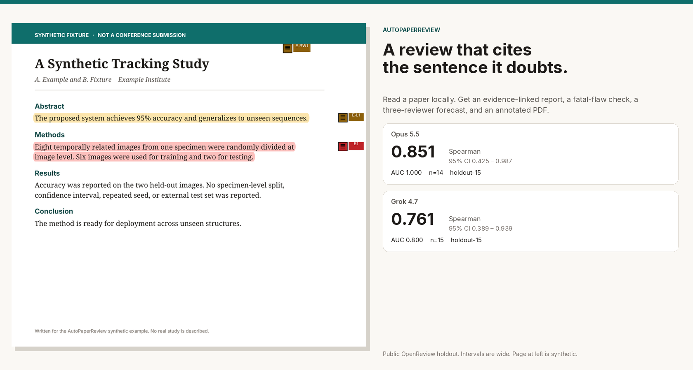
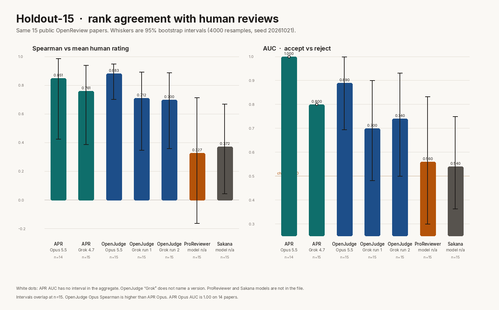
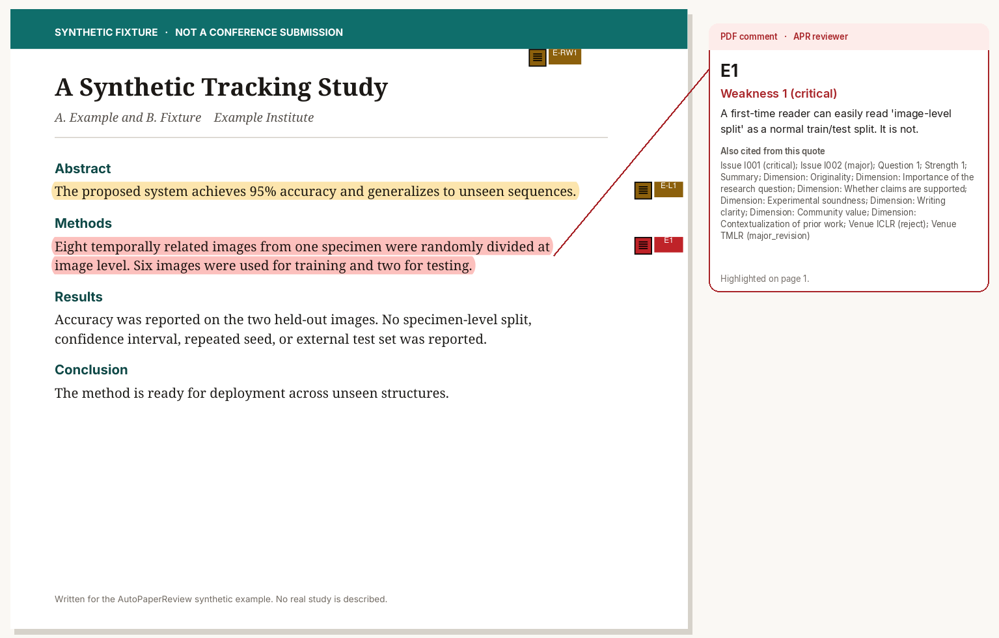
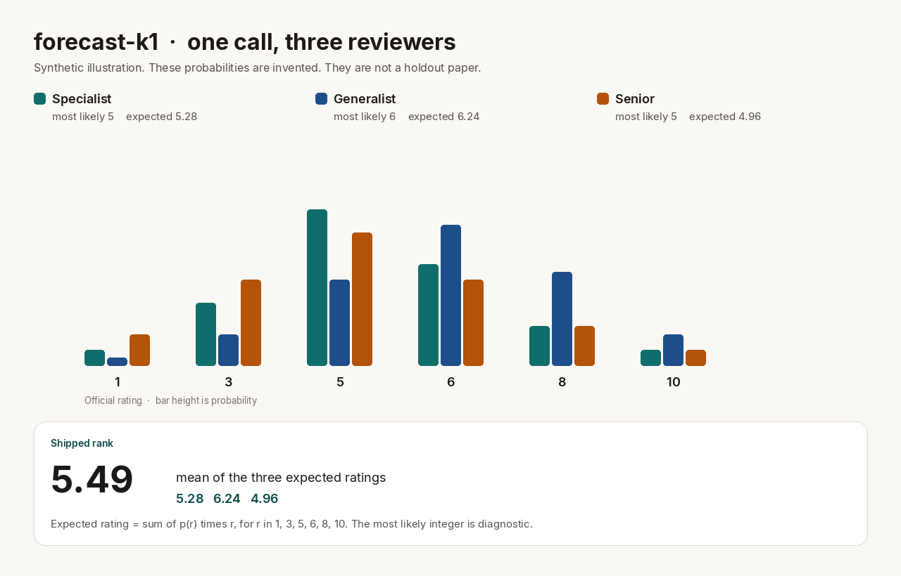
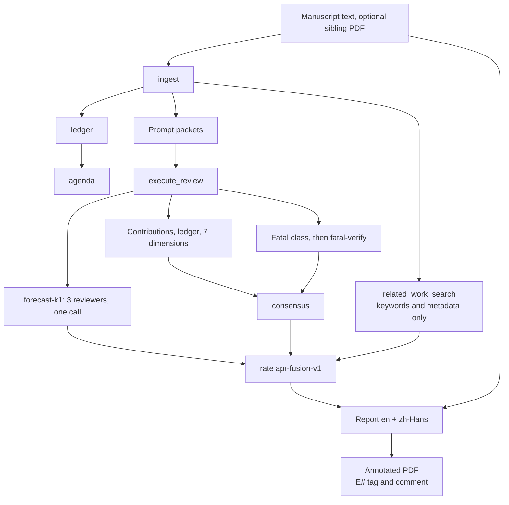

English | [Simplified Chinese](README.zh-CN.md)

# AutoPaperReview

AutoPaperReview reads a paper locally and writes a venue-style review that cites the manuscript: an evidence ledger, seven dimension scores, a fatal-flaw check with a second verify call, a three-reviewer **forecast** rank, a bilingual report, and an annotated PDF whose numbered markers open comments.



Version `0.1.10`. The shipped rank is `forecast-k1` on coefficient set `apr-fusion-v1`. It is a declared formula, not a fitted regression, and not a substitute for a human reviewer.

## What a run produces

| Piece | What it is |
| --- | --- |
| Contributions and ledger | Claims the manuscript makes, the evidence it offers, and what is still missing. |
| Seven dimension scores | Originality, importance, claims supported, experimental soundness, writing, community value, prior-work context. Bands sit on 2/4/6/8/10. |
| Fatal-flaw check | A class such as leakage or an unfair baseline is stored only when the excerpt is in the paper **and** a second call says that excerpt states the class. |
| Forecast | One call simulates a specialist, a generalist, and a senior reviewer. Each gives a probability over ratings 1, 3, 5, 6, 8, and 10. The rank is the mean of the three expected ratings. |
| Decision bin | The same call returns a 1–6 decision. That decision, not the rank, maps onto the ICLR bins 1 / 3 / 5 / 6 / 8 / 10. |
| Report | English and Simplified Chinese in one Markdown file, and a PDF when `reportlab` is installed. |
| Annotated PDF | Each cited evidence item is highlighted, tagged in the margin (`E1`, `E2`, …), and given a PDF comment from `APR reviewer`. |
| Related work | Keyword and metadata search (arXiv, OpenAlex, Semantic Scholar). Manuscript prose is not sent. |
| Venue profiles | Format checks for ICLR 2027 and AAAI-27. The rating bins above are the ICLR scale. AAAI here is a format profile, not a second score formula. |

The offline example under `examples/synthetic/` uses a fixture adapter. It writes the report and the annotated PDF without a model call, and it does **not** compute `forecast-k1`. The forecast runs when `execute_review` includes a `holistic` judgment and `rate` uses `apr-fusion-v1`.

## How well the rank tracks human scores

Holdout of **15 public OpenReview papers**. Spearman and Kendall compare the system score with the **mean official human rating**. AUC is accept versus reject. Intervals are a 95% paper-level percentile bootstrap: 4000 resamples, seed `20261021`, the procedure in `src/autopaperreview/rank_metrics.py`.

APR’s score in this table is the shipped rank: `forecast-k1`, the mean expected rating on 1–10. Full precision is in [`docs/assets/holdout15-aggregate.json`](docs/assets/holdout15-aggregate.json). Figures below are rounded to three decimals. No paper id or title is in that file or in this README.

| System | Model, as recorded | n | Spearman | Kendall | AUC | MAE | Bias |
| --- | --- | --- | --- | --- | --- | --- | --- |
| APR | Opus 5.5 | 14 | 0.851 [0.425, 0.987] | — | 1.000 | 0.796 | −0.513 |
| APR | Grok 4.7 | 15 | 0.761 [0.389, 0.939] | — | 0.800 | 1.330 | −0.848 |
| OpenJudge | Opus 5.5 | 15 | 0.883 [0.702, 0.950] | 0.756 [0.579, 0.882] | 0.890 [0.694, 1.000] | — | — |
| OpenJudge | Grok, run 1 | 15 | 0.712 [0.348, 0.892] | 0.593 [0.291, 0.799] | 0.700 [0.481, 0.900] | — | — |
| OpenJudge | Grok, run 2 | 15 | 0.700 [0.359, 0.889] | 0.575 [0.283, 0.794] | 0.740 [0.500, 0.932] | — | — |
| OpenJudge | Grok, mean of the two runs | 15 | 0.724 [0.374, 0.910] | 0.605 [0.312, 0.828] | 0.740 [0.500, 0.932] | — | — |
| ProReviewer | not recorded | 15 | 0.327 [−0.162, 0.714] | 0.272 [−0.124, 0.607] | 0.560 [0.300, 0.833] | 1.711 | −1.078 |
| Sakana AI Scientist reviewer | not recorded | 15 | 0.372 [0.046, 0.670] | 0.302 [0.039, 0.570] | 0.540 [0.364, 0.750] | 2.244 | −2.211 |



Read this table as a small sample, not a leaderboard:

- **OpenJudge on Opus 5.5 ranks higher than APR on Opus** (Spearman 0.883 vs 0.851). APR’s Opus AUC is 1.000 against OpenJudge’s 0.890, on **14** papers rather than 15. The Spearman intervals overlap.
- APR on Grok 4.7 is a bit above either OpenJudge Grok run (0.761 vs 0.712 and 0.700; AUC 0.800 vs 0.700 and 0.740). Those intervals overlap too.
- ProReviewer and the Sakana reviewer are near chance on accept/reject (AUC 0.560 and 0.540). Their Spearman intervals still reach into the 0.7s.
- APR Kendall was not in the aggregate. OpenJudge MAE and bias were not in it. OpenJudge’s published review score is an integer 1–6, so a MAE against a 1–10 human mean would not be comparable without a mapping we do not have.
- Both APR models score **below** humans on average (bias −0.51 Opus, −0.85 Grok 4.7).
- Opus scored 14 of 15 papers. The note with the run says the missing paper timed out. The aggregate names the model Opus 5.5 and does not record the effort setting; that same note calls the run max effort.
- A dash means the aggregate does not contain that cell. Nothing here was filled in by interpolation.

### Cost and time

| System | Model calls | USD total | USD / paper | Minutes / paper |
| --- | --- | --- | --- | --- |
| APR Opus 5.5 | not in the aggregate | — | 0.66 | ~5.3, from the run note, not the aggregate |
| APR Grok 4.7 | not in the aggregate | — | 0.11 | ~2.9, from the run note, not the aggregate |
| OpenJudge Opus 5.5 | 15 (1 / paper) | 6.16 | 0.41 | not recorded |
| OpenJudge Grok run 1 | 15 | 0.94 | 0.063 | not recorded |
| OpenJudge Grok run 2 | 15 | 0.97 | 0.065 | not recorded |
| ProReviewer | 364 (~24 / paper) | 12.77 | 0.85 | not recorded |
| Sakana reviewer | 137 (~9 / paper) | 12.88 | 0.86 | not recorded |

These dollars are the ranking runs behind the table. The aggregate does not split them into the forecast call versus contributions, dimensions, and the fatal-flaw pass. Turning those stages on costs more than a rank-only call.

### Tuning split, same aggregate

The tuning split is not a confirmation set. The file has point estimates and no bootstrap interval. Opus is missing one of 30 papers; the file does not say why.

| Split | Model | n | Spearman | AUC |
| --- | --- | --- | --- | --- |
| tune-30 | Opus 5.5 | 29 | 0.858 | 1.000 |
| tune-30 | Grok 4.7 | 30 | 0.656 | 0.857 |

`forecast-k1` stays the shipped rank. Do not swap it for another candidate because a later number looks better on this split. Details: [public calibration](docs/public-calibration.md).

### Where the other systems’ models come from

This repository does not vendor OpenJudge, ProReviewer, or Sakana. Labels below are from their public docs, checked when this README was written. The **holdout model** is whatever the aggregate records, which is less than the upstream default.

- **OpenJudge** paper review ([agentscope-ai/OpenJudge](https://github.com/agentscope-ai/OpenJudge)) is a multi-grader pipeline: safety, correctness, a 1–6 scholarly score, a criticality pass that can mark a finding as a false positive, and BibTeX checks against CrossRef. The aggregate’s OpenJudge rows are Opus 5.5 and two Grok runs. The Grok version is not in the file.
- **ProReviewer** ([UKPLab/arxiv2026-ProReviewer](https://github.com/UKPLab/arxiv2026-ProReviewer), arXiv:2606.13349) is a multi-step agent with a review log. The public checkpoint is a Qwen3-8B model; the API path accepts other models. This holdout does not record which one ran. About 24 calls per paper matches a multi-step loop, not a single score.
- **Sakana’s AI Scientist reviewer** ([SakanaAI/AI-Scientist](https://github.com/SakanaAI/AI-Scientist) `perform_review`) returns NeurIPS-style scores, strengths, weaknesses, and accept/reject from extracted PDF text. The upstream README’s default review model is `gpt-4o-2024-05-13`, with an ensemble. This holdout does not record the model or the ensemble settings.

## What the score-only baselines do not hand you

A Spearman number does not revise a paper. On the same holdout APR is not uniformly more accurate than OpenJudge. What the APR package adds, and what those three codebases document differently:

| | APR | OpenJudge paper review | ProReviewer | Sakana reviewer |
| --- | --- | --- | --- | --- |
| Evidence-grounded quote | Quote, evidence id, and a required action. Major issues can be blocked from export without a quote. | Review prose. The public pipeline does not store a quote-to-span contract. | Review log of claims, questions, and notes. The project page links log lines back to the paper. | Free-text strengths and weaknesses from extracted PDF text. |
| Numbered PDF markers and comment popups | Yes. Margin tag `E#`, highlight, PDF comment authored by `APR reviewer`. | Not in the public paper-review pipeline. | Not in the public repo. The demo traces log entries, not PDF popups. | Not in `perform_review`. |
| Second check before a fatal label | Yes. `fatal-verify` must agree that the excerpt states the class. `missing_closest_neighbor` is owned by related-work search, not by that call. | Criticality grader reclassifies correctness findings, including false positives. Different contract. | Not described as a second excerpt check. | Not described. |
| Rank from a probability over official ratings | Yes. One call, three seats, probabilities on 1/3/5/6/8/10, rank = mean expected rating. | Integer score 1–6. | Not described. | Ensemble of integer overall scores in the published reviewer. Not a probability vector. |
| Venue scale | ICLR bins from the 1–6 decision. Format profiles `iclr2027` and `aaai2027` (page limit, anonymity). AAAI is format only. | Optional venue **name** on a discipline rubric. Published score is 1–6, not the ICLR bin set. | Not a pinned ICLR/AAAI format profile. | Published prompt follows a NeurIPS-style form (soundness, presentation, contribution, overall, confidence). |
| Bilingual export | `en` and `zh-Hans` in one file. Export fails if a pair is missing. | One language per run, `en` or `zh`. | Not described. | Not described. |
| Related work without sending the manuscript | Keyword and id/title/DOI lookups. Prose stays local. A provider that fails does not add a cap. | Bibliography check (CrossRef; the skill also names arXiv and DBLP). Sends reference metadata, not a five-family related-work search. | Not described. | Not described. |
| Confidentiality guard for a public repo | `scripts/check_confidentiality.py` rejects review workdirs, page images, and submission-id patterns. | Not part of that project. | Not part of that project. | Not part of that project. |

The fatal-flaw pass and the dimension bands **do not move** `forecast-k1`. The rank is the forecast mean. A verified venue cap is recorded and is not applied to that rank. The forecast call is not checked against the manuscript; the fatal-flaw call is. If you want a number that can be capped by a verified flaw, that is the older `apr-iclr-cap-v2` dimension formula, and it is not the number in the table above.

## What a critique looks like

The figure and the excerpt are the **synthetic** tracking note in `examples/synthetic/`. It was written for this repository. It is not a submission, and it is not one of the holdout papers. The run used `FixtureReviewAdapter`, so the sentences below are the fixture’s review, rendered by the real report stage.



The highlight is evidence `E1`. The PDF comment, written by the annotator from that package, is:

> **E1** · Weakness 1 (critical)
>
> A first-time reader can easily read 'image-level split' as a normal train/test split. It is not.
>
> Highlighted on page 1.

The same id is also attached to the other review fields that cite it (the second issue, the question, the seven dimension scores, the fixture’s ICLR reject and TMLR major-revision notes). The margin tag is the index; the comment says which point it supports.

The report ties the same id to a revision. The generated file repeats each section in `zh-Hans`; that wording is on [the Chinese page](README.zh-CN.md). Abbreviated English from `review_report.md` after `autopaperreview run examples/synthetic/review.toml`:

```markdown
## Weaknesses

- The evaluation does not establish sequence independence, so the deployment claim is unsupported. [E1]

## Dimension Scores

- claims_supported — 2.0/10 [E1]
  The deployment claim is not supported by the reported split or uncertainty.
- experimental_soundness — 2.0/10 [E1]
  Image-level split of eight temporally related images is not an independent test.

### I001  (critical, blocking)

> Eight temporally related images from one specimen were randomly divided at image level.

Why this matters: the eight images are temporally related and come from one specimen,
so the test images are near-duplicates of the training images. The generalization
and deployment claims do not follow.

Required action: Use specimen- or sequence-level holdout and report results on a
genuinely independent test set.
```

That ICLR “reject” line in the fixture is a written venue conclusion stored on the package. This example never runs `rate`, and the report says no overall 0–10 was assigned. The holdout rank further up the page is a different output.

## How the forecast becomes a rank



One `holistic` call in mode `forecast` (the default, K = 1, temperature 0.7) reads the full manuscript packet, capped at 240,000 characters of source text for the longest papers. It answers as three seats defined in `anchors.FORECAST_SEATS`:

- **Specialist** — closest prior work, baselines, whether the gain is one the area would treat as real.
- **Generalist** — a strong neighbour: clarity, whether the claims follow, whether the problem matters past its niche.
- **Senior** — whether the result is something the area will build on.

For each seat the model writes a one-sentence summary, up to two strengths and two weaknesses, the official rating it would most likely submit, six probabilities, and a confidence from 1 to 5. It also writes its own `predicted_mean` and a 1–6 decision. Those last two are diagnostic relative to the rank: the chair mean is not the rank, and the decision is not the rank.

```text
expected rating = p1·1 + p3·3 + p5·5 + p6·6 + p8·8 + p10·10
rank            = mean of the three expected ratings, clamped to 1–10
bin             = decision 1,2,3,4,5,6  →  ICLR 1,3,5,6,8,10
```

Probabilities that do not sum to one are normalised and counted. An official rating off {1, 3, 5, 6, 8, 10} is counted as `off_scale` and kept. The figure uses invented weights run through `expected_rating` and `forecast_mean` (rank 5.4933). It is there so the arithmetic is visible.

## Quickstart

```bash
python3 -m venv .venv
source .venv/bin/activate
pip install -e ".[pdf,visual]"
```

`pdf` installs PyMuPDF and reportlab (annotated manuscript and report PDF). `visual` installs page rendering for the format check. Without them, Markdown and JSON still run.

No API key, fixture review of the synthetic note:

```bash
PYTHONPATH=src python3 -m autopaperreview validate examples/synthetic/review.toml
PYTHONPATH=src python3 -m autopaperreview run examples/synthetic/review.toml
```

The second run reuses every stage whose signature still matches. The report is copied next to `review.toml` as `review_report.md`. A sibling `manuscript.pdf`, if you add one, is copied to `annotated_manuscript.pdf`. Both of those outputs are gitignored. Do not commit them.

Offline review of your own text, still with no model, using the deterministic adapter that `init` writes:

```bash
autopaperreview init reviews/my-paper --project-id my-paper --title "My paper review"
# replace reviews/my-paper/manuscript.txt
autopaperreview run reviews/my-paper/review.toml
```

Keep real manuscripts in a gitignored directory (`reviews/`, `workdir/`, `papers/`, `uploads/`).

### Call a model

`OpenAICompatibleAdapter` speaks an OpenAI-compatible chat API. The key stays in the environment (`APR_MODEL_API_KEY` by default). It is not written into the TOML, the request log, or the stage signature.

A loopback server is allowed while `network_policy` stays `deny`. A remote host also needs `allow_remote = true`, `requires_network = true`, and `network_policy = "allow"`. The run manifest then records that the manuscript left the machine.

Default judgments are `contributions`, `ledger`, `dimensions`, and `fatal`. The forecast is the `holistic` judgment. Ask for it explicitly, then score with `apr-fusion-v1`:

```toml
[[stages]]
id = "review"
type = "execute_review"
depends_on = ["prompt_packets", "ledger"]
[stages.params]
adapter = "autopaperreview.model_exec:OpenAICompatibleAdapter"
base_url = "https://api.example.com/v1"
model = "your-model-id"
api_key_env = "APR_MODEL_API_KEY"
allow_remote = true
requires_network = true
bilingual = true
judgments = ["contributions", "ledger", "dimensions", "fatal", "holistic"]
holistic_mode = "forecast"
holistic_samples = 1

[[stages]]
id = "rate"
type = "rate"
depends_on = ["consensus"]
[stages.params]
coefficient_set = "apr-fusion-v1"
```

`cheap = true` keeps the holistic call and skips contributions, ledger, dimensions, and fatal. That is a rank-only run. `bilingual = true` on `execute_review` adds one `zh-Hans` pass so the report stage can export both languages. The report stage needs `bilingual = true` as well. The model timeout defaults to 900 seconds.

`base_url` is the API root (`…/v1`), not a URL with a key in the query string.

To annotate after the fact, without another model call:

```bash
autopaperreview annotate path/to/review.toml --pdf path/to/manuscript.pdf
```

Pass `--review` when the highlight color should follow Strengths / Weaknesses / Questions in the Markdown rather than only the package claims.

## Pipeline



The synthetic example stops at a fixture `execute_review` and a bilingual report. It has no `rate` stage and no model. `related_work_search` is on the DAG only when the TOML includes it; `novelty` and `rate` must depend on it when it is present. Live search needs `network_policy` of `metadata_only` or `allow`. If every provider fails, status is `degraded` and the score does not drop.

## Outputs

| Path | Contents |
| --- | --- |
| `review_report.md` | Bilingual review. Evidence ids link to the evidence index. |
| `review_report.pdf` | Same report when reportlab is installed. |
| `annotated_manuscript.pdf` | Highlight, margin tag, comment popup, and an evidence-index page. A quote that is not in the PDF becomes a page-level note and stays in the index. |
| `<run>/run_manifest.json` | Stage status, signatures, and whether the manuscript left the machine. |
| `<run>/stages/<id>/` | Package JSON, prompt packets, and, for a model stage, raw request and response bytes with their SHA-256. |

Repeating `run` reuses a stage whose signature and output hashes still match. Changing the export gate reruns the report and keeps ingest, search, and judgments.

## Commands

```text
autopaperreview init            Create a local project (deterministic adapter)
autopaperreview validate        Check TOML, the DAG, and local paths
autopaperreview run             Run or resume
autopaperreview inspect         Print a run manifest
autopaperreview annotate        Highlights, margin tags, and comments
autopaperreview migrate         Import an older review JSON
autopaperreview doctor          Optional extras and adapters
autopaperreview calibrate-eval  Compare a rank to public human scores
```

`calibrate-eval` writes under a gitignored cache. It does not fit weights. A remote adapter needs `--allow-remote --requires-network --network-policy allow`. The locked mode is `--holistic-mode forecast --holistic-samples 1` with `--coefficient-set apr-fusion-v1`.

## Confidentiality

This repository is public. Manuscripts, page renders, reviews, submission ids, and forum ids stay in a gitignored directory. The synthetic note and the four PNGs in `docs/assets/` are the only preview images, and they are allowlisted because the confidentiality check otherwise rejects PNGs. They are generated by:

```bash
python3 scripts/render_readme_figures.py
```

That script runs the synthetic fixture and draws the chart from `docs/assets/holdout15-aggregate.json`. It does not take a key and does not read a holdout paper.

`python3 scripts/check_confidentiality.py` is the same check CI runs. If something confidential was pushed, do not force-push `main`. Report the commit SHAs. Policy: [CONFIDENTIALITY.md](CONFIDENTIALITY.md).

The network policy is a declaration the runner enforces on stage metadata. It is not an operating-system firewall.

## Limitations

- Fifteen papers, one Opus timeout, and bootstrap intervals that run from about 0.4 to about 1.0. A 0.02 Spearman gap is not a result.
- Both models under-score relative to the human mean.
- Opus at the reported effort is about $0.66 and several minutes per paper, and it can time out (default budget 900 seconds).
- `forecast-k1` is not grounded by an excerpt check. Fatal-flaw verification and dimension scores are real outputs; they are not why the rank correlates.
- OpenJudge on Opus currently has the higher Spearman on this holdout.
- ProReviewer’s and Sakana’s models for these runs were not recorded, so those rows are system comparisons, not model comparisons.
- Related-work search can come back partial or degraded. A failed provider must not tighten a cap, and the report should say the search was incomplete.
- Format profiles can reject an over-length or non-anonymous PDF. They do not decide the forecast.

## Status

Alpha, `0.1.10`. Python 3.11–3.13. MIT license.

The core is a local DAG: TOML config, Pydantic records, content-hash cache, and adapters. Prompts under `src/autopaperreview/prompts/` are versioned route assets. Parsers and model vendors stay behind those adapters.

Further reading, in the repo: [architecture](docs/architecture.md), [public calibration](docs/public-calibration.md), [related-work search](docs/related-work-search.md), [first-read writing](docs/first-read-review.md). [docs/oss-experiment-gaps.md](docs/oss-experiment-gaps.md) is a gap list from 2026-08-29. Use the matrix above for the current comparison; that note is older than `forecast-k1`.
