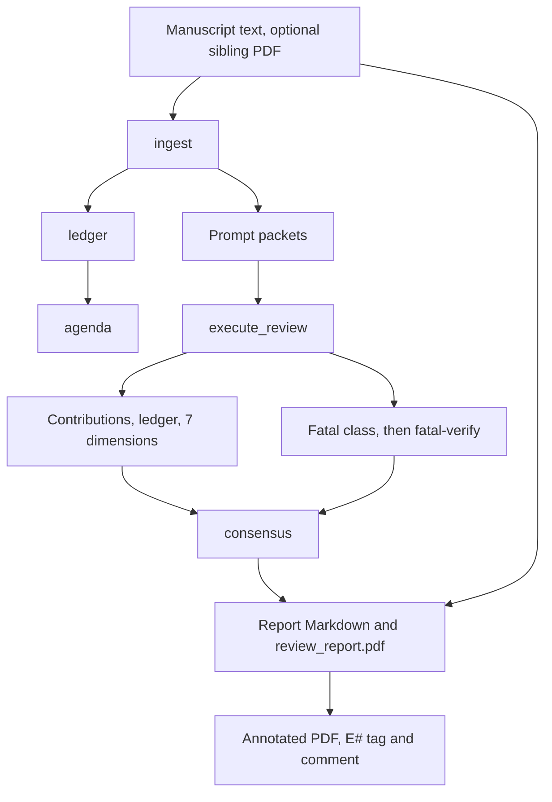

English | [Simplified Chinese](README.zh-CN.md)

# AutoPaperReview

Two uses. They are not the same run.

- **[Review report](#track-a)** is the default. `init` and a normal `run` write a seven-dimension review: an evidence ledger, a contributions audit, a fatal-flaw check, a Markdown report, `review_report.pdf` when reportlab is installed, and an annotated manuscript PDF.
- **[Venue score and benchmark](#track-b)** is optional. A `holistic` forecast plus `rate` with `apr-fusion-v1` produces `forecast-k1`. The holdout table measures that rank only.


Version `0.1.10`. Alpha. Python 3.11–3.13. MIT license. Not a substitute for a human reviewer.

<a id="track-a"></a>

## Review report

This is the default. It does not compute a venue score. The forecast and the holdout numbers are in [Venue score and benchmark](#track-b).

### What you get

| Piece | What it is |
| --- | --- |
| Contributions and ledger | Claims the manuscript makes, the evidence it offers, and what is still missing. |
| Seven dimension scores | Originality, importance, claims supported, experimental soundness, writing, community value, prior-work context. The bands are 2/4/6/8/10. |
| Fatal-flaw check | A label such as leakage or an unfair baseline is kept only when the excerpt is in the paper **and** a second `fatal-verify` call agrees that the excerpt states that class. `missing_closest_neighbor` comes from related-work search, not from that call. |
| Review report | `review_report.md` next to `review.toml`. The same stage writes `review_report.pdf` when reportlab is installed. |
| Bilingual option | `bilingual = true` on `execute_review` and on `report` writes `en` and `zh-Hans` in one file. Export fails if a pair is missing. |
| Annotated original PDF | Each cited evidence item is highlighted, tagged in the margin (`E1`, `E2`, …), and given a PDF comment from `APR reviewer`. |
| Related work, if you add the stage | Keyword and metadata search (arXiv, OpenAlex, Semantic Scholar). Manuscript prose is not sent. |

The default judgments are `contributions`, `ledger`, `dimensions`, and `fatal`. `init` uses `DeterministicManuscriptAdapter`, so the first local run needs no API key and no `holistic` judgment.

### Synthetic preview

The figure and the excerpt come from the invented tracking note in `examples/synthetic/`. It is not a submission, and it is not one of the holdout papers. The run used `FixtureReviewAdapter`. The sentences are that fixture’s review, rendered by the real report stage. The example does not run `rate` and does not compute `forecast-k1`. The report says no overall 0–10 was assigned. The ICLR “reject” line in the fixture is a written venue conclusion stored on the package.


The highlight is evidence `E1`. The PDF comment, written by the annotator from that package, is:

> **E1** · Weakness 1 (critical)
>
> A first-time reader can easily read 'image-level split' as a normal train/test split. It is not.
>
> Highlighted on page 1.

The same id is cited by the other fields that use it: the second issue, the question, the seven dimension scores, and the fixture’s ICLR reject and TMLR major-revision notes. The margin tag is the index. The comment says which point it supports.

The report uses the same id for the required revision. The generated file repeats each section in `zh-Hans`. That wording is on [the Chinese page](README.zh-CN.md). Abbreviated English from `review_report.md` after `autopaperreview run examples/synthetic/review.toml`:

```markdown
## Weaknesses

- The evaluation does not establish sequence independence, so the deployment claim is unsupported. [E1]

## Dimension Scores

- claims_supported — 2.0/10 [E1]
  The deployment claim is not supported by the reported split or uncertainty.
- experimental_soundness — 2.0/10 [E1]
  Image-level split of eight temporally related images is not an independent test.

### I001  (critical, blocking)

> Eight temporally related images from one specimen were randomly divided at image level.

Why this matters: the eight images are temporally related and come from one specimen,
so the test images are near-duplicates of the training images. The generalization
and deployment claims do not follow.

Required action: Use specimen- or sequence-level holdout and report results on a
genuinely independent test set.
```

<a id="known-gaps"></a>

### Known gaps

These are not config options. This README does not add them.

- There is no switch for `review_report.pdf`. The report stage writes that PDF next to `review.toml` and under the report stage directory whenever reportlab is installed. Without reportlab, the Markdown and JSON still run and the PDF is skipped.
- There is no venue-specific official review form. `review_report.pdf` is a rendering of this project’s own Markdown report. It is not an ICLR form and not an AAAI form.
- `profile` on `render_pages` and `format_check`, and `venue` on `related_work_search`, accept `iclr2027` or `aaai2027`. Those names select format, anonymity, and deadline checks only. They do not change the seven dimension bands, and they do not select a score formula. AAAI here is not a second rating scale. The ICLR bins in [Venue score and benchmark](#track-b) are the rating scale used by `decision_bin`.

### Quickstart

1. Install. `pdf` installs PyMuPDF and reportlab (the annotated manuscript and `review_report.pdf`). `visual` installs page rendering for the format check. Without them, Markdown and JSON still run.

```bash
python3 -m venv .venv
source .venv/bin/activate
pip install -e ".[pdf,visual]"
```

2. Create a project. `init` writes a deterministic adapter, prompt files, and `review.toml`. Keep real manuscripts in a gitignored directory (`reviews/`, `workdir/`, `papers/`, `uploads/`).

```bash
autopaperreview init reviews/my-paper --project-id my-paper --title "My paper review"
```

3. Replace `reviews/my-paper/manuscript.txt`. To call a model, edit the `execute_review` stage. `OpenAICompatibleAdapter` calls an OpenAI-compatible chat API. The key stays in the environment (`APR_MODEL_API_KEY` by default). It is not written into the TOML, the request log, or the stage signature. A loopback server is allowed when `network_policy` is `deny`. A remote host also needs `allow_remote = true`, `requires_network = true`, and `network_policy = "allow"`. The run manifest then records that the manuscript left the machine. `base_url` is the API root (`…/v1`), not a URL with a key in the query string. The model timeout defaults to 900 seconds.

```toml
[project]
network_policy = "allow"

[[stages]]
id = "review"
type = "execute_review"
depends_on = ["prompt_packets", "ledger"]
[stages.params]
adapter = "autopaperreview.model_exec:OpenAICompatibleAdapter"
base_url = "https://api.example.com/v1"
model = "your-model-id"
api_key_env = "APR_MODEL_API_KEY"
allow_remote = true
requires_network = true
bilingual = true
judgments = ["contributions", "ledger", "dimensions", "fatal"]

[[stages]]
id = "report"
type = "report"
depends_on = ["consensus"]
[stages.params]
bilingual = true
```

Leave `holistic` and `rate` out of this file unless you want the [venue score](#track-b). `cheap = true` is a rank-only shortcut. It skips the review pieces in the table above.

4. Optional format check. `init` does not add these stages. `profile` is `iclr2027` or `aaai2027`.

```toml
[[stages]]
id = "pages"
type = "render_pages"
depends_on = ["ingest"]
[stages.params]
profile = "iclr2027"

[[stages]]
id = "format"
type = "format_check"
depends_on = ["pages"]
[stages.params]
profile = "iclr2027"
```

Related-work search runs only when the TOML includes it. When it is present, `novelty` and `rate` must depend on it. Live search needs `network_policy` of `metadata_only` or `allow`. If every provider fails, the status is `degraded` and the score does not drop. `venue` uses the same two names and loads that venue’s deadline file. It does not change the rating scale in the review text.

```toml
[[stages]]
id = "search"
type = "related_work_search"
depends_on = ["ingest"]
[stages.params]
venue = "aaai2027"
mode = "live"
requires_network = true
```

5. Run. A second run reuses each stage whose signature still matches.

```bash
autopaperreview validate reviews/my-paper/review.toml
autopaperreview run reviews/my-paper/review.toml
```

The synthetic note needs no API key:

```bash
PYTHONPATH=src python3 -m autopaperreview validate examples/synthetic/review.toml
PYTHONPATH=src python3 -m autopaperreview run examples/synthetic/review.toml
```

6. Annotate. If `manuscript.pdf` sits next to the text when `report` runs, and PyMuPDF is installed, that stage already writes `annotated_manuscript.pdf`. To annotate later, without another model call:

```bash
autopaperreview annotate reviews/my-paper/review.toml --pdf path/to/manuscript.pdf
```

Pass `--review` when the highlight color should follow Strengths, Weaknesses, and Questions in the Markdown, not only the claims on the package. The default output of `annotate` is `<run>/annotated_manuscript.pdf`.

### Where the files land

| Path | Contents |
| --- | --- |
| `review_report.md` | Next to `review.toml`, and again under `<run>/stages/report/`. Evidence ids link to the evidence index. |
| `review_report.pdf` | The same report, in both places, when reportlab is installed. There is no flag to skip it. |
| `annotated_manuscript.pdf` | Next to `review.toml` when the report stage sees a sibling PDF. `annotate` writes the run-directory copy unless you pass `--output`. A quote that is not in the PDF becomes a page-level note and stays in the index. |
| `<run>/run_manifest.json` | Stage status, signatures, and whether the manuscript left the machine. |
| `<run>/stages/<id>/` | Package JSON, prompt packets, and, for a model stage, raw request and response bytes with their SHA-256. |

`<run>` is `<run_root>/<run_id>`. `init` sets `run_root` to `.runs`. A later `run` reuses a stage whose signature and output hashes still match. Changing the export gate reruns the report and keeps ingest, search, and judgments. Do not commit `review_report.md`, `review_report.pdf`, or `annotated_manuscript.pdf`.

### Pipeline



The synthetic example stops at a fixture `execute_review` and a bilingual report. It has no `rate` stage and no model.

### Commands

```text
autopaperreview init            Create a local project (deterministic adapter)
autopaperreview validate        Check TOML, the DAG, and local paths
autopaperreview run             Run or resume
autopaperreview inspect         Print a run manifest
autopaperreview annotate        Highlights, margin tags, and comments
autopaperreview doctor          Optional extras and adapters
```

<a id="track-b"></a>

## Venue score and benchmark

Add a `holistic` judgment in mode `forecast` and a `rate` stage with `coefficient_set = "apr-fusion-v1"`. This is separate from the review report. The seven dimension bands and the fatal-flaw pass **do not move** `forecast-k1`.

```toml
judgments = ["contributions", "ledger", "dimensions", "fatal", "holistic"]
holistic_mode = "forecast"
holistic_samples = 1

[[stages]]
id = "rate"
type = "rate"
depends_on = ["consensus"]
[stages.params]
coefficient_set = "apr-fusion-v1"
```

`cheap = true` keeps the holistic call and skips contributions, ledger, dimensions, and fatal. That is a rank-only run. It is what the table below measured.

### How the forecast becomes a rank


One `holistic` call in mode `forecast` (the default, K = 1, temperature 0.7) reads the full manuscript packet. Source text is capped at 240,000 characters on the longest papers. The call answers as three seats defined in `anchors.FORECAST_SEATS`:

- **Specialist** — closest prior work, baselines, and whether that area would treat the gain as real.
- **Generalist** — a strong reader from a nearby area: whether the paper is clear, whether the claims follow, and whether the problem matters outside its niche.
- **Senior** — whether the area will build on the result.

Each seat writes a one-sentence summary, up to two strengths and two weaknesses, the official rating it would most likely submit, six probabilities, and a confidence from 1 to 5. It also writes `predicted_mean` (the chair mean) and a 1–6 decision. Neither is the rank. The seat confidence is not the confidence printed on the review form. That field is a parameter of the `rate` stage, not a model output.

```text
expected rating = p1·1 + p3·3 + p5·5 + p6·6 + p8·8 + p10·10
rank            = mean of the three expected ratings, clamped to 1–10
bin             = decision 1,2,3,4,5,6  →  ICLR 1,3,5,6,8,10
```

Probabilities that do not sum to one are normalised, then counted. An official rating outside {1, 3, 5, 6, 8, 10} is counted as `off_scale` and kept. The figure uses invented weights, passed through `expected_rating` and `forecast_mean` (rank 5.4933), so the arithmetic is visible.

The venue rating in the report is `decision_bin` of that 1–6 decision, not the rank snapped down. Invented example, not a holdout paper and not the figure above: rank 5.53 with decision 4 reports rating 6. Snapping that rank down reports 5 (`snap_down`). The rank and the rating can differ by one bin.

### What the benchmark measured

The holdout and tune-30 numbers measure the rank, not a full review.

They come from a rank-only run: `calibrate-eval` with `--cheap --holistic-mode forecast --holistic-samples 1 --related-work off --coefficient-set apr-fusion-v1`. That is one forecast call per paper. Contributions, the ledger, dimension scores, the fatal-flaw check, `fatal-verify`, and related-work search did not run. Spearman, Kendall, AUC, MAE, and bias below check the continuous `forecast-k1` rank only. They do not check the written review, the weaknesses, the dimension bands or sub-scores, the fatal labels, or the annotated PDF. The USD/paper figures further down are those rank-only costs. A full review, which also writes the other outputs, costs considerably more.

Spearman and AUC in the table are computed on the rank. The decision-bin rating was not evaluated on this holdout.

Holdout of **15 public OpenReview papers**. Spearman and Kendall compare the system score with the **mean official human rating**. AUC is accept versus reject. Intervals are a 95% paper-level percentile bootstrap: 4000 resamples, seed `20261021`, the procedure in `src/autopaperreview/rank_metrics.py`.

APR’s score in this table is the shipped rank: `forecast-k1`, the mean expected rating on 1–10. Full precision is in [`docs/assets/holdout15-aggregate.json`](docs/assets/holdout15-aggregate.json). The figures below are rounded to three decimals. No paper id or title is in that file or in this README.

| System | Model, as recorded | n | Spearman | Kendall | AUC | MAE | Bias |
| --- | --- | --- | --- | --- | --- | --- | --- |
| APR | Opus 5.5 | 14 | 0.851 [0.425, 0.987] | — | 1.000 | 0.796 | −0.513 |
| APR | Grok 4.7 | 15 | 0.761 [0.389, 0.939] | — | 0.800 | 1.330 | −0.848 |
| OpenJudge | Opus 5.5 | 15 | 0.883 [0.702, 0.950] | 0.756 [0.579, 0.882] | 0.890 [0.694, 1.000] | — | — |
| OpenJudge | Grok, run 1 | 15 | 0.712 [0.348, 0.892] | 0.593 [0.291, 0.799] | 0.700 [0.481, 0.900] | — | — |
| OpenJudge | Grok, run 2 | 15 | 0.700 [0.359, 0.889] | 0.575 [0.283, 0.794] | 0.740 [0.500, 0.932] | — | — |
| OpenJudge | Grok, mean of the two runs | 15 | 0.724 [0.374, 0.910] | 0.605 [0.312, 0.828] | 0.740 [0.500, 0.932] | — | — |
| ProReviewer | not recorded | 15 | 0.327 [−0.162, 0.714] | 0.272 [−0.124, 0.607] | 0.560 [0.300, 0.833] | 1.711 | −1.078 |
| Sakana AI Scientist reviewer | not recorded | 15 | 0.372 [0.046, 0.670] | 0.302 [0.039, 0.570] | 0.540 [0.364, 0.750] | 2.244 | −2.211 |


Read the table as a small sample, not a leaderboard:

- **OpenJudge on Opus 5.5 ranks higher than APR on Opus** (Spearman 0.883 vs 0.851). APR’s Opus AUC is 1.000. OpenJudge’s is 0.890. APR has **14** papers, not 15. The Spearman intervals overlap.
- APR on Grok 4.7 is a bit above either OpenJudge Grok run (0.761 vs 0.712 and 0.700; AUC 0.800 vs 0.700 and 0.740). Those intervals overlap too.
- ProReviewer and the Sakana reviewer are near chance on accept/reject (AUC 0.560 and 0.540). Their Spearman intervals still reach the 0.7s.
- APR Kendall is not in the aggregate. OpenJudge MAE and bias are not in it either. OpenJudge’s published review score is an integer 1–6, so a MAE against a 1–10 human mean is not comparable without a mapping this repository does not have.
- Both APR models score **below** the human mean (bias −0.51 on Opus, −0.85 on Grok 4.7).
- Opus scored 14 of 15 papers. The run note says the missing paper timed out. The aggregate names the model Opus 5.5 and does not record the effort setting. That same note calls the run max effort.
- A dash means the aggregate has no such cell. No cell here was filled by interpolation.

### Cost and time

| System | Model calls | USD total | USD / paper | Minutes / paper |
| --- | --- | --- | --- | --- |
| APR Opus 5.5 | not in the aggregate | — | 0.66 | ~5.3, from the run note, not the aggregate |
| APR Grok 4.7 | not in the aggregate | — | 0.11 | ~2.9, from the run note, not the aggregate |
| OpenJudge Opus 5.5 | 15 (1 / paper) | 6.16 | 0.41 | not recorded |
| OpenJudge Grok run 1 | 15 | 0.94 | 0.063 | not recorded |
| OpenJudge Grok run 2 | 15 | 0.97 | 0.065 | not recorded |
| ProReviewer | 364 (~24 / paper) | 12.77 | 0.85 | not recorded |
| Sakana reviewer | 137 (~9 / paper) | 12.88 | 0.86 | not recorded |

These dollar amounts are the rank-only forecast calls behind the table. A full review costs considerably more.

### Tuning split

The tuning split is not a confirmation set. The file has point estimates and no bootstrap interval. Opus is missing one of 30 papers. The file does not say why.

| Split | Model | n | Spearman | AUC |
| --- | --- | --- | --- | --- |
| tune-30 | Opus 5.5 | 29 | 0.858 | 1.000 |
| tune-30 | Grok 4.7 | 30 | 0.656 | 0.857 |

`forecast-k1` stays the shipped rank. Do not replace it because a later number looks better on this split. Details: [public calibration](docs/public-calibration.md).

### Where the other models come from

This repository does not include OpenJudge, ProReviewer, or Sakana. The labels below come from their public docs, checked when this README was written. The **holdout model** is whatever the aggregate records, which is less than the upstream default.

- **OpenJudge** paper review ([agentscope-ai/OpenJudge](https://github.com/agentscope-ai/OpenJudge)) uses several graders: safety, correctness, a 1–6 scholarly score, a criticality pass that can mark a finding as a false positive, and BibTeX checks against CrossRef. The aggregate’s OpenJudge rows are Opus 5.5 and two Grok runs. The Grok version is not in the file.
- **ProReviewer** ([UKPLab/arxiv2026-ProReviewer](https://github.com/UKPLab/arxiv2026-ProReviewer), arXiv:2606.13349) is a multi-step agent with a review log. The public checkpoint is a Qwen3-8B model. The API path accepts other models. This holdout does not record which one ran. About 24 calls per paper is a multi-step loop, not a single score.
- **Sakana’s AI Scientist reviewer** ([SakanaAI/AI-Scientist](https://github.com/SakanaAI/AI-Scientist) `perform_review`) returns NeurIPS-style scores, strengths, weaknesses, and accept/reject from extracted PDF text. The upstream README’s default review model is `gpt-4o-2024-05-13`, with an ensemble. This holdout does not record the model or the ensemble settings.

### What a score does not give you

A Spearman value does not tell the author what to revise. On this holdout, APR is not more accurate than OpenJudge on every metric. The table below is what the APR package adds, and what those three codebases document differently:

| | APR | OpenJudge paper review | ProReviewer | Sakana reviewer |
| --- | --- | --- | --- | --- |
| Evidence-grounded quote | Quote, evidence id, and a required action. Major issues can be blocked from export without a quote. | Review prose. The public pipeline does not store a quote-to-span contract. | Review log of claims, questions, and notes. The project page links log lines back to the paper. | Free-text strengths and weaknesses from extracted PDF text. |
| Numbered PDF markers and comment popups | Yes. Margin tag `E#`, highlight, PDF comment authored by `APR reviewer`. | Not in the public paper-review pipeline. | Not in the public repo. The demo traces log entries, not PDF popups. | Not in `perform_review`. |
| Second check before a fatal label | Yes. `fatal-verify` must agree that the excerpt states the class. `missing_closest_neighbor` comes from related-work search, not from that call. | Criticality grader reclassifies correctness findings, including false positives. Different contract. | Not described as a second excerpt check. | Not described. |
| Rank from a probability over official ratings | Yes. One call, three seats, probabilities on 1/3/5/6/8/10, rank = mean expected rating. | Integer score 1–6. | Not described. | Ensemble of integer overall scores in the published reviewer. Not a probability vector. |
| Venue scale | ICLR bins from the 1–6 decision. Format profiles `iclr2027` and `aaai2027` (page limit, anonymity). AAAI is format only. | Optional venue **name** on a discipline rubric. Published score is 1–6, not the ICLR bin set. | Not a pinned ICLR/AAAI format profile. | Published prompt follows a NeurIPS-style form (soundness, presentation, contribution, overall, confidence). |
| Bilingual export | `en` and `zh-Hans` in one file. Export fails if a pair is missing. | One language per run, `en` or `zh`. | Not described. | Not described. |
| Related work without sending the manuscript | Keyword and id/title/DOI lookups. Prose stays local. A provider that fails does not add a cap. | Bibliography check (CrossRef; the skill also names arXiv and DBLP). Sends reference metadata, not a five-family related-work search. | Not described. | Not described. |
| Confidentiality guard for a public repo | `scripts/check_confidentiality.py` rejects review workdirs, page images, and submission-id patterns. | Not part of that project. | Not part of that project. | Not part of that project. |

A verified venue cap is recorded and is not applied to this rank. The forecast call is not checked against the manuscript. The fatal-flaw call is. A number that a verified flaw can lower is the older `apr-iclr-cap-v2` dimension formula. That is not the number in the table above.

### Reproduce the benchmark

Use public OpenReview data only. Put the cache in a gitignored directory such as `reviews/`. Do not commit the manifest, the cache, forum ids, titles, or a split-id file. This repository does not contain the id list for the 15-paper table, so a new listing will not reproduce those cells.

`calibrate-eval` has five subcommands: `list`, `fetch`, `prepare`, `run`, `report`.

1. List one public venue group. The accepted `--listing` labels are `ICLR 2024 oral`, `ICLR 2024 spotlight`, `ICLR 2024 poster`, `ICLR 2024 rejected`, `ICLR 2025 oral`, `ICLR 2025 spotlight`, `ICLR 2025 poster`, and `ICLR 2025 rejected`. `--limit` defaults to 20. Stdout is JSON with public forum ids and titles. Leave that JSON out of git.

```bash
autopaperreview calibrate-eval list --listing "ICLR 2025 poster" --limit 20
```

2. Write the manifest yourself from that stdout. `forum_id` and `decision` (`accept` or `reject`) are required. `listing` is optional. `REPLACE_ME` below is a placeholder, not a paper.

```json
{
  "papers": [
    {"forum_id": "REPLACE_ME", "decision": "accept", "listing": "ICLR 2025 poster"}
  ]
}
```

3. Fetch public PDFs and held-out official ratings, then build prompt packets. `--pdf-fallback` defaults to `arxiv`. `--max-pages` defaults to 40.

```bash
autopaperreview calibrate-eval fetch --manifest reviews/public-eval/manifest.json --cache reviews/public-eval
autopaperreview calibrate-eval prepare --cache reviews/public-eval
```

4. Score with the locked rank-only flags. `--mode adapter` is required for the bundled chat adapter. A remote endpoint also needs `--allow-remote`, `--requires-network`, and `--network-policy allow`. `--cheap` keeps the holistic call and skips contributions, ledger, dimensions, and fatal. `--related-work off` does not run related-work search. The default `--mode` is `agent`. That mode waits for a hand-written judgment file and does not call a model.

```bash
autopaperreview calibrate-eval run \
  --cache reviews/public-eval \
  --mode adapter \
  --adapter autopaperreview.model_exec:OpenAICompatibleAdapter \
  --base-url "https://api.example.com/v1" \
  --model "your-model-id" \
  --allow-remote \
  --requires-network \
  --network-policy allow \
  --cheap \
  --holistic-mode forecast \
  --holistic-samples 1 \
  --related-work off \
  --coefficient-set apr-fusion-v1
```

5. Two different reports. `calibrate-eval report` scores the venue bin (`our_bin`, the decision bin) against the human mean. It will not match the table. The table’s Spearman and AUC are the continuous `forecast-k1` rank. `scripts/rank_eval.py --mode locked` reads `rank_score`. `--resamples` defaults to 4000. The bootstrap seed is `20261021` inside `rank_metrics.py`, not a flag. The cache and `--output` must be a gitignored path such as `reviews/` or `workdir/`. A tracked path inside the checkout is refused.

```bash
autopaperreview calibrate-eval report \
  --cache reviews/public-eval \
  --output reviews/public-eval/bin-report.md
PYTHONPATH=src python3 scripts/rank_eval.py \
  --cache reviews/public-eval \
  --output reviews/public-eval/rank-metrics.json \
  --mode locked \
  --resamples 4000
```

Do not pass `--only-ids` or `--split` to `calibrate-eval run`, and do not pass `--ids` or `--split` to `scripts/rank_eval.py`. Those flags select a private id list. This README does not publish one.

## Confidentiality

This repository is public. Manuscripts, page renders, reviews, submission ids, and forum ids stay in a gitignored directory. The synthetic note and the allowlisted PNGs in `docs/assets/` are the only preview images. Generate them with:

```bash
python3 scripts/render_readme_figures.py
```

The same command with `--zh` writes Chinese labels for the hero, the ranking chart, and the forecast panel. It does not overwrite the English files. The annotated page stays the English fixture. The script does not take a key and does not read a holdout paper.

`python3 scripts/check_confidentiality.py` is the check CI runs. If something confidential was pushed, do not force-push `main`. Report the commit SHAs. Policy: [CONFIDENTIALITY.md](CONFIDENTIALITY.md).

The network policy is a declaration the runner enforces on stage metadata. It is not an operating-system firewall.

## Limitations

- The table scores one rank-only forecast call. It does not measure the written review, the dimension bands, the fatal labels, or the annotated PDF. The decision-bin venue rating was not the number compared with humans. A full review costs considerably more than the USD/paper column.
- Fifteen papers, one Opus timeout, and bootstrap intervals from about 0.4 to about 1.0. A 0.02 Spearman gap is not a result.
- Both models score below the human mean.
- At the reported effort, Opus is about $0.66 and several minutes per paper, and it can time out (default budget 900 seconds).
- `forecast-k1` is not checked against an excerpt. Fatal-flaw verification and dimension scores are real outputs. They are not why the rank correlates.
- OpenJudge on Opus has the higher Spearman on this holdout.
- ProReviewer’s and Sakana’s models for these runs were not recorded, so those rows compare systems, not models.
- Related-work search can return a partial or degraded result. A failed provider must not tighten a cap. The report should say the search was incomplete.
- Format profiles can reject an over-length or non-anonymous PDF. They do not set the forecast.
- `review_report.pdf` cannot be switched off, and there is no venue-specific official review form. See [Known gaps](#known-gaps).

## Status

Alpha, `0.1.10`. Python 3.11–3.13. MIT license.

The core is a local DAG: TOML config, Pydantic records, a content-hash cache, and adapters. Prompts under `src/autopaperreview/prompts/` are versioned with the pipeline. Parsers and model vendors stay behind the adapters.

Further reading, in the repo: [architecture](docs/architecture.md), [public calibration](docs/public-calibration.md), [related-work search](docs/related-work-search.md), [first-read writing](docs/first-read-review.md). [docs/oss-experiment-gaps.md](docs/oss-experiment-gaps.md) is a gap list from 2026-08-29. Use the matrix above for the current comparison. That note is older than `forecast-k1`.
