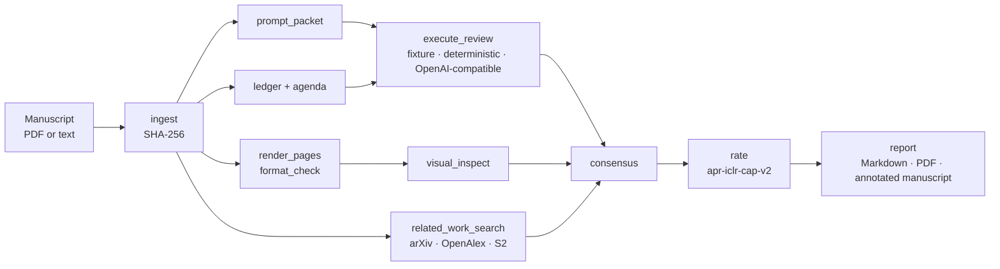

<div align="center">

# AutoPaperReview

**Paper reviews you can audit. Every score, claim, and verdict points back to a quote you can check.**

A local-first, evidence-traceable harness for repeatable scholarly manuscript review. Bring any model, or none. The manuscript stays on your machine unless you say otherwise.

[](https://github.com/XR-Lee/AutoPaperReview/actions/workflows/ci.yml)
[](CONFIDENTIALITY.md)
[](CHANGELOG.md)
[](pyproject.toml)
[](LICENSE)
[](docs/roadmap.md)
[](#contributing)

[Quick start](#quick-start) · [Benchmark](#benchmark) · [How it works](#how-it-works) · [Features](#features) · [Docs](#documentation) · [FAQ](#faq) · [Contributing](#contributing)

</div>

> **Alpha.** AutoPaperReview is at `0.1.x`. Additive schema changes ship in minor releases, and the CLI may still change. Feedback from people who review papers is what shapes it next — [come say hello](#contributing).

## Why AutoPaperReview?

LLM reviewers write fluent text. Fluent is not the same as checkable:

| | The problem | What AutoPaperReview does |
| --- | --- | --- |
| 🔎 **Traceability** | A score arrives with no reason you can verify. | Dimension scores, claims, and fatal flaws must cite an evidence id that resolves to a manuscript excerpt or a retrieved-source snapshot. The report links every `[E2]`. |
| 🔁 **Reproducibility** | Run it twice, get two different reviews and no record of why. | A TOML DAG with content-hash caching. Prompts and raw model responses are stored with their SHA-256, so a rerun reuses unchanged stages instead of calling the model again. |
| 🔒 **Confidentiality** | The manuscript quietly leaves your machine. | Network is deny-by-default and the model endpoint is loopback by default. A remote call needs an explicit policy change and is recorded as `manuscript_left_machine`. |
| 🧩 **Lock-in** | The review database becomes whatever your agent framework stores. | The core depends only on Pydantic. Parsers, models, retrieval, and journal platforms sit behind adapters and convert into canonical records. |

## Quick start

Python 3.11+. No model, no API key, and no network needed for the first run.

```bash
git clone https://github.com/XR-Lee/AutoPaperReview.git
cd AutoPaperReview
python3 -m venv .venv && source .venv/bin/activate
pip install -e ".[pdf,visual]"

autopaperreview run examples/synthetic/review.toml
```

That reviews a short, made-up manuscript through 12 stages and writes `examples/synthetic/review_report.md` (plus a PDF when `reportlab` is installed), in English and Simplified Chinese. Run the same command again: every stage is a cache hit.

<details>
<summary><b>See what the review looks like</b> (excerpt from the synthetic report)</summary>

```markdown
## Dimension Scores / 维度评分

- **claims_supported:** Whether claims are supported / 主张是否得到支持 — 2.0/10 [[E1](#record-e1)]
  - **en:** The deployment claim is not supported by the reported split or uncertainty.
  - **zh-Hans:** 所报告的数据拆分与不确定性并不能支持部署结论。
- **experimental_soundness:** Experimental soundness / 实验可靠性 — 2.0/10 [[E1](#record-e1)]
  - **en:** Image-level split of eight temporally related images is not an independent test.

## Critical Issues / 严重问题

### I001

**What the paper said / 论文写了什么.**
- **en:** The paper trains and tests on eight images taken over time from one specimen. Six images are
  randomly assigned to training and two to testing. The authors then treat high accuracy on those two
  images as evidence that the method will work on unseen structures.

**Quoted passage / 原文摘录.**

> Eight temporally related images from one specimen were randomly divided at image level.

**Required action / 需采取的行动.**
- **en:** Use specimen- or sequence-level holdout and report results on a genuinely independent test set.
```

The manuscript is [`examples/synthetic/manuscript.txt`](examples/synthetic/manuscript.txt), written for the tests. It is not a real paper.

</details>

Start your own project with `autopaperreview init` ([below](#start-a-review-project)), or connect a model with the [OpenAI-compatible adapter](#closed-loop-model-review).

## Benchmark

### Reference points from published work

How good are automated reviewers today? These are the numbers others have published. **They are not reproduced in this repository**; they are the bar we compare against.

| Reviewer | Rank agreement with a human reviewer (Spearman) | Accept/reject AUC | Setting | Source |
| --- | ---: | ---: | --- | --- |
| Another human reviewer | 0.41 | 0.84 | ICLR 2025, 147 test papers | [Stanford SAR tech overview](https://paperreview.ai/tech-overview) |
| Stanford Agentic Reviewer (hosted, fitted regression) | 0.42 | 0.75 | same | same |

What the literature adds:

- **Matching humans on rank is not matching them on decisions.** SAR's rank agreement equals human–human, yet its accept/reject AUC trails a single human score (0.75 vs 0.84).
- **Manuscript-only scores compress the accept/reject gap.** On 200 ICLR 2025 papers, the human score gap between accepted and rejected papers is 1.52 points; SAR's is 0.25, and it rewards polished framing without checking experimental substance ([How Far Are We From True Auto-Research?](https://arxiv.org/abs/2605.19156)).
- **Reviewer bias alone can swing decisions.** A simulation of reviewer, author, and area-chair phases attributes a 37.1% decision swing to reviewer bias ([AgentReview](https://github.com/Ahren09/AgentReview), EMNLP 2024).

These findings are why AutoPaperReview binds every score to evidence, applies verified caps for fatal flaws and missing comparisons, and searches related work *before* it rates. More context: [Stanford SAR comparison](docs/stanford-sar-comparison.md) and [feature gaps versus open experiments](docs/oss-experiment-gaps.md).

### How AutoPaperReview is measured

`calibrate-eval` compares our rating to public human scores. It is **report-only**: it never fits weights, caps, or bins, so the formula cannot quietly overfit the test set.

| Part | Protocol |
| --- | --- |
| **Sample** | 100 public ICLR 2024 and 2025 submissions, seed `20261021`, drawn by [`scripts/select_public_calibration.py`](scripts/select_public_calibration.py) |
| **Strata** | By mean official rating: clear reject 20 · low 15 · borderline 25 · high 20 · strong 20, with primary areas round-robined |
| **Split** | 60% tuning / 40% held out inside each stratum, chosen before any model score exists |
| **Candidates** | `apr-iclr-cap-v2` (declared formula) and the pre-registered `holistic-capped` |
| **Metrics** | Spearman, Kendall tau-b, MAE, bin agreement, accept/reject AUC, a bin confusion table, and score spread |

**Our own numbers are not in this README yet.** Manuscripts, forum ids, per-paper rows, and the numeric report stay in a gitignored cache under the [confidentiality policy](CONFIDENTIALITY.md). Until aggregate held-out results are added here, this project makes no correlation claim. Full protocol: [public calibration eval](docs/public-calibration.md).

**Help us fill the table.** Run `calibrate-eval` with your model and [share the aggregate metrics in an issue](https://github.com/XR-Lee/AutoPaperReview/issues/new?title=%5Bbench%5D%20%3Cmodel%3E%20on%20calibrate-eval) — model, adapter settings, split, and the metric table. Please leave out titles, forum ids, and per-paper rows.

### Engineering checks on every push

| Check | Result on `main` |
| --- | --- |
| Unit tests (CPython 3.11, 3.12, 3.13) | 252 tests pass in about 17 s |
| Synthetic pipeline, cold run | 12/12 stages succeed in about 1.3 s, no model or network |
| Synthetic pipeline, second run | 12/12 stages reused from cache in about 0.4 s — CI fails if any stage reruns |
| Committed JSON Schema | Regenerated and diffed against the tree |
| Confidentiality scan | No manuscripts, page renders, submission ids, or blocked strings in tracked files |

<sub>Timings measured locally on CPython 3.13 with the `pdf` and `visual` extras installed. CI enforces pass or fail, not the timings.</sub>

## How it works

AutoPaperReview is an executable Python harness, not a prompt-only skill. A review is a DAG of stages declared in TOML. Each stage reads hashed inputs, writes hashed artifacts into its own directory, and records a signature. When the signature and output hashes still match, the next `run` skips the stage.



<sub>A typical review DAG. Every box is a stage type you can drop, replace, or extend with a plugin; `autopaperreview plugins` lists them.</sub>

The TOML DAG, Pydantic schemas, artifact hashing, cache/resume logic, migration, plugin registry, and CLI are code. Files under `src/autopaperreview/prompts/` are packaged, versioned route assets that can be replaced without changing the canonical data model.

The core does not parse PDF/DOCX by itself. It calls a model only when a stage selects the bundled OpenAI-compatible adapter. Fixture JSON and the deterministic adapter remain equal options. Any other model provider, parser, retrieval worker, or journal platform is connected through a stage plugin or adapter and must convert its output into AutoPaperReview records.

The core does not depend on LangChain, LangGraph, Prefect, Docling, GROBID, PaperQA, LiteLLM, or a specific model API. Those systems belong behind adapters so their release cadence does not become the review database schema.

## Features

- 📐 **Canonical records** — strict Pydantic models for artifacts, sources, evidence, issues, review packages, stages, and run manifests, with generated JSON Schema and migration from older review JSON.
- 🔁 **Resumable DAG** — TOML-defined stages, validation, content-hash caching, atomic promotion, and Python entry-point plugins under `autopaperreview.stages`.
- 🧾 **Evidence-bound review** — typed anchors, an export gate, a claim ledger and investigation agenda, integrity checks, and matched-setting novelty. Listed contributions are audited one by one.
- 📚 **Related-work search before scoring** — five keyword families plus name lookups across arXiv, OpenAlex, and Semantic Scholar, with a judge-confirmed must-compare list. A failed provider never lowers a score. [Details](docs/related-work-search.md).
- 🖼️ **Figure and format review** — hashed page renders, venue page-limit profiles (`iclr2027`, `aaai2027`), and a visual inspector that must cite the page image, not the caption.
- ⚖️ **Declared ICLR rating** — seven anchored dimensions, verified fatal-flaw caps, and a snap onto ICLR bins. No overall score by default, and no fitted regression pretending to be one.
- ✍️ **First-read writing** — each issue restates the claim, quotes the passage, and says what would change the assessment, so an area chair can follow it cold. [Strategy](docs/first-read-review.md).
- 🌏 **Bilingual reports** — one Markdown/PDF with English and Simplified Chinese side by side; incomplete pairing is refused rather than silently falling back.
- 📝 **Annotated manuscript PDF** — role-colored highlights, margin tags, and reviewer comments for every cited evidence id.

The complete, detailed list is in [docs/features.md](docs/features.md).

## Install

```bash
python3 -m venv .venv
source .venv/bin/activate
pip install -e ".[pdf,visual]"
```

For development without installation:

```bash
PYTHONPATH=src python3 -m autopaperreview --version
```

## Run the synthetic example

```bash
PYTHONPATH=src python3 -m autopaperreview validate examples/synthetic/review.toml
PYTHONPATH=src python3 -m autopaperreview run examples/synthetic/review.toml
```

The synthetic example sets `bilingual = true` on the report stage so `review_report.md` contains English and Simplified Chinese section by section, including dimension rationales. After a successful run, `review_report.md` (and `review_report.pdf` if `reportlab` is installed) is also copied next to `review.toml`. Evidence citations such as `[E2, E3]` link each id to the Evidence Index. Inspect `stages/report/review_report.md`, `stages/prompt_packets/M3.md`, `stages/integrity/integrity.json`, and `stages/novelty/novelty.json` under the run directory.

The related-work example is a separate fictional manuscript. It does not replace the example above.

```bash
PYTHONPATH=src python3 -m autopaperreview validate examples/synthetic/related_work/review.toml
PYTHONPATH=src python3 -m autopaperreview run examples/synthetic/related_work/review.toml
```

`init` writes a deterministic adapter DAG that can review a replaced `manuscript.txt` without a model API. The synthetic example uses `FixtureReviewAdapter` plus a local snapshot so literature, ledger, integrity, and novelty records are visible. Both are equal to the chat adapter below: packets plus externally written JSON, or a model call inside the same `run`.

The run directory is the project id. Source and configuration hashes stay on the manifest. Repeating the command reuses a stage when its own signature and output hashes still match, so an export-gate edit reruns the report and keeps ingest, rendered pages, search, and judgments.

## Annotated manuscript PDF

Cited evidence is drawn on a copy of the source PDF: a highlight colored by role (strength, weakness, question, neutral), a margin tag such as `E7`, and a comment popup authored by `APR reviewer`. The comment names the review field, for example `Weakness 1 (major)`, and a one- or two-sentence note. An index page at the end lists every cited id and links to it. A quote that cannot be found is kept as a page-level note and as an index row. Quote search ignores margin line numbers and still matches a span when a few words differ. Pass `--review` when the role lives in the review markdown rather than in the package claims. The tag sits in the margin with more free space.

Re-annotate a finished run without calling the model. The default output is `<run-directory>/annotated_manuscript.pdf`. When the target is `review.toml`, the same file is also copied next to that config. `--output` writes only the path you name. A sibling `review_report.md` is used when `--review` is omitted.

```bash
autopaperreview annotate path/to/review.toml --pdf path/to/manuscript.pdf --review path/to/review.md
autopaperreview annotate path/to/run_dir --pdf path/to/manuscript.pdf --output path/to/annotated_manuscript.pdf
```

PyMuPDF comes with `pip install 'autopaperreview[pdf]'`. Without a sibling `manuscript.pdf`, the report stage still writes the Markdown and review PDF and skips manuscript annotation.

Each run records a normalized configuration snapshot, source hash, handler version, stage signature, command input hashes, and relative output artifacts under the configured run root.

## Start a review project

```bash
autopaperreview init reviews/my-paper --project-id my-paper --title "My paper review"
autopaperreview validate reviews/my-paper/review.toml
autopaperreview run reviews/my-paper/review.toml
```

`reviews/` is gitignored. Keep real manuscripts and reviews there, never in a commit ([why](CONFIDENTIALITY.md)).

## Closed-loop model review

`OpenAICompatibleAdapter` reads the prompt packets already written for contributions, ledger and agenda items, the seven rating dimensions, and fatal classification. `OpenAICompatibleVisionInspector` reads the visual packet and sends each rendered page image. The pipeline validates the JSON and retries a schema failure once, including an empty contribution list or an empty ledger list. A dimension excerpt that does not resolve is retried once with that unresolved-anchor error; if any of the seven dimensions is still missing, the stage fails. It does not fall back to the deterministic adapter.

Loopback is the default, including a hostname that resolves only to loopback addresses. A remote host also needs `allow_remote = true`, `network_policy = "allow"`, and a key in the environment. The key is not written to the run and is not part of the stage signature, so replacing it does not rerun a cached stage. A remote call sets `manuscript_left_machine` on the run manifest. Connection errors, timeouts, HTTP 429, and HTTP 5xx are retried up to two times. Any other HTTP 4xx fails immediately.

```toml
[project]
network_policy = "deny"

[[stages]]
id = "review"
type = "execute_review"
depends_on = ["prompt_packets", "ledger"]
[stages.params]
adapter = "autopaperreview.model_exec:OpenAICompatibleAdapter"
base_url = "http://127.0.0.1:8000/v1"
model = "local-reviewer"
api_key_env = "APR_MODEL_API_KEY"
allow_remote = false
bilingual = false
judgments = ["contributions", "ledger", "dimensions", "fatal"]

[stages.params.packet_routes]
contributions = "M7"
ledger = "M0"
dimensions = "M3"
fatal = "M2"
```

Set `include_source_text = true` on `prompt_packet` so the packet contains the manuscript. `base_url` is the API root (`.../v1`), not a URL with a query or a key. For a remote endpoint, set `allow_remote = true`, `requires_network = true`, and `network_policy = "allow"`, then export `APR_MODEL_API_KEY`.

The same client inspects page images:

```toml
[[stages]]
id = "visual"
type = "visual_inspect"
depends_on = ["render_pages", "prompt_packets"]
[stages.params]
adapter = "autopaperreview.model_exec:OpenAICompatibleVisionInspector"
base_url = "http://127.0.0.1:8000/v1"
model = "local-vision"
packet_route = "M6"
allow_remote = false
```

Set `bilingual = true` on `execute_review` for one `zh-Hans` judgment over the accepted English fields. A bilingual `report` stage can then export. To keep the model outside the process, use `adapter = "autopaperreview.adapters:FixtureReviewAdapter"` with `fixture_path`, or `AgentFindingsInspector` with `findings_path`. `rate` still applies `apr-iclr-cap-v2`. The chat adapter does not emit the overall score.

Raw requests and responses are stored under `stages/<id>/model/` with their SHA-256 on the stage record. A second `run` reuses that stage while the signature matches and does not call the endpoint again.

## Migrate an existing review package

```bash
autopaperreview migrate old_review_package.json canonical_review_package.json \
  --source manuscript.docx \
  --project-id manuscript-2026
```

Migration is non-destructive: the input is not modified, bilingual fields are normalized, unknown legacy fields are retained under metadata, and the original source is bound by SHA-256.

The migration command does not copy an unpublished manuscript beside the output JSON. The package records its logical source name and hash; use an ingest stage with source copying when a self-contained local run bundle is required.

## CLI

```text
autopaperreview init       Create a minimal project
autopaperreview validate   Validate TOML, DAG, plugins, and local paths
autopaperreview run        Run or resume the pipeline
autopaperreview inspect    Print a run manifest
autopaperreview annotate   Add evidence highlights, margin tags, and comments to a manuscript PDF
autopaperreview migrate    Import legacy review JSON
autopaperreview schema     Export canonical JSON Schema
autopaperreview templates  Export packaged prompt templates
autopaperreview plugins    List installed stage types
autopaperreview doctor     Inspect optional adapter availability
autopaperreview calibrate-eval
                   Compare the declared ICLR formula to public human scores (report only)
```

## Design principles

1. Deterministic checks run before model-based judgments.
2. Every released claim must bind to an immutable manuscript or external-source snapshot.
3. Model prompts and responses are versioned artifacts, not hidden application state.
4. Semantic deduplication never happens silently. The v0.1 consensus stage performs only explicit-key or exact normalized grouping.
5. Manuscript text is local by default. Metadata-only or full-text network use requires an explicit policy change. Real manuscripts, reviews, and page renders are never committed; see [Confidentiality](CONFIDENTIALITY.md).
6. Third-party objects are converted immediately into canonical AutoPaperReview models.

The built-in network policy validates declared requirements but is not an operating-system network sandbox. Stage plugins and commands are trusted local code; use containers or another sandbox when executing untrusted integrations.

Command stages inherit an explicit environment-variable allowlist rather than the complete parent environment. Add secret variable names with `inherit_env`; their values affect the cache signature but are not written to command records. Never put secret values in the TOML `env` table because configuration is snapshotted.

## Documentation

| If you want to… | Read |
| --- | --- |
| See every feature in detail | [docs/features.md](docs/features.md) |
| Understand the data model and stages | [docs/architecture.md](docs/architecture.md) |
| Run the public calibration benchmark | [docs/public-calibration.md](docs/public-calibration.md) |
| Configure related-work search | [docs/related-work-search.md](docs/related-work-search.md) |
| Learn the first-read writing contract | [docs/first-read-review.md](docs/first-read-review.md) |
| Compare with Stanford SAR (paperreview.ai) | [docs/stanford-sar-comparison.md](docs/stanford-sar-comparison.md) |
| Compare with DeepReviewer, AgentReview, MARG, PaperQA2, … | [docs/oss-experiment-gaps.md](docs/oss-experiment-gaps.md) |
| See which open-source tools fit behind adapters | [docs/oss-reference-stack.md](docs/oss-reference-stack.md) |
| Know what is planned | [docs/roadmap.md](docs/roadmap.md) · [CHANGELOG.md](CHANGELOG.md) |
| Know how releases are maintained | [docs/maintenance.md](docs/maintenance.md) |
| Keep real papers out of the repository | [CONFIDENTIALITY.md](CONFIDENTIALITY.md) · [SECURITY.md](SECURITY.md) |

## FAQ

**Do I need a model API?** No. The fixture and deterministic adapters run the whole pipeline without one. When you want a model, point the OpenAI-compatible adapter at a local server (the default) or, with an explicit policy change, a remote one.

**Does my manuscript leave my machine?** Not by default. The network policy is `deny`, the model endpoint defaults to loopback, and any remote call is recorded on the run manifest as `manuscript_left_machine`.

**Can I use it on a paper I was assigned to review?** Check your venue's policy on LLM use in peer review first. Many venues forbid sending a confidential submission to a third-party service. AutoPaperReview keeps the manuscript local by default, but the policy decision is yours.

**Does it give an overall score?** Not by default. The seven dimensions are scored separately, and venue conclusions are written per venue. `rate` maps them onto ICLR bins with a declared formula (`apr-iclr-cap-v2`), not a fitted regression.

**Is it affiliated with ICLR, OpenReview, or Stanford?** No. Their names appear only where we compare against published work or use public data.

## Contributing

Ideas, questions, bug reports, and pull requests are all welcome. If you review papers, your sense of what a useful review looks like is exactly what this project needs.

**Ways to help — no pull request needed:**

- 🧪 **Run the [quick start](#quick-start)** and tell us what was confusing.
- 📊 **[Benchmark a model](#how-autopaperreview-is-measured)** with `calibrate-eval` and share the aggregate numbers.
- 🔌 **Write an adapter or stage plugin** — a PDF parser, a retrieval source, a model provider, or a journal platform. The [reference stack](docs/oss-reference-stack.md) lists good candidates.
- 🏛️ **Add a venue profile** next to `iclr2027` and `aaai2027` in [`src/autopaperreview/profiles/`](src/autopaperreview/profiles).
- 💬 **Challenge a design choice.** The [roadmap](docs/roadmap.md) and the [gap review](docs/oss-experiment-gaps.md) explain what we chose not to build, and why. Disagree in an issue.

**Where to talk.** Open an [issue](https://github.com/XR-Lee/AutoPaperReview/issues) for a bug, a question, an idea, or a benchmark result. There is no Discussions board, so Issues is the place. A prefix such as `[idea]`, `[question]`, or `[bench]` in the title helps. English or Chinese is fine.

**Never paste real manuscript text, reviews, ratings, or submission ids** into an issue or a pull request. Reproduce problems with a synthetic example instead. See [CONFIDENTIALITY.md](CONFIDENTIALITY.md).

**Send a pull request.** Read [CONTRIBUTING.md](CONTRIBUTING.md) for the compatibility rules, then run:

```bash
python3 scripts/check_confidentiality.py
PYTHONPATH=src python3 -m unittest discover -s tests -v
```

Coding agents working in this tree should read [AGENTS.md](AGENTS.md) first.

## License

[MIT](LICENSE). If AutoPaperReview is useful to you, a ⭐ helps other reviewers find it.
