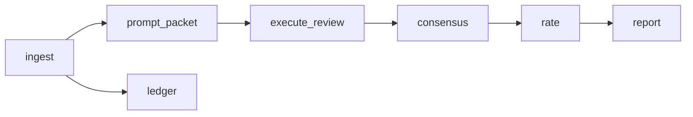

# AutoPaperReview

AutoPaperReview is a local-first, evidence-traceable harness for repeatable scholarly manuscript review. It separates durable review data and execution records from replaceable parsers, model providers, literature services, workflow engines, and journal platforms.

Version: `0.1.10`

[](https://github.com/XR-Lee/AutoPaperReview/actions/workflows/ci.yml)
[](CONFIDENTIALITY.md)
[](CHANGELOG.md)
[](pyproject.toml)
[](LICENSE)

The `0.1.x` line may still change the CLI. Additive schema fields can ship in a minor release. See [Maintenance](docs/maintenance.md).

## Why AutoPaperReview

| | The problem | What this harness does |
| --- | --- | --- |
| Traceability | A score arrives with no passage to check. | Dimension scores, claims, and fatal flaws cite an evidence id that resolves to a manuscript excerpt or a retrieved-source snapshot. The report links every `[E2]`. |
| Reproducibility | A second run has no record of the first. | A TOML DAG with content-hash caching. Prompts and raw model responses are stored with their SHA-256. A matching signature skips the model call. |
| Confidentiality | The manuscript leaves the machine without a record. | Network policy defaults to `deny`. The model endpoint defaults to loopback. A remote call requires an explicit policy change and is recorded as `manuscript_left_machine`. |
| Lock-in | The review database becomes the agent framework's store. | The core depends only on Pydantic. Parsers, models, retrieval, and journal platforms sit behind adapters and convert into canonical records. |

## Quick start

Python 3.11 or newer. The synthetic example needs no model, no API key, and no network.

```bash
git clone https://github.com/XR-Lee/AutoPaperReview.git
cd AutoPaperReview
python3 -m venv .venv && source .venv/bin/activate
pip install -e ".[pdf,visual]"

autopaperreview run examples/synthetic/review.toml
```

That reviews a short fictional manuscript through twelve stages and writes `examples/synthetic/review_report.md` (and `review_report.pdf` when `reportlab` is installed), in English and Simplified Chinese. The same command again reuses every stage. CI fails the job if the second synthetic run is not a full cache hit.

The manuscript is [`examples/synthetic/manuscript.txt`](examples/synthetic/manuscript.txt). One sentence it contains is "Eight temporally related images from one specimen were randomly divided at image level." The fixture's claims-supported rationale is "The deployment claim is not supported by the reported split or uncertainty."

Start a project with [`autopaperreview init`](#start-a-review-project), or connect a model with the [OpenAI-compatible adapter](#closed-loop-model-review). The locked fusion rank is [forecast-k1](#forecast-rank-forecast-k1).

## Benchmark

### Published reference points

These numbers are from other projects. This repository has not reproduced them.

| Reviewer | Spearman vs one human reviewer | Accept/reject AUC | Setting | Source |
| --- | ---: | ---: | --- | --- |
| Another human reviewer | 0.41 | 0.84 | ICLR 2025, 147 test papers | [Stanford SAR tech overview](https://paperreview.ai/tech-overview) |
| Stanford Agentic Reviewer (hosted, fitted regression) | 0.42 | 0.75 | same | same |

The same sources, already discussed in [Stanford SAR vs AutoPaperReview](docs/stanford-sar-comparison.md) and the [gap review](docs/oss-experiment-gaps.md):

- SAR's rank agreement matches human–human agreement, and its accept/reject AUC is 0.75 against 0.84 for one human score.
- On 200 ICLR 2025 papers, the human accept/reject gap is 1.52 points and SAR's is 0.25 ([How Far Are We From True Auto-Research?](https://arxiv.org/abs/2605.19156)).
- A simulation of reviewer, author, and area-chair phases attributes a 37.1% decision swing to reviewer bias ([AgentReview](https://github.com/Ahren09/AgentReview), EMNLP 2024).

### How this repository is measured

`calibrate-eval` compares a declared score with public human scores. It does not fit weights, caps, bins, or the locked rank.

| Part | Protocol |
| --- | --- |
| Sample | 100 public ICLR 2024 and 2025 submissions, seed `20261021`, drawn by [`scripts/select_public_calibration.py`](scripts/select_public_calibration.py) |
| Strata | By mean official rating: clear reject 20, low 15, borderline 25, high 20, strong 20 |
| Split | 60% tuning / 40% held out inside each stratum, chosen before any model score exists |
| Default formula | `apr-iclr-cap-v2` |
| Locked fusion rank | `forecast-k1`, when `--coefficient-set apr-fusion-v1` |
| Metrics | Spearman, Kendall tau-b, MAE, bin agreement, accept/reject AUC, a bin confusion table, and score spread |

This README does not publish a correlation for AutoPaperReview. Manuscripts, forum ids, per-paper rows, and the numeric report stay in a gitignored cache. Protocol: [public calibration eval](docs/public-calibration.md).

CI on every push and pull request runs the unit suite on CPython 3.11, 3.12, and 3.13, diffs the committed JSON Schema, builds a wheel, and runs the synthetic pipeline twice. A separate workflow runs `scripts/check_confidentiality.py`.

## How it works

AutoPaperReview is an executable Python harness. A review is a DAG of stages in TOML. Each stage reads hashed inputs, writes hashed artifacts, and records a signature. When the signature and output hashes still match, the next `run` skips the stage.



That is one closed-loop shape. The synthetic example uses a fixture adapter and does not call `rate` or a model. `related_work_search`, `render_pages`, `format_check`, `visual_inspect`, `literature_grounding`, `agenda`, `workspace_inspect`, `integrity`, and `novelty` are further stage types. `autopaperreview plugins` lists them.

The TOML DAG, Pydantic schemas, artifact hashing, cache/resume logic, migration, plugin registry, and CLI are code. Files under `src/autopaperreview/prompts/` are packaged, versioned route assets. The core calls a model only when a stage selects the bundled OpenAI-compatible adapter. Fixture JSON and the deterministic adapter remain equal options. Any other model provider, parser, retrieval worker, or journal platform is connected through a stage plugin or adapter.

The core does not depend on LangChain, LangGraph, Prefect, Docling, GROBID, PaperQA, LiteLLM, or a specific model API.

## Features

- Canonical Pydantic records, generated JSON Schema, and migration from older review JSON.
- A resumable TOML DAG with content-hash caching and entry-point plugins.
- Evidence-bound review: anchors, an export gate, a claim ledger, an investigation agenda, integrity checks, and matched-setting novelty.
- Related-work search before scoring, over arXiv, OpenAlex, and Semantic Scholar. A failed provider does not lower a score. [Details](docs/related-work-search.md).
- Figure and format review: hashed page renders and venue profiles `iclr2027` and `aaai2027`.
- Declared ICLR rating `apr-iclr-cap-v2`, and the opt-in fusion rank [`forecast-k1`](#forecast-rank-forecast-k1).
- First-read writing, bilingual English / Simplified Chinese reports, and an annotated manuscript PDF.

The detailed list is [docs/features.md](docs/features.md).

See [Stanford SAR vs AutoPaperReview](docs/stanford-sar-comparison.md), [feature gaps versus stronger open experiments](docs/oss-experiment-gaps.md) (status through 0.1.10), and [first-read review writing](docs/first-read-review.md). This repository does not claim Stanford's ICLR Spearman numbers.

## Install

```bash
python3 -m venv .venv
source .venv/bin/activate
pip install -e ".[pdf,visual]"
```

For development without installation:

```bash
PYTHONPATH=src python3 -m autopaperreview --version
```

## Run the synthetic example

```bash
PYTHONPATH=src python3 -m autopaperreview validate examples/synthetic/review.toml
PYTHONPATH=src python3 -m autopaperreview run examples/synthetic/review.toml
```

The synthetic example sets `bilingual = true` on the report stage so `review_report.md` contains English and Simplified Chinese section by section, including dimension rationales. After a successful run, `review_report.md` (and `review_report.pdf` if `reportlab` is installed) is also copied next to `review.toml`. Evidence citations such as `[E2, E3]` link each id to the Evidence Index. Inspect `stages/report/review_report.md`, `stages/prompt_packets/M3.md`, `stages/integrity/integrity.json`, and `stages/novelty/novelty.json` under the run directory.

The related-work example is a separate fictional manuscript. It does not replace the example above.

```bash
PYTHONPATH=src python3 -m autopaperreview validate examples/synthetic/related_work/review.toml
PYTHONPATH=src python3 -m autopaperreview run examples/synthetic/related_work/review.toml
```

`init` writes a deterministic adapter DAG that can review a replaced `manuscript.txt` without a model API. The synthetic example uses `FixtureReviewAdapter` plus a local snapshot so literature, ledger, integrity, and novelty records are visible. Both are equal to the chat adapter below: packets plus externally written JSON, or a model call inside the same `run`.

The run directory is the project id. Source and configuration hashes stay on the manifest. Repeating the command reuses a stage when its own signature and output hashes still match, so an export-gate edit reruns the report and keeps ingest, rendered pages, search, and judgments.

## Annotated manuscript PDF

Cited evidence is drawn on a copy of the source PDF: a highlight colored by role (strength, weakness, question, neutral), a margin tag such as `E7`, and a comment popup authored by `APR reviewer`. The comment names the review field, for example `Weakness 1 (major)`, and a one- or two-sentence note. An index page at the end lists every cited id and links to it. A quote that cannot be found is kept as a page-level note and as an index row. Quote search ignores margin line numbers and still matches a span when a few words differ. Pass `--review` when the role lives in the review markdown rather than in the package claims. The tag sits in the margin with more free space.

Re-annotate a finished run without calling the model. The default output is `<run-directory>/annotated_manuscript.pdf`. When the target is `review.toml`, the same file is also copied next to that config. `--output` writes only the path you name. A sibling `review_report.md` is used when `--review` is omitted.

```bash
autopaperreview annotate path/to/review.toml --pdf path/to/manuscript.pdf --review path/to/review.md
autopaperreview annotate path/to/run_dir --pdf path/to/manuscript.pdf --output path/to/annotated_manuscript.pdf
```

PyMuPDF comes with `pip install 'autopaperreview[pdf]'`. Without a sibling `manuscript.pdf`, the report stage still writes the Markdown and review PDF and skips manuscript annotation.

Each run records a normalized configuration snapshot, source hash, handler version, stage signature, command input hashes, and relative output artifacts under the configured run root.

## Start a review project

```bash
autopaperreview init reviews/my-paper --project-id my-paper --title "My paper review"
autopaperreview validate reviews/my-paper/review.toml
autopaperreview run reviews/my-paper/review.toml
```

`reviews/` is gitignored. Keep real manuscripts and reviews there. See [Confidentiality](CONFIDENTIALITY.md).

## Closed-loop model review

`OpenAICompatibleAdapter` reads the prompt packets already written for contributions, ledger and agenda items, the seven rating dimensions, and fatal classification. An optional `holistic` judgment is what `forecast-k1` uses; it is off unless the stage lists it. `OpenAICompatibleVisionInspector` reads the visual packet and sends each rendered page image. The pipeline validates the JSON and retries a schema failure once, including an empty contribution list or an empty ledger list. A dimension excerpt that does not resolve is retried once with that unresolved-anchor error; if any of the seven dimensions is still missing, the stage fails. It does not fall back to the deterministic adapter.

Loopback is the default, including a hostname that resolves only to loopback addresses. A remote host also needs `allow_remote = true`, `network_policy = "allow"`, and a key in the environment. The key is not written to the run and is not part of the stage signature, so replacing it does not rerun a cached stage. A remote call sets `manuscript_left_machine` on the run manifest. Connection errors, timeouts, HTTP 429, and HTTP 5xx are retried up to two times. Any other HTTP 4xx fails immediately. The timeout defaults to 900 seconds.

```toml
[project]
network_policy = "deny"

[[stages]]
id = "review"
type = "execute_review"
depends_on = ["prompt_packets", "ledger"]
[stages.params]
adapter = "autopaperreview.model_exec:OpenAICompatibleAdapter"
base_url = "http://127.0.0.1:8000/v1"
model = "local-reviewer"
api_key_env = "APR_MODEL_API_KEY"
allow_remote = false
bilingual = false
judgments = ["contributions", "ledger", "dimensions", "fatal"]

[stages.params.packet_routes]
contributions = "M7"
ledger = "M0"
dimensions = "M3"
fatal = "M2"
```

Set `include_source_text = true` on `prompt_packet` so the packet contains the manuscript. `base_url` is the API root (`.../v1`), not a URL with a query or a key. For a remote endpoint, set `allow_remote = true`, `requires_network = true`, and `network_policy = "allow"`, then export `APR_MODEL_API_KEY`.

The same client inspects page images:

```toml
[[stages]]
id = "visual"
type = "visual_inspect"
depends_on = ["render_pages", "prompt_packets"]
[stages.params]
adapter = "autopaperreview.model_exec:OpenAICompatibleVisionInspector"
base_url = "http://127.0.0.1:8000/v1"
model = "local-vision"
packet_route = "M6"
allow_remote = false
```

Set `bilingual = true` on `execute_review` for one `zh-Hans` judgment over the accepted English fields. A bilingual `report` stage can then export. To keep the model outside the process, use `adapter = "autopaperreview.adapters:FixtureReviewAdapter"` with `fixture_path`, or `AgentFindingsInspector` with `findings_path`. The default `rate` coefficient set is `apr-iclr-cap-v2`. The chat adapter does not emit that score; `rate` does.

Raw requests and responses are stored under `stages/<id>/model/` with their SHA-256 on the stage record. A second `run` reuses that stage while the signature matches and does not call the endpoint again.

## Forecast rank (`forecast-k1`)

`apr-fusion-v1` ranks by one simulated forecast panel. The locked mode is `forecast` and the locked sample count is 1 (`LOCKED_HOLISTIC_MODE`, `LOCKED_HOLISTIC_SAMPLES` in `anchors`). The default `rate` formula stays `apr-iclr-cap-v2` until the coefficient set is `apr-fusion-v1`.

The call reads the full manuscript packet. The source text is capped at `anchors.FULL_TEXT_MAX_CHARS` (240,000 characters); a shorter manuscript is sent unchanged. It simulates the three seats in `anchors.FORECAST_SEATS` — specialist, generalist, and senior — who have read the whole manuscript and have not seen each other's reviews. For each seat the model writes a one-sentence summary, up to two strengths, up to two weaknesses, the official rating that reviewer would most likely submit (1, 3, 5, 6, 8, or 10), six probabilities that this rating is 1, 3, 5, 6, 8, and 10 in that order, and a confidence from 1 to 5. It then writes its own `predicted_mean` on 1.0–10.0 and a decision from 1 to 6.

The pipeline normalizes each probability vector (a sum other than one is counted as `renormalized`). One reviewer's expected rating is the sum of probability times official rating. The per-call sample is the mean of the three expected ratings. The shipped rank is that sample clamped to 1.0–10.0. The decision sets the ICLR bin: levels 1, 2, 3, 4, 5, and 6 map onto 1, 3, 5, 6, 8, and 10. The temperature is 0.7.

Stored beside the rank, and not used as the rank: `vote-k1` (mean of the three integer ratings), `chair-k1` (the model's own mean), `high-k1` and `low-k1` (the highest and lowest expected rating). An integer off the official list is counted as `off_scale`. An integer that is not the rating with the most mass is counted as `mode_mismatch`. Neither is retried. This mode does not check excerpts against the manuscript. A verified venue cap does not change this rank. Dimension bands stay on the package and stay off this rank.

`--holistic-samples 2` runs two forecast calls and still ranks by the first. `holistic_mode` can be `rebuttal`, `matched`, `panel`, `expert`, `audited`, or `mean`. Those modes keep their earlier candidates and their prompt text. A package that stored only one of those families still ranks by `rebuttal-k2`, `matched-k2`, `panel-k2`, `expert-k2`, `audited-k1`, or `mean-k3`. `scripts/rank_eval.py` defaults to `--mode locked`, which reports `forecast-k1`. The locked candidate stays `forecast-k1` after tune or held-out metrics are known.

`our_score.json` records `forecast_samples`, `vote_samples`, and a `forecast` summary of seat ids and numbers without the review text. The full field list and the other modes are in [public calibration eval](docs/public-calibration.md).

### Run it on one manuscript

`prompt_packet` must set `include_source_text = true`. `execute_review` must list the `holistic` judgment. `cheap = true` keeps that judgment and skips contributions, ledger, dimensions, and fatal. `holistic_mode` and `holistic_samples` below are the defaults. `rate` must use `apr-fusion-v1`. Put a `consensus` stage between `review` and `rate` when the DAG follows the calibration shape.

```toml
[[stages]]
id = "review"
type = "execute_review"
depends_on = ["prompt_packets"]
[stages.params]
adapter = "autopaperreview.model_exec:OpenAICompatibleAdapter"
base_url = "http://127.0.0.1:8000/v1"
model = "local-reviewer"
api_key_env = "APR_MODEL_API_KEY"
allow_remote = false
cheap = true
judgments = ["holistic"]
holistic_mode = "forecast"
holistic_samples = 1

[stages.params.packet_routes]
holistic = "M0"

[[stages]]
id = "consensus"
type = "consensus"
depends_on = ["review"]
[stages.params]
min_independent_routes = 1

[[stages]]
id = "rate"
type = "rate"
depends_on = ["consensus"]
[stages.params]
coefficient_set = "apr-fusion-v1"
```

The fragment assumes a `prompt_packets` stage and a route `M0`. A full review appends `"holistic"` to the other judgments and leaves `cheap` unset. The same `rate` coefficient set still ranks by `forecast-k1` when the forecast panel is present.

### Run it on the public calibration cache

`calibrate-eval run` defaults to `--holistic-mode forecast --holistic-samples 1` and to `--coefficient-set apr-iclr-cap-v2`. The fusion flag is what selects `forecast-k1` and includes the holistic judgment. `--cheap` runs that judgment only.

```bash
PYTHONPATH=src python3 -m autopaperreview calibrate-eval run \
  --cache workdir/calibration-eval --mode adapter \
  --adapter autopaperreview.model_exec:OpenAICompatibleAdapter \
  --base-url http://127.0.0.1:8000/v1 --model local-reviewer \
  --coefficient-set apr-fusion-v1 --cheap --holistic-mode forecast --holistic-samples 1
```

The cache has to be fetched and prepared first. Those commands, and the rule that the report stays outside git, are in [public calibration eval](docs/public-calibration.md).

## Migrate an existing review package

```bash
autopaperreview migrate old_review_package.json canonical_review_package.json \
  --source manuscript.docx \
  --project-id manuscript-2026
```

Migration is non-destructive: the input is not modified, bilingual fields are normalized, unknown legacy fields are retained under metadata, and the original source is bound by SHA-256.

The migration command does not copy an unpublished manuscript beside the output JSON. The package records its logical source name and hash; use an ingest stage with source copying when a self-contained local run bundle is required.

## CLI

```text
autopaperreview init       Create a minimal project
autopaperreview validate   Validate TOML, DAG, plugins, and local paths
autopaperreview run        Run or resume the pipeline
autopaperreview inspect    Print a run manifest
autopaperreview annotate   Add evidence highlights, margin tags, and comments to a manuscript PDF
autopaperreview migrate    Import legacy review JSON
autopaperreview schema     Export canonical JSON Schema
autopaperreview templates  Export packaged prompt templates
autopaperreview plugins    List installed stage types
autopaperreview doctor     Inspect optional adapter availability
autopaperreview calibrate  Order rated packages and require same-bin reasons
autopaperreview calibrate-eval
                   Compare a declared score to public human scores (report only)
```

## Design principles

1. Deterministic checks run before model-based judgments.
2. Every released claim must bind to an immutable manuscript or external-source snapshot.
3. Model prompts and responses are versioned artifacts, not hidden application state.
4. Semantic deduplication never happens silently. The v0.1 consensus stage performs only explicit-key or exact normalized grouping.
5. Manuscript text is local by default. Metadata-only or full-text network use requires an explicit policy change. Real manuscripts, reviews, and page renders are never committed; see [Confidentiality](CONFIDENTIALITY.md).
6. Third-party objects are converted immediately into canonical AutoPaperReview models.

The built-in network policy validates declared requirements but is not an operating-system network sandbox. Stage plugins and commands are trusted local code; use containers or another sandbox when executing untrusted integrations.

Command stages inherit an explicit environment-variable allowlist rather than the complete parent environment. Add secret variable names with `inherit_env`; their values affect the cache signature but are not written to command records. Never put secret values in the TOML `env` table because configuration is snapshotted.

## Documentation

| If you want to… | Read |
| --- | --- |
| See every feature in detail | [docs/features.md](docs/features.md) |
| Understand the data model and stages | [docs/architecture.md](docs/architecture.md) |
| Run the public calibration benchmark | [docs/public-calibration.md](docs/public-calibration.md) |
| Configure related-work search | [docs/related-work-search.md](docs/related-work-search.md) |
| Learn the first-read writing contract | [docs/first-read-review.md](docs/first-read-review.md) |
| Compare with Stanford SAR (paperreview.ai) | [docs/stanford-sar-comparison.md](docs/stanford-sar-comparison.md) |
| Compare with DeepReviewer, AgentReview, MARG, PaperQA2, and others | [docs/oss-experiment-gaps.md](docs/oss-experiment-gaps.md) |
| See which open-source tools fit behind adapters | [docs/oss-reference-stack.md](docs/oss-reference-stack.md) |
| Know what is planned | [docs/roadmap.md](docs/roadmap.md) and [CHANGELOG.md](CHANGELOG.md) |
| Know how releases are maintained | [docs/maintenance.md](docs/maintenance.md) |
| Keep real papers out of the repository | [CONFIDENTIALITY.md](CONFIDENTIALITY.md) and [SECURITY.md](SECURITY.md) |

## FAQ

**Do I need a model API?** The fixture and deterministic adapters run the pipeline without one. To call a model, point `OpenAICompatibleAdapter` at an OpenAI-compatible server. Loopback is the default. A remote host needs an explicit network policy.

**Does the manuscript leave the machine?** The network policy defaults to `deny`, and the model endpoint defaults to loopback. A remote call is recorded on the run manifest as `manuscript_left_machine`.

**Can I use it on a paper I was assigned to review?** Check the venue's rule on LLM use in peer review before you do. Many venues forbid sending a confidential submission to a third-party service. This harness keeps the manuscript local unless the project policy allows a remote call. The venue's rule is yours to follow.

**Does it give an overall score?** No score is emitted by default, and the chat adapter does not emit one. `rate` assigns the bin. The default coefficient set, `apr-iclr-cap-v2`, snaps seven dimension bands and fatal caps onto ICLR bins. It is a declared formula. `apr-fusion-v1` ranks by `forecast-k1` when that panel was stored. Venue conclusions are still written per venue from the dimension scores.

**Is it affiliated with ICLR, OpenReview, or Stanford?** Their names appear where this repository compares against published work or reads public data.

## Contributing

Bug reports, questions, and pull requests are welcome. Open an [issue](https://github.com/XR-Lee/AutoPaperReview/issues). A title prefix such as `[idea]`, `[question]`, or `[bench]` is enough. English or Chinese is fine.

Ways to help without a large change:

- Run the [quick start](#quick-start) and say what was confusing.
- Run [calibrate-eval](docs/public-calibration.md) and share aggregate metrics. Leave out titles, forum ids, and per-paper rows.
- Add an adapter or stage plugin. The [reference stack](docs/oss-reference-stack.md) lists candidates.
- Add a venue profile next to `iclr2027` and `aaai2027` in [`src/autopaperreview/profiles/`](src/autopaperreview/profiles).

Never paste a real manuscript, review, rating, or submission id into an issue or a pull request. Use a synthetic example. See [CONFIDENTIALITY.md](CONFIDENTIALITY.md).

Read [CONTRIBUTING.md](CONTRIBUTING.md), then:

```bash
python3 scripts/check_confidentiality.py
PYTHONPATH=src python3 -m unittest discover -s tests -v
```

Coding agents in this tree should read [AGENTS.md](AGENTS.md) first.

## License

[MIT](LICENSE).
