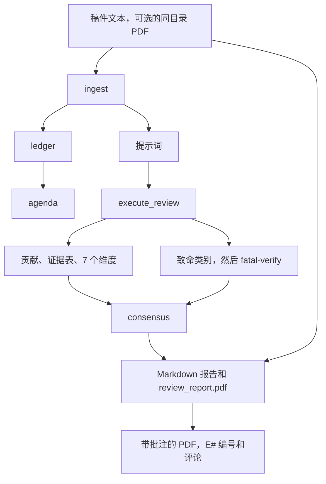
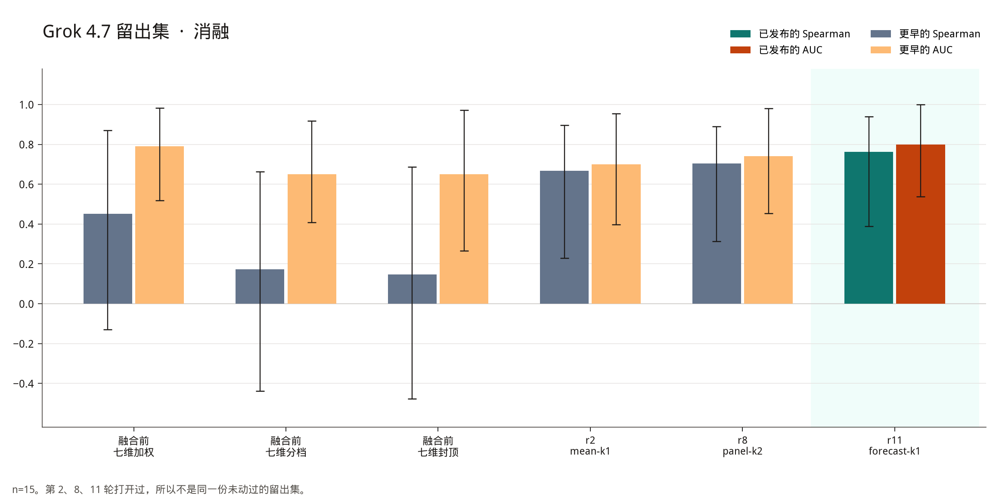

[English](README.md) | 简体中文

# AutoPaperReview

两种用法，不是同一次运行。

- **[审稿报告](#track-a)** 是默认用法。`init` 之后正常 `run`，会写出七个维度的审稿：证据表、贡献核对、致命问题检查、Markdown 报告、装了 reportlab 时的 `review_report.pdf`，以及带批注的稿件 PDF。
- **[评分与基准](#track-b)** 是可选模块。`holistic` 预测再加上系数为 `apr-fusion-v1` 的 `rate`，得到 `forecast-k1`。留出集表格只测这个排序分。


版本 `0.1.10`。Alpha。Python 3.11–3.13。MIT 许可证。不能代替人来审稿。

### 结果一览


只算排序分的 `forecast-k1`。误差线是 95% 的论文层面自助法区间（重抽样 4000 次，种子 `20261021`）。APR Opus 的 AUC 仍画成柱；区间退化（已完成的 14 篇把录用和拒稿完全分开），所以区间是 [1.000, 1.000]。APR Opus 的 n=14，其余行的 n=15，区间很宽。流程差在哪、分数从哪一步来：[方法和消融](#method)。口径见 [基准测了什么](#benchmark-scope)。完整表在 [评分与基准](#track-b)。

<a id="track-a"></a>

## 审稿报告

这是默认流程，不算会议分。预测和留出集数字在 [评分与基准](#track-b)。

### 报告内容

| 内容 | 说明 |
| --- | --- |
| 贡献和证据表 | 稿件声称了什么、用了什么证据、还缺什么。 |
| 七个维度 | 原创性、重要性、主张是否有支持、实验是否可靠、写作、对社区的价值、相关工作放得对不对。分数档是 2/4/6/8/10。 |
| 致命问题 | 数据泄漏、基线不公平等标签，只有摘录确实在论文里，**并且** 第二次 `fatal-verify` 也认为这段摘录说的就是这个类别，才会留下。`missing_closest_neighbor` 来自相关工作检索，不是这次调用。 |
| 审稿报告 | `review.toml` 旁边的 `review_report.md`。装了 reportlab 时，同一步还会写 `review_report.pdf`。 |
| 中英双语 | `execute_review` 和 `report` 都设 `bilingual = true`，同一份文件里写 `en` 和 `zh-Hans`。缺一对就导出失败。 |
| 带批注的原稿 PDF | 每条被引用的证据都会高亮，页边写上编号（`E1`、`E2`……），并加一条作者为 `APR reviewer` 的 PDF 评论。 |
| 相关工作（可选） | 按关键词和元数据检索 arXiv、OpenAlex、Semantic Scholar。稿件正文不会发出去。 |

默认判断是 `contributions`、`ledger`、`dimensions` 和 `fatal`。`init` 用的是 `DeterministicManuscriptAdapter`。第一次在本地跑，不需要 API 密钥，也不需要 `holistic`。

### 合成示例

图和摘录来自 `examples/synthetic/` 里虚构的跟踪笔记。它不是投稿，也不是留出集里的论文。运行用的是 `FixtureReviewAdapter`。下面的句子是这份示例里的审稿，由真正的报告阶段渲染出来。这个示例不跑 `rate`，也不算 `forecast-k1`。报告里写明没有总体 0–10。示例里那句 ICLR「拒稿」是存在结果包上的书面结论。

批注页和英文页是同一张图。示例稿件是英文，PDF 评论也是英文。中文在下面的摘录里。


高亮的是证据 `E1`。批注程序根据结果包写下的 PDF 评论是：

> **E1** · Weakness 1 (critical)
>
> A first-time reader can easily read 'image-level split' as a normal train/test split. It is not.
>
> Highlighted on page 1.

同一条 id 还被别的字段引用：第二个问题、提问、七个维度，以及示例里的 ICLR 拒稿和 TMLR 大修记录。页边编号只是序号。评论里写它支持的是哪一条。

报告用同一条 id 标出要改的地方。生成的文件会把每一节再用 `zh-Hans` 写一遍。下面是 `autopaperreview run examples/synthetic/review.toml` 之后，`review_report.md` 里的中文节选。这些句子来自示例，不是改写：

```markdown
## 不足

- 评估没有建立序列独立性，因此部署结论缺少支持。 [E1]

## 维度评分

- claims_supported — 2.0/10 [E1]
  所报告的数据拆分与不确定性并不能支持部署结论。
- experimental_soundness — 2.0/10 [E1]
  将八张时间相关图像做图像级拆分，并不能构成独立测试。

### I001  (critical, blocking)

> Eight temporally related images from one specimen were randomly divided at image level.

为何重要：八张图来自同一试件且时间相关，测试图几乎是训练图的近重复。因此泛化和部署结论并不能由这个实验推出。

需采取的行动：采用试件级或序列级留出，并在真正独立的测试集上报告结果。
```

<a id="known-gaps"></a>

### 已知限制

下面三件事现在都不是配置项。这篇 README 也不实现它们。

- 没有开关可以关掉 `review_report.pdf`。只要装了 reportlab，报告这一步就会把 PDF 写到 `review.toml` 旁边，以及报告目录里。没装 reportlab 时，Markdown 和 JSON 照常跑，只是跳过 PDF。
- 不会输出某个会议的官方审稿表。`review_report.pdf` 只是本项目 Markdown 报告的排版。它不是 ICLR 表格，也不是 AAAI 表格。
- `render_pages` 和 `format_check` 的 `profile`，以及 `related_work_search` 的 `venue`，可以填 `iclr2027` 或 `aaai2027`。这两个名字只选格式、匿名和截止日期检查。它们不改七个维度的分数档，也不选评分公式。这里的 AAAI 不是另一套评分。 [评分与基准](#track-b) 里的 ICLR 档才是 `decision_bin` 用的量表。

### 快速开始

1. 安装。`pdf` 会装上 PyMuPDF 和 reportlab，用来做批注稿和 `review_report.pdf`。`visual` 用来渲染页面、做格式检查。不装也能跑 Markdown 和 JSON。

```bash
python3 -m venv .venv
source .venv/bin/activate
pip install -e ".[pdf,visual]"
```

2. 建一个项目。`init` 会写下确定性适配器、提示词和 `review.toml`。真实稿件放在 gitignore 的目录里（`reviews/`、`workdir/`、`papers/`、`uploads/`）。

```bash
autopaperreview init reviews/my-paper --project-id my-paper --title "My paper review"
```

3. 换掉 `reviews/my-paper/manuscript.txt`。要调模型，就改 `execute_review` 这一步。`OpenAICompatibleAdapter` 走 OpenAI 兼容的 chat API。密钥放在环境变量里，默认是 `APR_MODEL_API_KEY`。它不会写进 TOML、请求日志或这一步的签名。`network_policy` 为 `deny` 时，本机回环地址上的服务仍然可以用。远程主机还要设 `allow_remote = true`、`requires_network = true` 和 `network_policy = "allow"`。运行清单会记下稿件离开了这台机器。`base_url` 是 API 根路径（`…/v1`），不要把密钥放在查询字符串里。模型超时默认 900 秒。

```toml
[project]
network_policy = "allow"

[[stages]]
id = "review"
type = "execute_review"
depends_on = ["prompt_packets", "ledger"]
[stages.params]
adapter = "autopaperreview.model_exec:OpenAICompatibleAdapter"
base_url = "https://api.example.com/v1"
model = "your-model-id"
api_key_env = "APR_MODEL_API_KEY"
allow_remote = true
requires_network = true
bilingual = true
judgments = ["contributions", "ledger", "dimensions", "fatal"]

[[stages]]
id = "report"
type = "report"
depends_on = ["consensus"]
[stages.params]
bilingual = true
```

除非要做 [评分与基准](#track-b)，否则不要在这个文件里加 `holistic` 和 `rate`。`cheap = true` 是只算排序分的捷径，会跳过上面表里的审稿内容。

4. 格式检查是可选的。`init` 不会加上这些步骤。`profile` 取 `iclr2027` 或 `aaai2027`。

```toml
[[stages]]
id = "pages"
type = "render_pages"
depends_on = ["ingest"]
[stages.params]
profile = "iclr2027"

[[stages]]
id = "format"
type = "format_check"
depends_on = ["pages"]
[stages.params]
profile = "iclr2027"
```

相关工作检索只有写进 TOML 才会跑。写了的话，`novelty` 和 `rate` 必须依赖它。在线检索要求 `network_policy` 是 `metadata_only` 或 `allow`。每个数据源都失败时，状态是 `degraded`，分数不会因此下降。`venue` 用同样的两个名字，并读取该会议的截止日期文件。它不改变审稿正文里的评分档。

```toml
[[stages]]
id = "search"
type = "related_work_search"
depends_on = ["ingest"]
[stages.params]
venue = "aaai2027"
mode = "live"
requires_network = true
```

5. 运行。再跑一次时，签名没变的步骤会直接复用。

```bash
autopaperreview validate reviews/my-paper/review.toml
autopaperreview run reviews/my-paper/review.toml
```

合成笔记不需要 API 密钥：

```bash
PYTHONPATH=src python3 -m autopaperreview validate examples/synthetic/review.toml
PYTHONPATH=src python3 -m autopaperreview run examples/synthetic/review.toml
```

6. 批注。`report` 运行时，如果文本旁边有 `manuscript.pdf`，并且装了 PyMuPDF，这一步已经会写出 `annotated_manuscript.pdf`。事后再批注，不必再调模型：

```bash
autopaperreview annotate reviews/my-paper/review.toml --pdf path/to/manuscript.pdf
```

高亮颜色要跟着 Markdown 里的优点、不足、问题走，而不是只跟着结果包里的主张，就加上 `--review`。`annotate` 默认写到 `<run>/annotated_manuscript.pdf`。

### 输出位置

| 路径 | 内容 |
| --- | --- |
| `review_report.md` | 在 `review.toml` 旁边，`<run>/stages/report/` 里还有一份。证据 id 链到证据索引。 |
| `review_report.pdf` | 装了 reportlab 时，两处都是同一份报告。没有跳过它的参数。 |
| `annotated_manuscript.pdf` | 报告步骤看到同目录 PDF 时，写在 `review.toml` 旁边。`annotate` 默认写运行目录里的那份，除非传入 `--output`。PDF 里找不到的引文会变成页级笔记，并留在索引里。 |
| `<run>/run_manifest.json` | 各步状态、签名，以及稿件有没有离开这台机器。 |
| `<run>/stages/<id>/` | 结果包 JSON、提示词，以及模型步骤的原始请求、响应和 SHA-256。 |

`<run>` 是 `<run_root>/<run_id>`。`init` 把 `run_root` 设为 `.runs`。再次 `run` 时，签名和输出哈希没变的步骤会复用。改导出条件会重跑报告，稿件解析、检索和各项判断都保留。不要提交 `review_report.md`、`review_report.pdf` 或 `annotated_manuscript.pdf`。

### 流程



合成示例停在示例用的 `execute_review` 和一份双语报告。没有 `rate`，也没有模型。

### 命令

```text
autopaperreview init            建一个本地项目（确定性适配器）
autopaperreview validate        检查 TOML、依赖和本地路径
autopaperreview run             运行或接着跑
autopaperreview inspect         打印运行清单
autopaperreview annotate        高亮、页边编号和评论
autopaperreview doctor          检查可选依赖和适配器
```

<a id="method"></a>

## 方法和消融

上面的图是已发布的排序分 `forecast-k1`，旁边是另外三个系统。这一节写审稿流程本身、它和那三个系统差在哪，以及 Grok 留出集上的分数是哪一步抬上去的。

### 流程差在哪

本仓库不包含 OpenJudge、ProReviewer 或 Sakana 的代码。下面没有新增对它们的说法。已有说法见 [对照系统的模型](#other-models)，逐项对照见 [分数之外](#comparison)。

APR 默认写出的是一份审稿。模型提出判断，流水线只在引用的原句能在稿件或检索快照里对上时才保留。

- **七个维度、证据表、引用原句。** 每个维度的分数就是模型引用的那一档（`sar_bands_v1`）。原句对不上时，`execute_review` 重试一次，仍然失败就停。证据表记下主张、证据，以及还缺什么。报告用证据编号引用这些原句。
- **贡献核对。** 至少一条列出的贡献，原句用同一条规则。空列表会让这个阶段失败。
- **致命问题先给候选，再单独核对一次。** `fatal` 判断给流水线已经分配的 issue id 标一个类别。另一次调用 `fatal-verify` 必须同意这段原句说的就是这个类别。不同意就丢掉。`missing_closest_neighbor` 在这条路上会被拒绝，它归相关工作检索。
- **`forecast-k1`：三个席位的分数预测，再用 decision 档读出。** 一次 `holistic` 调用模拟 specialist、generalist 和 senior（`anchors.FORECAST_SEATS`）。每个席位在 1/3/5/6/8/10 上给概率。排序分是三个期望分的平均，夹到 1–10。同一次调用的 1–6 决策不是排序分。`decision_bin` 把它映射成审稿表上的 ICLR 档。`vote`、`chair`、`high`、`low` 是同一次调用的诊断读法。
- **相关工作检索，带网络策略。** 只有 TOML 写了这个阶段才跑。查询是关键词和元数据（arXiv、OpenAlex、Semantic Scholar），不发送正文。在线检索要求 `network_policy` 为 `metadata_only` 或 `allow`。状态是 `degraded` 时不会把分数压低。
- **会议配置上的格式检查。** `render_pages` 和 `format_check` 的 `profile` 接受 `iclr2027` 或 `aaai2027`：页数上限、匿名，以及该配置里的其他格式检查。`related_work_search` 的 `venue` 只加载该会议的截止日期文件。两个名字都不选评分公式。
- **带批注的原稿 PDF。** 文本旁边有 `manuscript.pdf` 且装了 PyMuPDF 时，报告阶段写出 `annotated_manuscript.pdf`：页边编号（`E1`、`E2`）、高亮，以及作者为 `APR reviewer` 的弹出评论。

OpenJudge 的公开论文审稿流程，按本 README 里已经写过的说明，分几路打分：安全、正确性、1–6 的学术分、可以把一条发现标成假阳性的关键性检查，以及对照 CrossRef 的 BibTeX。它不保存「引文对上哪一段」的约定，公开流程也不写带编号的 PDF 弹出评论。公布的分数是整数 1–6。

ProReviewer，按这里已经写过的说明，是带审稿日志的多步代理。公开检查点是 Qwen3-8B。这次留出集没有记下实际跑的模型。项目页把日志行链回论文。文档没有把它写成第二次原句核对，也没有写成 PDF 弹出评论。

Sakana 的 `perform_review`，按这里已经写过的说明，从抽出的 PDF 文本给出 NeurIPS 式分数、优点和不足。上游默认审稿模型是 `gpt-4o-2024-05-13`，并且用了集成。这次留出集没有记下模型，也没有记下集成设置。已发表的审稿人是整数总分的集成，不是概率向量，`perform_review` 也不写带编号的 PDF 标记。

### 留出集上的分数从哪来

`forecast-k1` 不用七个维度的分数档。`apr-fusion-v1` 就按这一次调用排序。更早的公式 `apr-iclr-cap-v2` 仍在代码里，但不是融合候选（`fusion.py`）。它用 `rating.WEIGHTS` 给七档加权，再做最弱环节（claims-supported 和 experimental-soundness 里较小的那个，再加 1），然后套上当前生效的会议上限。前三根柱是这个公式在 Grok 4.7 留出集上的三种读法（n=15）：

- **weighted** — 加权和，还没套最弱一环，也还没套上限。
- **capped** — 套过最弱一环和会议上限之后。
- **bin** — 把 capped 用 `snap_down` 落到 1/3/5/6/8/10，也就是不超过 capped 的最大档。

后三根是同一批公开论文上更晚的排序调用，仍是 Grok 4.7，n=15：

- **r2 mean-k1** — 一次会议均分调用（`holistic_mode = mean`，K=1）。
- **r8 panel-k2** — 两次混合角色小组，取平均（`holistic_mode = panel`，K=2）。
- **r11 forecast-k1** — 已发布的三席位预测（K=1），预先登记在 `anchors.py` 的 `LOCKED_CANDIDATE`。

Holdout-15 在第 2、8、11 轮打开过。这不是一份未动过的留出集事后算了六遍。



Grok 4.7，n=15。Spearman 对照的是官方评分的均值。AUC 是录用对拒稿。区间是 95% 的论文层面自助法区间（重抽样 4000 次，种子 `20261021`），存在 [`docs/assets/ablation-aggregate.json`](docs/assets/ablation-aggregate.json)。最后一对是已发布的排序分。下表保留三位小数：

| Series | Spearman | AUC |
| --- | --- | --- |
| pre-fusion 7-dim weighted | 0.452 [−0.130, 0.870] | 0.790 [0.518, 0.982] |
| pre-fusion 7-dim bin | 0.174 [−0.438, 0.662] | 0.650 [0.409, 0.917] |
| pre-fusion 7-dim capped | 0.147 [−0.478, 0.686] | 0.650 [0.266, 0.972] |
| r2 mean-k1 | 0.667 [0.228, 0.895] | 0.700 [0.398, 0.954] |
| r8 panel-k2 | 0.705 [0.313, 0.890] | 0.740 [0.453, 0.980] |
| r11 forecast-k1 | 0.761 [0.389, 0.939] | 0.800 [0.537, 1.000] |

在这一片上，加权和比分档或封顶后的分数更能排（Spearman 0.452，对照 0.174 和 0.147）。后面的排序调用更高。区间仍然重叠，而且 n=15。

### 同一次运行，不同读法

这些行是同一次候选运行的不同读法，不是确认集。文件里是点估计，这些行没有自助法区间。

Grok 4.7，第 11 轮，n=30：

| Readout | Spearman | AUC |
| --- | --- | --- |
| forecast-k1 | 0.656 | 0.857 |
| vote-k1 | 0.628 | 0.828 |
| chair-k1 | 0.684 | 0.866 |
| high-k1 | 0.651 | 0.842 |
| low-k1 | 0.651 | 0.821 |
| decision-k1 | 0.639 | 0.830 |

Opus 5.5，第 11 轮，n=29：

| Readout | Spearman | AUC |
| --- | --- | --- |
| forecast-k1 | 0.858 | 1.000 |
| vote-k1 | 0.866 | 0.995 |
| chair-k1 | 0.862 | 1.000 |
| high-k1 | 0.875 | 0.995 |
| low-k1 | 0.846 | 1.000 |
| decision-k1 | 0.842 | 0.992 |

Grok 4.7，第 2 轮，分数平均对照决策档，n=30：

| Readout | Spearman | AUC |
| --- | --- | --- |
| mean-k1 | 0.601 | 0.780 |
| mean-k3 | 0.572 | 0.758 |
| decision-k1 | 0.515 | 0.706 |
| bin | 0.485 | 0.658 |

Grok 调参集上，chair-k1（0.684 / 0.866）略高于预先登记的 forecast-k1 读法（0.656 / 0.857）。Opus 调参集上，几种读法挤在一起，差距在噪声里（Spearman 从 0.842 到 0.875）。`forecast-k1` 在看留出集之前就登记了。它不是在留出集上挑出来的。

用分数的平均来排序，好于读决策档（r2 调参集：mean-k1 0.601/0.780 vs bin 0.485/0.658）。所以基准用 `rank_score`，审稿表用档。

上面留出集的每条区间都很宽。n 是 14 到 15。

<a id="track-b"></a>

## 评分与基准

加上模式为 `forecast` 的 `holistic`，以及 `coefficient_set = "apr-fusion-v1"` 的 `rate`。这和审稿报告是分开的。七个维度和致命问题检查 **不会改变** `forecast-k1`。

```toml
judgments = ["contributions", "ledger", "dimensions", "fatal", "holistic"]
holistic_mode = "forecast"
holistic_samples = 1

[[stages]]
id = "rate"
type = "rate"
depends_on = ["consensus"]
[stages.params]
coefficient_set = "apr-fusion-v1"
```

`cheap = true` 只保留 holistic 调用，跳过贡献、证据表、维度和致命问题。这就是只算排序分的运行，也是下表测的东西。

### 排序分


模式 `forecast` 下一次 `holistic` 调用（默认 K = 1，温度 0.7）读完整的稿件包。最长的论文，源文本上限是 240,000 个字符。它按 `anchors.FORECAST_SEATS` 里的三个席位作答：

- **领域专家（Specialist）** — 最接近的已有工作、基线，以及这个方向会不会把这项提升当真。
- **邻近领域的读者（Generalist）** — 文章清不清楚、主张跟不跟得上证据、问题是不是只在自己的小圈子里重要。
- **资深审稿人（Senior）** — 这个结果，这个方向以后会不会接着做。

每个席位写一句摘要、最多两条优点、两条不足、自己最可能给出的官方分、六个概率，以及 1 到 5 的置信度。它还会写 `predicted_mean`（主席均值）和 1–6 的 decision。这两个都不是排序分。席位上的置信度也不是审稿表上印的 confidence。表上的 confidence 是 `rate` 的参数，不是模型输出。

```text
期望评分 = p1·1 + p3·3 + p5·5 + p6·6 + p8·8 + p10·10
排序分   = 三个期望评分的平均，限制在 1–10
档位     = decision 1,2,3,4,5,6  →  ICLR 1,3,5,6,8,10
```

概率加起来不是一，会先归一化再计入。官方分不在 {1, 3, 5, 6, 8, 10} 里，记为 `off_scale`，仍然保留。图里的权重是编的，再送进 `expected_rating` 和 `forecast_mean`（排序分 5.4933），用来把这步算术摊开。

写进报告的会议分是这个 1–6 decision 的 `decision_bin`，不是把排序分向下取档。下面是编的例子，不是留出集论文，也不是上面那张图：排序分 5.53、decision 4，报告里的评分是 6。把这个排序分向下取档得到 5（`snap_down`）。排序分和评分可以差一档。

<a id="benchmark-scope"></a>

### 基准测了什么

留出集和 tune-30 的数字测的是排序分，不是一份完整审稿。

它们来自只算排序分的运行：`calibrate-eval`，参数是 `--cheap --holistic-mode forecast --holistic-samples 1 --related-work off --coefficient-set apr-fusion-v1`。每篇论文一次 forecast 调用。贡献、证据表、维度分、致命问题检查、`fatal-verify` 和相关工作检索都没跑。下面的 Spearman、Kendall、AUC、MAE 和偏差只检验连续的 `forecast-k1`。它们不检验写成的审稿、不足、维度分数或子分数、致命标签，以及带批注的 PDF。再往下的美元/篇也是这次只算排序分的费用。完整审稿还会写出那些结果，费用高得多。

表里的 Spearman 和 AUC 是在排序分上算的。decision 映射出的会议分，没有在这份留出集上评过。

留出集是 **15 篇公开的 OpenReview 论文**。Spearman 和 Kendall 比较的是系统分数和 **人类官方评分的平均**。AUC 是录用对拒稿。区间是论文层面的 95% 分位数自助法：重抽样 4000 次，种子 `20261021`，做法在 `src/autopaperreview/rank_metrics.py`。

表里 APR 的分数是已发布的排序分 `forecast-k1`，也就是 1–10 上的期望评分均值。完整精度在 [`docs/assets/holdout15-aggregate.json`](docs/assets/holdout15-aggregate.json)。下面的数四舍五入到三位小数。那个文件和本 README 都没有论文 id 或标题。

| 系统 | 记录的模型 | n | Spearman | Kendall | AUC | MAE | 偏差 |
| --- | --- | --- | --- | --- | --- | --- | --- |
| APR | Opus 5.5 | 14 | 0.851 [0.425, 0.987] | — | 1.000 | 0.796 | −0.513 |
| APR | Grok 4.7 | 15 | 0.761 [0.389, 0.939] | — | 0.800 | 1.330 | −0.848 |
| OpenJudge | Opus 5.5 | 15 | 0.883 [0.702, 0.950] | 0.756 [0.579, 0.882] | 0.890 [0.694, 1.000] | — | — |
| OpenJudge | Grok，第 1 次 | 15 | 0.712 [0.348, 0.892] | 0.593 [0.291, 0.799] | 0.700 [0.481, 0.900] | — | — |
| OpenJudge | Grok，第 2 次 | 15 | 0.700 [0.359, 0.889] | 0.575 [0.283, 0.794] | 0.740 [0.500, 0.932] | — | — |
| OpenJudge | Grok，两次的平均 | 15 | 0.724 [0.374, 0.910] | 0.605 [0.312, 0.828] | 0.740 [0.500, 0.932] | — | — |
| ProReviewer | 未记录 | 15 | 0.327 [−0.162, 0.714] | 0.272 [−0.124, 0.607] | 0.560 [0.300, 0.833] | 1.711 | −1.078 |
| Sakana AI Scientist reviewer | 未记录 | 15 | 0.372 [0.046, 0.670] | 0.302 [0.039, 0.570] | 0.540 [0.364, 0.750] | 2.244 | −2.211 |


这张表是一个小样本，不是排行榜：

- **Opus 5.5 上，OpenJudge 的排序相关性高于 APR**（Spearman 0.883 对 0.851）。APR 的 Opus AUC 是 1.000，OpenJudge 是 0.890。APR 是 **14** 篇，不是 15 篇。Spearman 的区间是重叠的。
- Grok 4.7 上，APR 略高于 OpenJudge 的两次 Grok 运行（0.761 对 0.712 和 0.700；AUC 0.800 对 0.700 和 0.740）。这些区间也重叠。
- ProReviewer 和 Sakana 的审稿人在录用/拒稿上接近随机（AUC 0.560 和 0.540）。它们的 Spearman 区间仍能到 0.7。
- 汇总里没有 APR 的 Kendall，也没有 OpenJudge 的 MAE 和偏差。OpenJudge 公布的审稿分是 1–6 的整数。没有一份这里没有的映射，就不能拿它和 1–10 的人类均分算 MAE。
- 两个 APR 模型的平均分都 **低于** 人类均分（Opus 偏差 −0.51，Grok 4.7 偏差 −0.85）。
- Opus 评了 15 篇里的 14 篇。运行笔记说缺的那篇超时了。汇总把模型记成 Opus 5.5，没有记录力度。同一份笔记把这次运行称为最大力度。
- 破折号表示汇总里没有这一格。这里没有用插值填数。

### 费用与时间

| 系统 | 模型调用 | 美元合计 | 美元 / 篇 | 分钟 / 篇 |
| --- | --- | --- | --- | --- |
| APR Opus 5.5 | 不在汇总里 | — | 0.66 | ~5.3，来自运行笔记，不是汇总 |
| APR Grok 4.7 | 不在汇总里 | — | 0.11 | ~2.9，来自运行笔记，不是汇总 |
| OpenJudge Opus 5.5 | 15（1 / 篇） | 6.16 | 0.41 | 未记录 |
| OpenJudge Grok 第 1 次 | 15 | 0.94 | 0.063 | 未记录 |
| OpenJudge Grok 第 2 次 | 15 | 0.97 | 0.065 | 未记录 |
| ProReviewer | 364（~24 / 篇） | 12.77 | 0.85 | 未记录 |
| Sakana 审稿人 | 137（~9 / 篇） | 12.88 | 0.86 | 未记录 |

这些美元是上表背后只算排序分的 forecast 调用。完整审稿贵得多。

### 调参集

调参集不是确认集。文件里只有点估计，没有自助法区间。Opus 在 30 篇里缺了一篇。文件没写原因。

| 划分 | 模型 | n | Spearman | AUC |
| --- | --- | --- | --- | --- |
| tune-30 | Opus 5.5 | 29 | 0.858 | 1.000 |
| tune-30 | Grok 4.7 | 30 | 0.656 | 0.857 |

`forecast-k1` 仍是已发布的排序分。不要因为后来某个候选在这个划分上更好看，就把它换掉。细节见 [公开标定](docs/public-calibration.md)。

<a id="other-models"></a>

### 对照系统的模型

本仓库不包含 OpenJudge、ProReviewer 或 Sakana 的代码。下面的说法来自它们的公开文档，写这份 README 时核对过。**留出集实际用的模型**以汇总为准，比上游默认值少。

- **OpenJudge** 的论文审稿（[agentscope-ai/OpenJudge](https://github.com/agentscope-ai/OpenJudge)）分几路打分：安全、正确性、1–6 的学术分、可以把某条发现标成假阳性的关键性检查，以及对照 CrossRef 的 BibTeX 检查。汇总里的 OpenJudge 行是 Opus 5.5 和两次 Grok。Grok 的版本不在文件里。
- **ProReviewer**（[UKPLab/arxiv2026-ProReviewer](https://github.com/UKPLab/arxiv2026-ProReviewer)，arXiv:2606.13349）是带审稿日志的多步代理。公开检查点是 Qwen3-8B。API 也可以换别的模型。这次留出集没记录用的是哪一个。大约每篇 24 次调用，对应多步循环，不是单独打一次分。
- **Sakana 的 AI Scientist 审稿人**（[SakanaAI/AI-Scientist](https://github.com/SakanaAI/AI-Scientist) 的 `perform_review`）从抽出的 PDF 文本给出 NeurIPS 式分数、优点、不足和录用/拒稿。上游 README 的默认审稿模型是 `gpt-4o-2024-05-13`，并且用了集成。这次留出集没记录模型，也没记录集成设置。

<a id="comparison"></a>

### 分数之外

Spearman 不能告诉作者该改哪一句。在这份留出集上，APR 并不是每一项都比 OpenJudge 更准。下表是 APR 多出来的东西，以及那三个代码库文档里写得不一样的地方：

| | APR | OpenJudge 论文审稿 | ProReviewer | Sakana 审稿人 |
| --- | --- | --- | --- | --- |
| 落到原文的引用 | 引文、证据 id，以及必须做的修改。没有引文时，主要问题可以禁止导出。 | 审稿正文。公开流程不保存「引文对应到哪一段」。 | 主张、问题和笔记的审稿日志。项目页把日志行链回论文。 | 从抽出的 PDF 文本写的自由文本优点和不足。 |
| 编号标记和 PDF 评论 | 有。页边 `E#`、高亮，以及作者为 `APR reviewer` 的 PDF 评论。 | 不在公开的论文审稿流程里。 | 不在公开仓库里。演示追踪的是日志，不是 PDF 评论。 | 不在 `perform_review` 里。 |
| 打致命标签前的第二次检查 | 有。`fatal-verify` 必须同意这段摘录说的就是这个类别。`missing_closest_neighbor` 来自相关工作检索，不是这次调用。 | 关键性评分会重判正确性发现，包括假阳性。约定不同。 | 没有写成第二次摘录检查。 | 没有写。 |
| 用官方分上的概率得到排序分 | 有。一次调用、三个席位、1/3/5/6/8/10 上的概率，排序分是期望评分的平均。 | 1–6 的整数分。 | 没有写。 | 已发表的审稿人是整数总分的集成，不是概率向量。 |
| 会议量表 | 1–6 的 decision 映射到 ICLR 档。格式配置 `iclr2027` 和 `aaai2027`（页数上限、匿名）。AAAI 只做格式。 | 学科量表上可以填会议 **名称**。公布的分数是 1–6，不是 ICLR 那一组档。 | 没有固定的 ICLR/AAAI 格式配置。 | 已发表的提示词沿用 NeurIPS 式表格（soundness、presentation、contribution、overall、confidence）。 |
| 双语导出 | 同一份文件里的 `en` 和 `zh-Hans`。缺一对就导出失败。 | 每次运行一种语言，`en` 或 `zh`。 | 没有写。 | 没有写。 |
| 不把稿件发出去的相关工作 | 关键词，以及 id、标题、DOI 查询。正文留在本地。失败的数据源不会加一条上限。 | 参考文献检查（CrossRef；该技能也提到 arXiv 和 DBLP）。发出去的是参考文献元数据，不是五类相关工作检索。 | 没有写。 | 没有写。 |
| 公开仓库的保密检查 | `scripts/check_confidentiality.py` 会拒绝审稿工作目录、页面图像和投稿 id 模式。 | 不属于那个项目。 | 不属于那个项目。 | 不属于那个项目。 |

核实过的会议上限会记下来，但不会套到这个排序分上。Forecast 调用不对照稿件做摘录检查。致命问题调用会。若要一个能被核实过的缺陷压低的数，那是更早的 `apr-iclr-cap-v2` 维度公式，不是上表里的数。

### 复现

只用公开的 OpenReview 数据。缓存放在 gitignore 的目录里，例如 `reviews/`。不要提交清单、缓存、论坛 id、标题或划分 id 文件。本仓库没有那张 15 篇表格背后的 id 列表，所以重新列一份，复现不出那些格子。

`calibrate-eval` 有五个子命令：`list`、`fetch`、`prepare`、`run`、`report`。

1. 列出一组公开的会议论文。可用的 `--listing` 是 `ICLR 2024 oral`、`ICLR 2024 spotlight`、`ICLR 2024 poster`、`ICLR 2024 rejected`、`ICLR 2025 oral`、`ICLR 2025 spotlight`、`ICLR 2025 poster` 和 `ICLR 2025 rejected`。`--limit` 默认 20。标准输出是 JSON，里面有公开的论坛 id 和标题。不要把这份 JSON 放进 git。

```bash
autopaperreview calibrate-eval list --listing "ICLR 2025 poster" --limit 20
```

2. 根据那份输出自己写清单。`forum_id` 和 `decision`（`accept` 或 `reject`）必填。`listing` 可选。下面的 `REPLACE_ME` 是占位符，不是一篇论文。

```json
{
  "papers": [
    {"forum_id": "REPLACE_ME", "decision": "accept", "listing": "ICLR 2025 poster"}
  ]
}
```

3. 下载公开 PDF 和留出的官方评分，再生成提示词。`--pdf-fallback` 默认 `arxiv`。`--max-pages` 默认 40。

```bash
autopaperreview calibrate-eval fetch --manifest reviews/public-eval/manifest.json --cache reviews/public-eval
autopaperreview calibrate-eval prepare --cache reviews/public-eval
```

4. 用锁定的、只算排序分的参数来打分。自带的 chat 适配器必须用 `--mode adapter`。远程端点还要 `--allow-remote`、`--requires-network` 和 `--network-policy allow`。`--cheap` 只保留 holistic 调用，跳过贡献、证据表、维度和致命问题。`--related-work off` 不做相关工作检索。默认 `--mode` 是 `agent`。这个模式等一份手写的判断文件，不会调模型。

```bash
autopaperreview calibrate-eval run \
  --cache reviews/public-eval \
  --mode adapter \
  --adapter autopaperreview.model_exec:OpenAICompatibleAdapter \
  --base-url "https://api.example.com/v1" \
  --model "your-model-id" \
  --allow-remote \
  --requires-network \
  --network-policy allow \
  --cheap \
  --holistic-mode forecast \
  --holistic-samples 1 \
  --related-work off \
  --coefficient-set apr-fusion-v1
```

5. 两份报告不是一回事。`calibrate-eval report` 拿会议档（`our_bin`，也就是 decision 档）和人类均分比，对不上上面的表。表里的 Spearman 和 AUC 是连续的 `forecast-k1`。`scripts/rank_eval.py --mode locked` 读的是 `rank_score`。`--resamples` 默认 4000。自助法种子是 `rank_metrics.py` 里的 `20261021`，不是命令行参数。缓存和 `--output` 必须是 gitignore 路径，例如 `reviews/` 或 `workdir/`。检出里被跟踪的路径会被拒绝。

```bash
autopaperreview calibrate-eval report \
  --cache reviews/public-eval \
  --output reviews/public-eval/bin-report.md
PYTHONPATH=src python3 scripts/rank_eval.py \
  --cache reviews/public-eval \
  --output reviews/public-eval/rank-metrics.json \
  --mode locked \
  --resamples 4000
```

不要给 `calibrate-eval run` 传 `--only-ids` 或 `--split`，也不要给 `scripts/rank_eval.py` 传 `--ids` 或 `--split`。这些参数用来选一份私有 id 列表。本 README 不公布这样一份列表。

## 保密

本仓库是公开的。稿件、页面渲染、审稿、投稿 id 和论坛 id 都留在 gitignore 的目录里。合成笔记和 `docs/assets/` 里允许列表上的 PNG 是仅有的预览图。生成命令：

```bash
python3 scripts/render_readme_figures.py
```

同一条命令加上 `--zh`，会给题图、排序图和预测图写中文，并且不覆盖英文文件。批注页仍是英文示例。脚本不用密钥，也不读留出集论文。

`python3 scripts/check_confidentiality.py` 就是 CI 跑的那项检查。如果保密内容被推上去了，不要强推 `main`。把提交 SHA 告诉维护者。政策见 [CONFIDENTIALITY.md](CONFIDENTIALITY.md)。

网络策略写在步骤的元数据里，由运行器检查。它不是操作系统防火墙。

## 局限

- 表里的数字来自一次只算排序分的 forecast 调用。它不衡量写成的审稿、维度分数、致命标签或带批注的 PDF。和人类评分比较的也不是 decision 档。完整审稿比「美元 / 篇」那一列贵得多。
- 十五篇论文、一次 Opus 超时，自助法区间大约从 0.4 到 1.0。Spearman 差 0.02 不算一项结果。
- 两个模型的分数都低于人类均分。
- 按所记录的力度，Opus 大约每篇 0.66 美元、要几分钟，并且可能超时（默认预算 900 秒）。
- `forecast-k1` 没有摘录检查。致命问题核验和维度分数是真实输出。排序分和人类分数相关，并不是因为有这两项。
- 在这份留出集上，Spearman 更高的是 Opus 上的 OpenJudge。
- 这些运行里，ProReviewer 和 Sakana 的模型没有记录，所以那几行是系统对比，不是模型对比。
- 相关工作检索可能只返回一部分，或者降级。失败的数据源不得收紧上限。报告里应写明检索不完整。
- 格式配置可以拒绝超页或未匿名的 PDF。它们不决定 forecast。
- `review_report.pdf` 不能关掉，也没有会议官方审稿表。见 [已知限制](#known-gaps)。

## 状态

Alpha，`0.1.10`。Python 3.11–3.13。MIT 许可证。

核心是一条本地 DAG：TOML 配置、Pydantic 记录、按内容哈希的缓存，以及适配器。`src/autopaperreview/prompts/` 里的提示词和流水线一起版本管理。解析器和模型厂商都留在适配器后面。

仓库里还可以看：[架构](docs/architecture.md)、[公开标定](docs/public-calibration.md)、[相关工作检索](docs/related-work-search.md)、[初读写法](docs/first-read-review.md)。[docs/oss-experiment-gaps.md](docs/oss-experiment-gaps.md) 是 2026-08-29 的一份缺口清单。当前比较用上面的表。那份笔记早于 `forecast-k1`。
