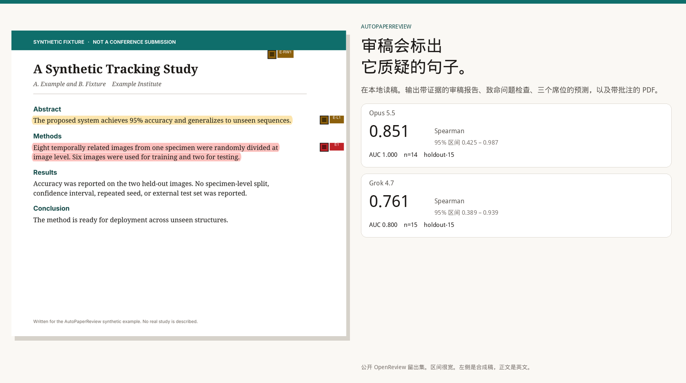
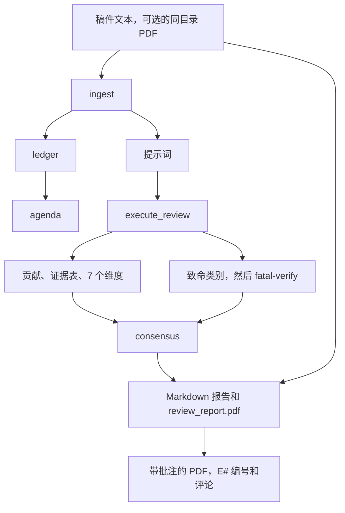
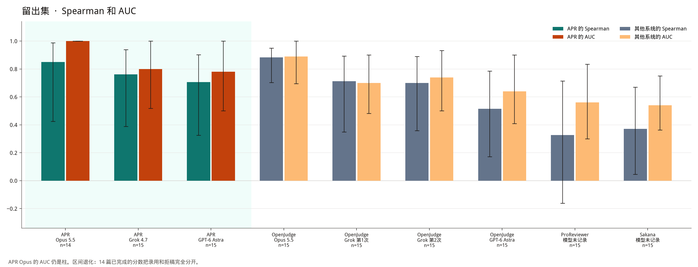
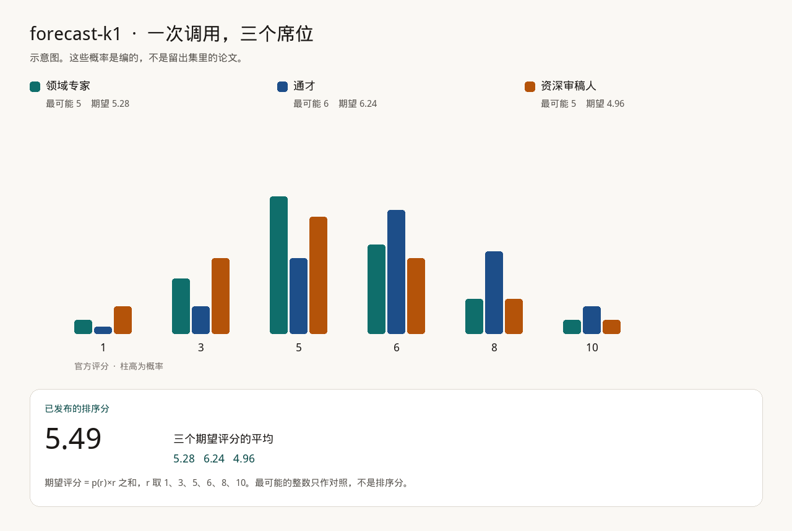
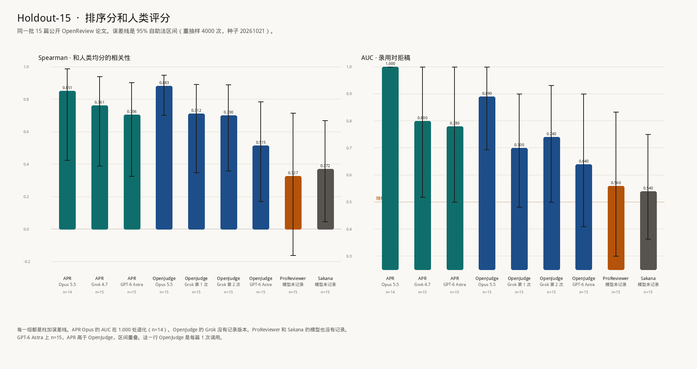

[English](README.md) | 简体中文

# AutoPaperReview

AutoPaperReview（简称 APR）是一条在本地运行的审稿流水线。它有两种用法，分别单独运行：

- **[审稿报告](#track-a)**：默认用法。`init` 之后正常 `run`，会写出一份七维审稿，附带证据表、贡献核对和致命问题检查。产物包括 Markdown 报告和带批注的稿件 PDF；装了 reportlab 的话，还有 `review_report.pdf`。
- **[评分与基准](#track-b)**：可选，默认关闭。`holistic` 预测之后再接一个 `rate` 阶段，系数用 `apr-fusion-v1`，得到排序分 `forecast-k1`。留出集表格只测这个排序分。



图的右半边来自可选的评分与基准部分。

版本 `0.1.10`，Alpha。Python 3.10–3.13。MIT 许可证。APR 不能代替人工审稿。

<a id="track-a"></a>

## 审稿报告

这是默认用法，不计算会议评分。预测和留出集数字见 [评分与基准](#track-b)。

### 报告内容

| 内容 | 说明 |
| --- | --- |
| 贡献和证据表 | 稿件声称了什么、拿出了什么证据、还缺什么。 |
| 七个维度 | 原创性、重要性、主张支撑、实验可靠性、写作、社区价值、已有工作定位。分数档是 2/4/6/8/10。 |
| 致命问题 | 数据泄漏、基线不公平这类标签，要同时满足两个条件才会保留：摘录确实出自论文，**并且**第二次调用 `fatal-verify` 也认定这段摘录说的就是这一类问题。`missing_closest_neighbor` 来自相关工作检索，不来自这次调用。 |
| 审稿报告 | `review_report.md`，写在 `review.toml` 旁边。装了 reportlab 的话，同一阶段还会写出 `review_report.pdf`。 |
| 中英双语 | 在 `execute_review` 和 `report` 上都设 `bilingual = true`，同一份文件里就会同时写 `en` 和 `zh-Hans`。缺任何一对，导出都会失败。 |
| 带批注的原稿 PDF | 引用到的每条证据都会高亮，页边标上编号（`E1`、`E2`……），再附一条 PDF 评论，署名是 `APR reviewer`。 |
| 相关工作（需另加阶段） | 按关键词和元数据检索 arXiv、OpenAlex、Semantic Scholar，不会把稿件正文发出去。 |

默认判断是 `contributions`、`ledger`、`dimensions` 和 `fatal`。`init` 用的是 `DeterministicManuscriptAdapter`，所以第一次在本地运行时，既不需要 API 密钥，也不需要 `holistic`。

### 合成示例

图和摘录都来自 `examples/synthetic/` 里一份虚构的跟踪笔记。它不是投稿，也不在留出集里。运行用的是 `FixtureReviewAdapter`：下面的句子是这份示例自带的审稿，由真正的报告阶段渲染出来。示例不跑 `rate`，也不算 `forecast-k1`，报告里写明不给总体 0–10 分。示例里那句 ICLR「拒稿」是一条书面的会议结论，存放在结果包里。

批注页和英文页用的是同一张图：示例稿件是英文，PDF 评论也是英文。中文在后面的摘录里。


高亮的是证据 `E1`。批注程序根据结果包写了这样一条 PDF 评论：

> **E1** · Weakness 1 (critical)
>
> A first-time reader can easily read 'image-level split' as a normal train/test split. It is not.
>
> Highlighted on page 1.

第二个问题、那条提问、七个维度的分数，以及示例里的 ICLR 拒稿和 TMLR 大修记录，也都引用了这个 id。页边编号对应证据索引，评论则写明这条证据支持哪一点。

报告也用这个 id 标出必须做的修改。生成的文件会把每一节再用 `zh-Hans` 写一遍。下面是运行 `autopaperreview run examples/synthetic/review.toml` 之后，`review_report.md` 里的中文节选，句子原样摘自示例，没有改写：

```markdown
## 不足

- 评估没有建立序列独立性，因此部署结论缺少支持。 [E1]

## 维度评分

- claims_supported — 2.0/10 [E1]
  所报告的数据拆分与不确定性并不能支持部署结论。
- experimental_soundness — 2.0/10 [E1]
  将八张时间相关图像做图像级拆分，并不能构成独立测试。

### I001  (critical, blocking)

> Eight temporally related images from one specimen were randomly divided at image level.

为何重要：八张图来自同一试件且时间相关，测试图几乎是训练图的近重复。因此泛化和部署结论并不能由这个实验推出。

需采取的行动：采用试件级或序列级留出，并在真正独立的测试集上报告结果。
```

<a id="comparison"></a>

### 分数之外

Spearman 值不会告诉作者该改哪一句。在基准的留出集上，APR 也不是每项指标都比 OpenJudge 准。下表列出 APR 结果包多给的东西，以及另外三个代码库在文档里写法不同的地方：

| | APR | OpenJudge 论文审稿 | ProReviewer | Sakana 审稿人 |
| --- | --- | --- | --- | --- |
| 落到原文的引用 | 引文、证据 id，以及必须做的修改。主要问题缺少引文时，可以让整次导出失败。 | 审稿正文。公开流程不保存「引文对应原文哪一段」的约定。 | 审稿日志，记下主张、问题和笔记。项目页把日志行链回论文。 | 根据抽取的 PDF 文本，用自由文本写优点和不足。 |
| 编号标记和 PDF 弹出评论 | 有。页边 `E#`、高亮，以及署名 `APR reviewer` 的 PDF 评论。 | 公开的论文审稿流程里没有。 | 公开仓库里没有。演示追踪的是日志条目，不是 PDF 弹出评论。 | `perform_review` 里没有。 |
| 打致命标签前的第二次检查 | 有。`fatal-verify` 必须同意这段摘录说的就是这一类。`missing_closest_neighbor` 来自相关工作检索，不来自这次调用。 | 关键性检查（criticality）会重新判定正确性发现，包括假阳性。约定不同。 | 没有写成第二次摘录检查。 | 没有写。 |
| 用官方评分上的概率得出排序分 | 有。一次调用、三个席位、1/3/5/6/8/10 上的概率，排序分是期望评分的平均。 | 1–6 的整数分。 | 没有写。 | 已发表的审稿人对多个整数总分做集成，得到的不是概率向量。 |
| 会议量表 | 1–6 决策映射到 ICLR 档。格式配置有 `iclr2027` 和 `aaai2027`（页数上限、匿名）。AAAI 只管格式。 | 学科量表上可以填会议**名称**。公布的分数是 1–6，不是 ICLR 那一组档。 | 没有固定的 ICLR/AAAI 格式配置。 | 已发表的提示词沿用 NeurIPS 式表格（soundness、presentation、contribution、overall、confidence）。 |
| 双语导出 | 同一份文件里写 `en` 和 `zh-Hans`。缺一对就导出失败。 | 每次运行一种语言，`en` 或 `zh`。 | 没有写。 | 没有写。 |
| 相关工作检索，不外发稿件 | 按关键词，以及 id、标题、DOI 查询。正文留在本地。数据源失败不会多加一条上限。 | 参考文献检查（CrossRef；该技能也提到 arXiv 和 DBLP）。发出去的是参考文献元数据，不是五类相关工作检索。 | 没有写。 | 没有写。 |
| 公开仓库的保密检查 | `scripts/check_confidentiality.py` 会拒绝审稿工作目录、页面图像和投稿 id 模式。 | 不属于那个项目。 | 不属于那个项目。 | 不属于那个项目。 |

### 快速开始

1. 安装。`pdf` 这组可选依赖会装上 PyMuPDF 和 reportlab，用来生成批注稿和 `review_report.pdf`；`visual` 负责渲染页面，供格式检查使用。不装这两组依赖，也照样能得到 Markdown 和 JSON。

```bash
python3 -m venv .venv
source .venv/bin/activate
pip install -e ".[pdf,visual]"
```

2. 新建项目。`init` 会写出确定性适配器、提示词文件和 `review.toml`。真实稿件放在 Git 忽略的目录里，例如 `reviews/`、`workdir/`、`papers/`、`uploads/`。

```bash
autopaperreview init reviews/my-paper --project-id my-paper --title "My paper review"
```

3. 把 `reviews/my-paper/manuscript.txt` 换成你的稿件。要调用模型，就照下面的例子改 `execute_review` 阶段。`OpenAICompatibleAdapter` 调用的是 OpenAI 兼容的 chat API。各阶段怎样衔接，见后面的「流程」一节。

   - 密钥放在环境变量里，默认是 `APR_MODEL_API_KEY`。APR 不会把它写进 TOML、请求日志或阶段签名。
   - `network_policy` 为 `deny` 时，仍然可以连本机回环地址上的服务。连远程主机则要设 `allow_remote = true`、`requires_network = true` 和 `network_policy = "allow"`，运行清单随后会记下稿件离开了这台机器。
   - `base_url` 填 API 根路径（`…/v1`）；密钥不要放进 URL 的查询字符串。
   - 模型超时默认 7200 秒。

```toml
[project]
network_policy = "allow"

[[stages]]
id = "review"
type = "execute_review"
depends_on = ["prompt_packets", "ledger"]
[stages.params]
adapter = "autopaperreview.model_exec:OpenAICompatibleAdapter"
base_url = "https://api.example.com/v1"
model = "your-model-id"
api_key_env = "APR_MODEL_API_KEY"
allow_remote = true
requires_network = true
bilingual = true
judgments = ["contributions", "ledger", "dimensions", "fatal"]

[[stages]]
id = "report"
type = "report"
depends_on = ["consensus"]
[stages.params]
bilingual = true
```

除非要用 [评分与基准](#track-b)，否则不要在这个文件里加 `holistic` 和 `rate`。`cheap = true` 是只算排序分的捷径，会跳过贡献、证据表、维度和致命问题这几项。

4. （可选）加格式检查或相关工作检索。`init` 不会加这些阶段。格式检查的 `profile` 填 `iclr2027` 或 `aaai2027`。

```toml
[[stages]]
id = "pages"
type = "render_pages"
depends_on = ["ingest"]
[stages.params]
profile = "iclr2027"

[[stages]]
id = "format"
type = "format_check"
depends_on = ["pages"]
[stages.params]
profile = "iclr2027"
```

要做相关工作检索，就加上 `search` 阶段。这个阶段只有写进 TOML 才会运行；写了的话，`novelty` 和 `rate` 必须依赖它。在线检索要求 `network_policy` 为 `metadata_only` 或 `allow`。所有数据源都失败时，状态记为 `degraded`，分数不会因此下降。`venue` 的取值和 `profile` 相同，并读取对应会议的截止日期文件，但不改变审稿正文里的评分档。

```toml
[[stages]]
id = "search"
type = "related_work_search"
depends_on = ["ingest"]
[stages.params]
venue = "aaai2027"
mode = "live"
requires_network = true
```

5. 运行。再跑一次时，签名没变的阶段会直接复用。

```bash
autopaperreview validate reviews/my-paper/review.toml
autopaperreview run reviews/my-paper/review.toml
```

运行合成示例不需要 API 密钥：

```bash
PYTHONPATH=src python3 -m autopaperreview validate examples/synthetic/review.toml
PYTHONPATH=src python3 -m autopaperreview run examples/synthetic/review.toml
```

6. 批注。`report` 运行时，如果文本旁边有 `manuscript.pdf`，并且装了 PyMuPDF，这一阶段就已经写出 `annotated_manuscript.pdf`。如果想事后单独批注、不再调用模型，可以运行：

```bash
autopaperreview annotate reviews/my-paper/review.toml --pdf path/to/manuscript.pdf
```

如果想让高亮颜色跟着 Markdown 里的优点、不足和提问走，而不只看结果包里的主张，就加上 `--review`。`annotate` 默认写到 `<run>/annotated_manuscript.pdf`。

### 输出位置

| 路径 | 内容 |
| --- | --- |
| `review_report.md` | 写在 `review.toml` 旁边，`<run>/stages/report/` 里还有一份。证据 id 链接到证据索引。 |
| `review_report.pdf` | 同一份报告，两处都有，只要装了 reportlab 就会生成。没有参数可以跳过它。 |
| `annotated_manuscript.pdf` | 报告阶段发现同目录有 PDF 时，写在 `review.toml` 旁边。`annotate` 默认写到运行目录，除非传了 `--output`。PDF 里找不到的引文会变成页级笔记，仍然留在索引里。 |
| `<run>/run_manifest.json` | 各阶段的状态、签名，以及稿件有没有离开这台机器。 |
| `<run>/stages/<id>/` | 结果包 JSON 和提示词；模型阶段还有原始请求、响应和它们的 SHA-256。 |

`<run>` 指 `<run_root>/<run_id>`，`init` 把 `run_root` 设为 `.runs`。再次 `run` 时，签名和输出哈希都没变的阶段会直接复用。改了导出条件，APR 会重跑报告，但保留稿件解析、检索和各项判断的结果。不要提交 `review_report.md`、`review_report.pdf` 或 `annotated_manuscript.pdf`。

### 流程



合成示例跑到示例用的 `execute_review` 和一份双语报告就停了：没有 `rate` 阶段，也不调用模型。

### 命令

```text
autopaperreview init            建一个本地项目（确定性或 agent 适配器）
autopaperreview validate        检查 TOML、依赖和本地路径
autopaperreview run             运行或接着跑；有阶段在等 drop 时退出码为 3
autopaperreview status          以 JSON 输出运行状态、待交的 drop 和产物
autopaperreview submit          先校验 agent 的 drop，再写入
autopaperreview mcp             通过 stdio 向 MCP 客户端提供审稿工具
autopaperreview inspect         打印运行清单
autopaperreview annotate        高亮、页边编号和评论
autopaperreview doctor          检查可选依赖和适配器
```

<a id="agent-mcp"></a>

### 接入 agent 与 MCP

审稿人也可以由 Claude Code、Codex CLI 这类编码 agent 来当。APR 写出提示词包，agent 读完后写一份判定文件（drop），APR 先校验这份 drop，再接着跑报告。这种用法下 APR 不需要 API 密钥。稿件由 agent 背后的模型来读，所以稿件会去到那个模型运行的地方。APR 看不到这一步，`manuscript_left_machine` 仍为 false。

先建一个 agent 项目。它的 `execute_review` 阶段用 `AgentJudgmentAdapter`，并设置 `fixture_path = "judgment.json"` 和 `verify_excerpts = true`。

```bash
autopaperreview init reviews/my-paper --project-id my-paper --adapter agent
```

再注册 MCP 服务。工具收到的每个路径都必须落在某个 `--root` 目录里。默认的 root 是服务启动时的工作目录。

```bash
claude mcp add autopaperreview -- autopaperreview mcp --root /abs/path/to/reviews
```

Codex CLI 则在 `~/.codex/config.toml` 里加上：

```toml
[mcp_servers.autopaperreview]
command = "autopaperreview"
args = ["mcp", "--root", "/abs/path/to/reviews"]
```

然后让 agent 审这篇稿件。工具有 `init_project`、`validate`、`run`、`status`、`read_input`、`drop_template`、`submit_drop` 和 `report`。

| 步骤 | 做什么 |
| --- | --- |
| `run` | 各阶段一直跑到 `execute_review` 发现没有 drop 为止。这个阶段记为 `awaiting_input`，它后面的阶段记为 `pending`，不依赖它的阶段照常运行。每个阶段发一条进度通知。 |
| `status`、`drop_template` | 列出要读的提示词包、drop 的路径，以及要原样回填的 `packet_sha256` 哈希。模板列出七个维度和 `sar_bands_v1` 的分数档，不预填任何一档。 |
| `read_input` | 读取提示词包或页面渲染图。文本按 `max_chars` 分页返回，长稿件也不会超出客户端的输出上限。 |
| `submit_drop` | 跑的就是该阶段自己的检查：哈希、schema、七个维度是否齐全，以及引文能否在稿件里找到。没通过的 drop 不会写入。 |
| `run`、`report` | 审稿阶段读入 drop，随后跑 consensus 和 report。`report` 返回 `review_report.md`。 |

不用 MCP，在 shell 里也是同一个循环。有阶段在等 drop 时，`run` 的退出码是 3；`status` 输出 JSON；`submit` 先校验 drop 文件，再把它写到声明的位置：

```bash
autopaperreview run reviews/my-paper/review.toml       # awaiting_input
autopaperreview status reviews/my-paper/review.toml --detail
autopaperreview submit reviews/my-paper/review.toml my-drop.json
autopaperreview run reviews/my-paper/review.toml       # success
```

`visual_inspect` 配 `AgentFindingsInspector`，或 `related_work_search` 配 `mode = "agent"` 时，只要声明了 `findings_path` 而文件还不存在，也会这样等待。每次运行都会锁住自己的运行目录，同一项目的第二个 `run` 会返回 `busy`，不会改动运行清单。工具调用没法取消已经在跑的阶段。每个提示词包都带着整份稿件，所以稿件读一遍就够，其余的包只看各自的路线说明。

<a id="known-gaps"></a>

### 已知缺口

下面几项都没有对应的配置项，本 README 也不另加。

- `review_report.pdf` 关不掉。只要装了 reportlab，报告阶段就会把这份 PDF 写到 `review.toml` 旁边，以及报告阶段的目录里。没装 reportlab 时，照样写出 Markdown 和 JSON，只是跳过 PDF。
- 不提供任何会议的官方审稿表。`review_report.pdf` 只是本项目 Markdown 报告的排版，既不是 ICLR 的表格，也不是 AAAI 的表格。
- `render_pages` 和 `format_check` 的 `profile`，以及 `related_work_search` 的 `venue`，都可以填 `iclr2027` 或 `aaai2027`。这两个名字只决定格式、匿名和截止日期检查，不改七个维度的分数档，也不选评分公式。这里的 AAAI 不是另一套评分。`decision_bin` 用的量表是 [评分与基准](#track-b) 里的 ICLR 档。

<a id="track-b"></a>

## 评分与基准

这条线是可选的，默认关闭，和审稿报告分开：七个维度和致命问题检查都**不会改变** `forecast-k1`。要打开它，就加一个 `holistic` 判断，模式设为 `forecast`；再加一个 `rate` 阶段，设 `coefficient_set = "apr-fusion-v1"`：

```toml
judgments = ["contributions", "ledger", "dimensions", "fatal", "holistic"]
holistic_mode = "forecast"
holistic_samples = 1

[[stages]]
id = "rate"
type = "rate"
depends_on = ["consensus"]
[stages.params]
coefficient_set = "apr-fusion-v1"
```

前三个键放在 `execute_review` 阶段的 `[stages.params]` 里。

设了 `cheap = true`，就只保留 holistic 调用，跳过贡献、证据表、维度和致命问题。这就是只算排序分的运行，留出集表格测的正是它。

### 结果一览



图中 APR 的柱子是只算排序分的 `forecast-k1`。误差线是论文层面的 95% 自助法区间（重抽样 4000 次，种子 `20261021`）。APR Opus 的 AUC 照样画成柱，但区间是退化的 [1.000, 1.000]，因为在已完成的 14 篇里，分数把录用和拒稿完全分开了。APR Opus 的 n=14，其余各行 n=15，区间都很宽。GPT-6 Astra 是图上的第三个模型，APR 和 OpenJudge 都是 n=15。口径和完整表格见 [基准测了什么](#benchmark-scope)；两套流程差在哪、分数在哪一步提上去，见 [方法和消融](#method)。

### 预测怎样变成排序分



一次 `holistic` 调用会读完整个稿件包。默认值是：模式 `forecast`，K = 1，温度 0.7。遇到最长的论文，源文本截到 240,000 个字符。这次调用分成三个席位作答，席位定义在 `anchors.FORECAST_SEATS` 里：

- **领域专家（Specialist）**：最接近的已有工作、基线，以及这个方向会不会把这项提升当真。
- **邻近领域读者（Generalist）**：相近方向的高水平读者，看文章清不清楚、主张能不能从证据推出来、问题出了小圈子还重不重要。
- **资深审稿人（Senior）**：这个方向以后会不会在这项结果上接着做。

每个席位写一句话摘要、最多两条优点和两条不足、自己最可能给出的官方评分、六个概率，以及 1 到 5 的置信度。这次调用还会写出 `predicted_mean`（主席均值）和 1–6 的决策，两者都不是排序分。席位的置信度也不是审稿表上印的 confidence：后者是 `rate` 阶段的参数，不是模型输出。

```text
期望评分 = p1·1 + p3·3 + p5·5 + p6·6 + p8·8 + p10·10
排序分   = 三个期望评分的平均，限制在 1–10
档位     = decision 1,2,3,4,5,6  →  ICLR 1,3,5,6,8,10
```

概率加起来不等于一时，先归一化再计入。官方评分不在 {1, 3, 5, 6, 8, 10} 里的，记为 `off_scale`，但仍然保留。图里的权重是编的，送进 `expected_rating` 和 `forecast_mean` 后得到排序分 5.4933，这样每一步算术都看得见。

写进报告的会议评分，是对这个 1–6 决策取 `decision_bin`，而不是把排序分向下取档。举一个编的例子（不是留出集论文，也不是上面那张图）：排序分 5.53、决策 4，报告里的评分是 6；把排序分向下取档，得到的是 5（`snap_down`）。排序分和评分可能差一档。

核实过的会议上限会记录下来，但不会作用到这个排序分上。forecast 调用不拿稿件做摘录检查，致命问题调用会。核实过的缺陷能压低的，是更早的 `apr-iclr-cap-v2` 维度公式算出的分数，不是留出集表格里的数。

<a id="benchmark-scope"></a>

### 基准测了什么

留出集和 tune-30 的数字测的是排序分，不是完整的审稿。

这些数字来自只算排序分的运行：`calibrate-eval` 加上 `--cheap --holistic-mode forecast --holistic-samples 1 --related-work off --coefficient-set apr-fusion-v1`，每篇论文只做一次 forecast 调用。贡献、证据表、维度分、致命问题检查、`fatal-verify` 和相关工作检索都没有运行。下表的 Spearman、Kendall、AUC、MAE 和偏差只检验连续的 `forecast-k1` 排序分，不检验写出来的审稿、不足、维度分数或子分数、致命标签，也不检验带批注的 PDF。后面「费用与时间」里的美元 / 篇，同样只是这种运行的费用。完整审稿还要写出其他产物，费用高得多。

表里的 Spearman 和 AUC 是在排序分上算的。由决策档得到的会议评分，没有在这份留出集上评估过。

留出集是 **15 篇公开的 OpenReview 论文**。Spearman 和 Kendall 比较的是系统分数和**人类官方评分的均值**。AUC 看的是分数能不能把录用和拒稿分开。区间是论文层面的 95% 分位数自助法区间：重抽样 4000 次，种子 `20261021`，算法在 `src/autopaperreview/rank_metrics.py`。

表里 APR 的分数是已发布的排序分 `forecast-k1`，也就是 1–10 上的期望评分均值。完整精度见 [`docs/assets/holdout15-aggregate.json`](docs/assets/holdout15-aggregate.json)，下表四舍五入到三位小数。这个文件和本 README 都不含论文 id 或标题。

| 系统 | 记录的模型 | n | Spearman | Kendall | AUC | MAE | 偏差 |
| --- | --- | --- | --- | --- | --- | --- | --- |
| APR | Opus 5.5 | 14 | 0.851 [0.425, 0.987] | — | 1.000 | 0.796 | −0.513 |
| APR | Grok 4.7 | 15 | 0.761 [0.389, 0.939] | — | 0.800 | 1.330 | −0.848 |
| APR | GPT-6 Astra | 15 | 0.706 [0.325, 0.902] | — | 0.780 [0.500, 1.000] | — | — |
| OpenJudge | Opus 5.5 | 15 | 0.883 [0.702, 0.950] | 0.756 [0.579, 0.882] | 0.890 [0.694, 1.000] | — | — |
| OpenJudge | Grok，第 1 次 | 15 | 0.712 [0.348, 0.892] | 0.593 [0.291, 0.799] | 0.700 [0.481, 0.900] | — | — |
| OpenJudge | Grok，第 2 次 | 15 | 0.700 [0.359, 0.889] | 0.575 [0.283, 0.794] | 0.740 [0.500, 0.932] | — | — |
| OpenJudge | Grok，两次的平均 | 15 | 0.724 [0.374, 0.910] | 0.605 [0.312, 0.828] | 0.740 [0.500, 0.932] | — | — |
| OpenJudge | GPT-6 Astra | 15 | 0.515 [0.171, 0.786] | — | 0.640 [0.409, 0.900] | — | — |
| ProReviewer | 未记录 | 15 | 0.327 [−0.162, 0.714] | 0.272 [−0.124, 0.607] | 0.560 [0.300, 0.833] | 1.711 | −1.078 |
| Sakana AI Scientist reviewer | 未记录 | 15 | 0.372 [0.046, 0.670] | 0.302 [0.039, 0.570] | 0.540 [0.364, 0.750] | 2.244 | −2.211 |



这张表样本很小，别当排行榜看：

- **Opus 5.5 上，OpenJudge 的排序相关性高于 APR**（Spearman 0.883 对 0.851）。APR 的 Opus AUC 是 1.000，OpenJudge 是 0.890。APR 只有 **14** 篇，不是 15 篇。两边的 Spearman 区间重叠。到了 tune-30，这个领先反了过来，见 [消融说明了什么](#ablations)。
- Grok 4.7 上，APR 略高于 OpenJudge 的两次 Grok 运行：Spearman 0.761 对 0.712 和 0.700，AUC 0.800 对 0.700 和 0.740。这些区间同样重叠。
- GPT-6 Astra 上，两边都是 n=15。APR 的 Spearman（0.706 对 0.515）和 AUC（0.780 对 0.640）都高于 OpenJudge，但两项的 95% 区间都重叠，所以这个领先只说明方向，在这个样本量下并不显著。这一行 OpenJudge 和其余 OpenJudge 行一样，每篇只调用 1 次；公开默认流程要调用 4 次模型，正确性高于 1 时还有第 5 次。
- ProReviewer 和 Sakana 审稿人在录用/拒稿上接近随机（AUC 0.560 和 0.540），但它们的 Spearman 区间上端仍接近 0.7。
- 汇总里没有 APR 的 Kendall，也没有 OpenJudge 的 MAE 和偏差。OpenJudge 公布的审稿分是 1–6 的整数，要和 1–10 的人类均分算 MAE，得先有一份换算映射，而本仓库没有。
- 用 Opus 和 Grok 时，APR 的分数都**低于**人类均分（Opus 偏差 −0.51，Grok 4.7 偏差 −0.85）。汇总里没有 Astra 的偏差。
- Opus 评了 15 篇里的 14 篇。运行笔记说缺的那篇超时了。汇总把模型记为 Opus 5.5，但没有记录 effort 设置；同一份笔记说这次运行用的是最大 effort。
- 破折号表示汇总里没有这一格。表里没有任何一格是插值补出来的。

<a id="other-models"></a>

### 对照系统的模型

本仓库不包含 OpenJudge、ProReviewer 或 Sakana 的代码。下面的描述来自它们的公开文档，写这份 README 时核对过。**留出集实际用的模型**以汇总的记录为准，汇总记下的信息比上游默认配置写明的少。

- **OpenJudge** 的论文审稿（[agentscope-ai/OpenJudge](https://github.com/agentscope-ai/OpenJudge)）分几路打分：安全、正确性、1–6 的学术分、关键性检查（可以把某条发现标成假阳性），以及对照 CrossRef 的 BibTeX 检查。汇总里的 OpenJudge 行是 Opus 5.5、两次 Grok 和 GPT-6 Astra。文件里没有 Grok 的版本。
- **ProReviewer**（[UKPLab/arxiv2026-ProReviewer](https://github.com/UKPLab/arxiv2026-ProReviewer)，arXiv:2606.13349）是带审稿日志的多步代理。公开的检查点是 Qwen3-8B，走 API 也可以换别的模型。这次留出集没有记录用的是哪一个。每篇大约 24 次调用，说明它是多步循环，不是单次打分。
- **Sakana 的 AI Scientist 审稿人**（[SakanaAI/AI-Scientist](https://github.com/SakanaAI/AI-Scientist) 的 `perform_review`）根据抽取出的 PDF 文本，给出 NeurIPS 式的分数、优点、不足和录用/拒稿结论。上游 README 的默认审稿模型是 `gpt-4o-2024-05-13`，并且用了集成。这次留出集既没有记录模型，也没有记录集成设置。

### 费用与时间

| 系统 | 模型调用 | 美元合计 | 美元 / 篇 | 分钟 / 篇 |
| --- | --- | --- | --- | --- |
| APR Opus 5.5 | 不在汇总里 | — | 0.66 | ~5.3，来自运行笔记，不是汇总 |
| APR Grok 4.7 | 不在汇总里 | — | 0.11 | ~2.9，来自运行笔记，不是汇总 |
| APR GPT-6 Astra | 不在汇总里 | — | — | 未记录 |
| OpenJudge Opus 5.5 | 15（1 / 篇） | 6.16 | 0.41 | 未记录 |
| OpenJudge Grok 第 1 次 | 15 | 0.94 | 0.063 | 未记录 |
| OpenJudge Grok 第 2 次 | 15 | 0.97 | 0.065 | 未记录 |
| OpenJudge GPT-6 Astra | 15（1 / 篇） | — | — | 未记录 |
| ProReviewer | 364（~24 / 篇） | 12.77 | 0.85 | 未记录 |
| Sakana 审稿人 | 137（~9 / 篇） | 12.88 | 0.86 | 未记录 |

这些金额对应留出集表格背后的 forecast 调用，只算排序分。完整审稿贵得多。

### 调参集

调参集不是确认集。文件里只有点估计，没有自助法区间。Opus 在 30 篇里缺了一篇，文件没写原因。

| 划分 | 模型 | n | Spearman | AUC |
| --- | --- | --- | --- | --- |
| tune-30 | Opus 5.5 | 29 | 0.858 | 1.000 |
| tune-30 | Grok 4.7 | 30 | 0.656 | 0.857 |

`forecast-k1` 仍是已发布的排序分。不要因为后来某个候选在这个划分上看起来更好，就把它换掉。细节见 [公开标定](docs/public-calibration.md)。

<a id="method"></a>

### 方法和消融

前面的留出集图把已发布的排序分 `forecast-k1` 和另外三个系统放在一起。图上有两点容易看漏：OpenJudge 做的不是同一种审稿；排序分的提升也不是靠一连串差不多的小步累积出来的。

#### APR 和 OpenJudge：每篇论文各做什么

APR 有两种运行。表里测的是一次 forecast 调用；默认的 `run` 写审稿，不改变这个数。OpenJudge 公开的默认流程由多个评分器组成，本仓库不带这份代码。下面的描述依据 OpenJudge 的 `cookbooks/paper_review`（见 [提交 c2fdc38](https://github.com/agentscope-ai/OpenJudge/blob/c2fdc38314cd971b03d4d9333cd2c9f24d85c27f/cookbooks/paper_review/pipeline.py)），再加上本页费用表里记下的调用次数。ProReviewer 和 Sakana 放在 [分数之外](#comparison) 一节。

- **分数是什么**：APR 的基准读的是 `forecast-k1`，即一次调用、三个席位，每个席位在 1/3/5/6/8/10 上给出概率。排序分是三个期望评分的平均。同一次调用给出的 1–6 决策，是审稿表上的档，不是排序分。OpenJudge 公布的推荐分是 review 评分器给的 1–6 整数（`result.review.score`）。正确性是另一个 1–3 的分数，不能代替这个 1–6。
- **调用几次模型**：表里的 APR 是 1 次 forecast 调用（`--cheap`）。OpenJudge 默认的 `review_paper` 调用 4 次模型：越狱检查、格式、正确性和审稿。只有正确性分数高于 1 时，才会有第 5 次，也就是关键性检查。`.bib` 文件可选；传了的话由 CrossRef 核对，这一步不调用模型。留出集的费用表把 OpenJudge 记为每篇 1 次调用，所以那一行用的不是这条默认流程。
- **拿什么对照原稿**：只有引用的摘录确实出现在稿件里，APR 才保留维度分；致命类别还要第二次调用 `fatal-verify` 同意才保留。OpenJudge 可以把一条正确性发现标成假阳性，但它的公开流程不要求审稿句子对上 PDF 里的某一段。它的输入就是 PDF（TeX 包走另一个入口）。只有设置了 `use_vision_for_pdf`，它才会把页面渲染成图像。
- **最后交回什么**：APR 默认写出七维审稿和证据表；装了 PyMuPDF 的话，还会写出 `annotated_manuscript.pdf`，带页边编号（`E1`、`E2`）和弹出式评论。OpenJudge 的 `generate_report` 写的是 Markdown，内容包括安全、正确性、1–6 的审稿和关键性检查，不会在原稿 PDF 上写带编号的评论。

<a id="ablations"></a>

#### 消融说明了什么

这里有用的是差距本身，所以直接用文字给出数字，不再多画一张分组柱状图。点估计见 [`docs/assets/ablation-aggregate.json`](docs/assets/ablation-aggregate.json) 和 [`docs/assets/tune30-r14-r15-aggregate.json`](docs/assets/tune30-r14-r15-aggregate.json)。凡是给出 95% 区间的地方，用的都是论文层面的自助法：重抽样 4000 次，种子 `20261021`。

真正把排序分提上去的一步，是不再用七维加权分和决策档，改用期望评分的平均。Grok 4.7 留出集（n=15）上的 Spearman：

- 七维加权分是 0.452 [−0.130, 0.870]
- r2 mean-k1 是 0.667 [0.228, 0.895]
- 已发布的 forecast-k1 是 0.761 [0.389, 0.939]

在调参集（n=30）上，取分数平均也比读档更能排序：mean-k1 是 0.601/0.780（Spearman/AUC），决策档是 0.485/0.658。所以基准用 `rank_score`，审稿表上仍然印档。

在这份留出集上，后来的变体没能超出噪声。`panel-k2` 是 0.705 [0.313, 0.890]，`forecast-k1` 是 0.761 [0.389, 0.939]，两个区间重叠。Holdout-15 在第 2、8、11 轮都打开过，所以它不是一份从没动过的留出集。n 是 14 或 15。

在留出集上，OpenJudge 用 Opus 时领先（0.883 对 APR 的 0.851）；到了 tune-30，这个领先就不成立了。tune-30 用同一套评测框架和 Opus 5.5，n=29，因为安全分类器拒了其中 1 篇。这时 OpenJudge 的 Spearman 是 0.635 [0.345, 0.830]，AUC 是 0.879 [0.748, 0.972]。文件把这次 OpenJudge 的 effort 记为 xhigh，没有记录这几次 APR 的 effort。APR 的三次 `forecast-k1` 分别是 0.858、0.837 和 0.815，AUC 都是 1.000；每一次的 Spearman 都领先 0.18 到 0.22，AUC 领先约 0.12。换成 Grok 4.7（n=30），两边很接近：OpenJudge 是 0.629 [0.315, 0.836]，AUC 0.816 [0.662, 0.938]；APR 两次分别是 0.656/0.857 和 0.582/0.761。

后来的两个改法都没起作用：

- **r14 dated-k1** 让小组按稿件写成时的时间点来审，不许用事后信息。Grok 得到 0.554/0.766，低于前面两次 Grok。Opus（n=29）得到 0.827/0.985，和主 forecast 的相关系数是 0.985，落在 Opus 那几次的 0.815 到 0.858 之间。把审稿时间钉住，并没有带来新的排序信号。
- **r15 duo-k1** 把这个小组和另一位写完整报告的审稿人等权平均。Grok 上，平均后是 0.493/0.775；审稿人单独是 0.421/0.749，同一次运行里小组单独是 0.619/0.801。把审稿人平均进去，分数反而降了。Opus 的 duo 没有数字，因为审稿人那几次调用超时了。

`forecast-k1` 是在看留出集之前登记的，不是在留出集上挑出来的。Grok 调参集上，chair-k1（0.684/0.866）略高于 `forecast-k1`（0.656/0.857）。Opus 上，其他读法在 0.842 到 0.875 之间。

### 复现基准

只用公开的 OpenReview 数据。缓存放在 Git 忽略的目录里，例如 `reviews/`。不要提交清单、缓存、论坛 id、标题或划分 id 文件。本仓库没有那张 15 篇表格背后的 id 列表，所以重新列一份，也复现不出那些格子。

`calibrate-eval` 有五个子命令：`list`、`fetch`、`prepare`、`run` 和 `report`。

1. 列出一组公开的会议论文。`--listing` 可以取 `ICLR 2024 oral`、`ICLR 2024 spotlight`、`ICLR 2024 poster`、`ICLR 2024 rejected`、`ICLR 2025 oral`、`ICLR 2025 spotlight`、`ICLR 2025 poster` 和 `ICLR 2025 rejected`。`--limit` 默认 20。命令把 JSON 打到标准输出，里面有公开的论坛 id 和标题。不要把这份 JSON 放进 Git。

```bash
autopaperreview calibrate-eval list --listing "ICLR 2025 poster" --limit 20
```

2. 根据这份输出自己写清单。每条记录都要有 `forum_id` 和 `decision`（`accept` 或 `reject`），`listing` 可选。下面的 `REPLACE_ME` 是占位符，不是论文。

```json
{
  "papers": [
    {"forum_id": "REPLACE_ME", "decision": "accept", "listing": "ICLR 2025 poster"}
  ]
}
```

3. 下载公开 PDF 和留出的官方评分，再生成提示词。`--pdf-fallback` 默认 `arxiv`，`--max-pages` 默认 40。

```bash
autopaperreview calibrate-eval fetch --manifest reviews/public-eval/manifest.json --cache reviews/public-eval
autopaperreview calibrate-eval prepare --cache reviews/public-eval
```

4. 用锁定参数打分，只算排序分。自带的 chat 适配器必须用 `--mode adapter`。远程端点还要加 `--allow-remote`、`--requires-network` 和 `--network-policy allow`。`--cheap` 只保留 holistic 调用，跳过贡献、证据表、维度和致命问题；`--related-work off` 不做相关工作检索。`--mode` 默认是 `agent`，这个模式会等一份手写的判断文件，不调用模型。

```bash
autopaperreview calibrate-eval run \
  --cache reviews/public-eval \
  --mode adapter \
  --adapter autopaperreview.model_exec:OpenAICompatibleAdapter \
  --base-url "https://api.example.com/v1" \
  --model "your-model-id" \
  --allow-remote \
  --requires-network \
  --network-policy allow \
  --cheap \
  --holistic-mode forecast \
  --holistic-samples 1 \
  --related-work off \
  --coefficient-set apr-fusion-v1
```

`calibrate-eval run` 的 `--fixed-set` 默认是 `none`，评的是你抓下来的那份缓存。要评已提议的 48 篇开发集，加上 `--fixed-set iclr-dev --model-id "your-model-id" --effort xhigh`。这两个参数在开发集上是必填的，上面的 forecast-k1 参数也必须和清单一致。

5. 生成两份报告，它们测的东西不一样。`calibrate-eval report` 拿会议档（`our_bin`，即决策档）和人类均分比，结果对不上留出集表格；那张表里的 Spearman 和 AUC 用的是连续的 `forecast-k1`。`scripts/rank_eval.py --mode locked` 读的是 `rank_score`，默认评 `benchmarks/fixed_eval/` 里已提议的固定 ICLR 开发集（`--fixed-set iclr-dev`）。这次运行必须带 `--model-id` 和 `--effort`。`--fixed-set none` 评整份缓存，已公布的留出集表格就是这样算的。`--resamples` 默认 4000。自助法种子 `20261021` 写在 `rank_metrics.py` 里，不是命令行参数。缓存和 `--output` 都必须是 Git 忽略的路径，例如 `reviews/` 或 `workdir/`。命令会拒绝检出目录里受 Git 跟踪的路径。论文集合和清单摘要对不上时，固定集运行以退出码 2 结束。见 [docs/fixed-eval.md](docs/fixed-eval.md)。

```bash
autopaperreview calibrate-eval report \
  --cache reviews/public-eval \
  --output reviews/public-eval/bin-report.md
PYTHONPATH=src python3 scripts/rank_eval.py \
  --cache reviews/public-eval \
  --output reviews/public-eval/rank-metrics.json \
  --mode locked \
  --model-id "your-model-id" \
  --effort xhigh \
  --resamples 4000
```

不要把 `--only-ids` 和 `--fixed-set iclr-dev` 一起用。`--fixed-set iclr-dev` 打开时，`scripts/rank_eval.py` 的 `--ids` 必须和开发集一致。`--holdout-file` 评的是私有留出集，只在要改 README 数字时使用。本 README 不公布那些 id。

## 保密

本仓库是公开的。稿件、页面渲染图、审稿、投稿 id 和论坛 id 都要放在 Git 忽略的目录里。预览图只有合成笔记和 `docs/assets/` 里列入允许清单的 PNG。生成命令：

```bash
python3 scripts/render_readme_figures.py
```

同一条命令加上 `--zh`，会给题图、排序图和预测图写中文标签，不覆盖英文文件。批注页仍然是英文示例。脚本不需要密钥，也不读取留出集论文。

CI 跑的就是 `python3 scripts/check_confidentiality.py` 这项检查。如果保密内容已经推上去了，不要强推 `main`，把提交 SHA 告诉维护者。政策见 [CONFIDENTIALITY.md](CONFIDENTIALITY.md)。

网络策略只是阶段元数据里的一项声明，由运行器负责执行，不是操作系统防火墙。

## 局限

**审稿报告**

- 相关工作检索可能只返回部分结果，或者降级。失败的数据源不得收紧上限，报告里应写明检索不完整。
- 格式配置可以拒绝超页或未匿名的 PDF，但不决定 forecast。
- `review_report.pdf` 关不掉，也没有会议官方审稿表。见 [已知缺口](#known-gaps)。

**评分与基准**

- 表里的数字来自一次只算排序分的 forecast 调用，不衡量写出来的审稿、维度分数、致命标签或带批注的 PDF。和人类评分比较的也不是决策档对应的会议评分。完整审稿比「美元 / 篇」那一列贵得多。
- 十五篇论文、一次 Opus 超时、自助法区间大约从 0.4 到 1.0，这意味着 Spearman 差 0.02 算不上结论。
- 用 Opus 和 Grok 时，APR 的分数都低于人类均分。
- 按记录的 effort，Opus 每篇大约 0.66 美元、要几分钟。那张表里有一次调用超时。模型调用的默认预算是 7200 秒。
- `forecast-k1` 没有摘录检查。致命问题核验和维度分数是真实输出，但排序分和人类评分相关，并不是靠这两项。
- 在这份留出集上，Spearman 更高的是 Opus 上的 OpenJudge；到了 tune-30，这个领先就不成立了。见 [消融说明了什么](#ablations)。
- GPT-6 Astra 上，APR 的 Spearman 和 AUC 都高于 OpenJudge，但 n=15 的区间重叠，这个领先只说明方向。见 [评分与基准](#track-b)。
- 这些运行没有记录 ProReviewer 和 Sakana 用的模型，所以那两行比较的是系统，不是模型。

## 状态

AutoPaperReview `0.1.10` 处于 Alpha 阶段，适用于 Python 3.10–3.13，采用 MIT 许可证。

核心是一个本地运行的 DAG（有向无环图），由 TOML 配置、Pydantic 记录、按内容哈希的缓存和适配器组成。`src/autopaperreview/prompts/` 里的提示词和流水线一起做版本管理。解析器和模型厂商都隔在适配器后面。

所有拉取请求都以 `pre-release` 为目标，并且只有在 CI 全部通过时才合并。`main` 只接受来自 `pre-release` 的晋升。一次晋升只有在回归报告显示 `pre-release` 在同一固定基准上的分数高于或等于 `main` 时才允许。两条分支使用同一个模型：通过 Cursor 运行的 grok-4.7，reasoning_effort 为 `xhigh`。基准定义仍是 TODO，见 [分支](docs/branching.md)。

仓库里的延伸阅读：[架构](docs/architecture.md)、[公开标定](docs/public-calibration.md)、[相关工作检索](docs/related-work-search.md)、[初读写法](docs/first-read-review.md)。[docs/oss-experiment-gaps.md](docs/oss-experiment-gaps.md) 是 2026-08-29 的一份缺口清单，早于 `forecast-k1`；当前的比较请看「分数之外」一节的对照表。
