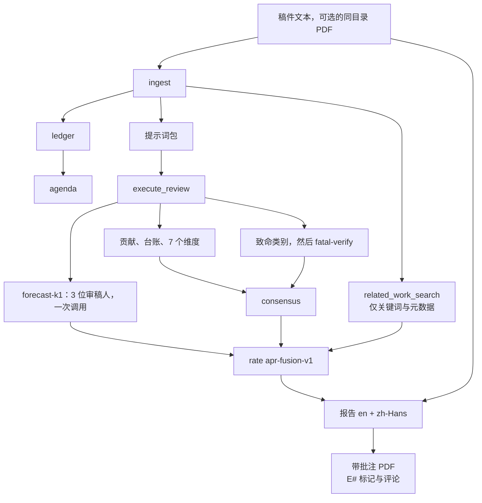

[English](README.md) | 简体中文

# AutoPaperReview

AutoPaperReview 在本地阅读一篇论文，并写出一份会引用稿件原文的会议式审稿：证据台账、七个维度分数、带第二次核验调用的致命缺陷检查、三位审稿人的 **forecast** 排序分、一份双语报告，以及带编号标记的批注 PDF，点开标记即可看到评论。


版本 `0.1.10`。已发布的排序分是系数集 `apr-fusion-v1` 上的 `forecast-k1`。它是一条声明好的公式，不是拟合出来的回归，也不能代替人类审稿人。

## 一次运行会写出什么

| 部分 | 它是什么 |
| --- | --- |
| 贡献与台账 | 稿件提出的主张、它给出的证据，以及仍然缺失的部分。 |
| 七个维度分数 | 原创性、重要性、主张是否得到支持、实验可靠性、写作、对社区的价值、对已有工作的定位。档位落在 2/4/6/8/10。 |
| 致命缺陷检查 | 泄漏或不公平基线这类类别，只有在摘录确实出现在论文中 **并且** 第二次调用认定该摘录陈述了这个类别时，才会被存下来。 |
| Forecast | 一次调用模拟一位领域专家、一位通才和一位资深审稿人。每人给出对评分 1、3、5、6、8、10 的概率。排序分是三个期望评分的平均。 |
| 决策档 | 同一次调用还返回一个 1–6 的决策。映射到 ICLR 档位 1 / 3 / 5 / 6 / 8 / 10 的是这个决策，不是排序分。 |
| 报告 | 同一份 Markdown 里同时有英文和简体中文；安装了 `reportlab` 时还会有 PDF。 |
| 批注 PDF | 每条被引用的证据都会高亮，在页边标上记号（`E1`、`E2`……），并附上作者为 `APR reviewer` 的 PDF 评论。 |
| 相关工作 | 关键词与元数据检索（arXiv、OpenAlex、Semantic Scholar）。稿件正文不会被发出去。 |
| 会议格式配置 | ICLR 2027 与 AAAI-27 的格式检查。上面的评分档是 ICLR 的量表。这里的 AAAI 只是格式配置，不是第二套评分公式。 |

`examples/synthetic/` 下的离线示例使用夹具适配器。它会写出报告和批注 PDF，不调用模型，也 **不会** 计算 `forecast-k1`。只有当 `execute_review` 包含 `holistic` 判断、并且 `rate` 使用 `apr-fusion-v1` 时，forecast 才会运行。

## 排序分与人类评分的吻合程度

下面的留出集和 tune-30 数字衡量的是排序分，不是一份完整审稿。

它们来自只算排序分的模式：`calibrate-eval`，参数为 `--cheap --holistic-mode forecast --holistic-samples 1 --related-work off --coefficient-set apr-fusion-v1`。也就是每篇论文一次 forecast 调用。贡献、台账、维度分数、致命缺陷检查和 `fatal-verify`，以及相关工作检索都没有运行。下面的 Spearman、Kendall、AUC、MAE 和偏差只检验连续的 `forecast-k1` 排序分。它们不检验写成的审稿、不足、维度档位或子分数、致命标签，或带批注的 PDF。再往下的美元/篇是这次只算排序分的费用。完整模式的审稿还会写出那些其他输出，费用高得多。

在完整审稿里，报告出去的会议评分是决策档：同一次 forecast 调用的 1–6 决策，映射到 ICLR 档位 1 / 3 / 5 / 6 / 8 / 10。它不是把排序分向下取到不超过它的档，所以评分可以和排序分相差一档。下面是编造的例子，不是留出集论文，也不是本页后面的那张预测图：排序分 5.53、决策 4，报告的评分是 6（`decision_bin`），而把该排序分向下取档会得到 5（`snap_down`）。表中的 Spearman 和 AUC 是在排序分上计算的。决策档本身没有在这份留出集上被评估过。

审稿表格上印出的置信度是 `rate` 阶段的一个配置参数，不是模型的输出。

**15 篇公开 OpenReview 论文**的留出集。Spearman 与 Kendall 比较的是系统分数和 **人类官方评分的平均值**。AUC 是接收相对拒稿。区间是论文层面的 95% 分位数自助法：4000 次重抽样，种子 `20261021`，做法在 `src/autopaperreview/rank_metrics.py`。

本表中 APR 的分数是已发布的排序分：`forecast-k1`，即 1–10 上的期望评分均值。完整精度在 [`docs/assets/holdout15-aggregate.json`](docs/assets/holdout15-aggregate.json)。下表数字四舍五入到三位小数。该文件和本 README 都不含论文 id 或标题。

| 系统 | 记录中的模型 | n | Spearman | Kendall | AUC | MAE | 偏差 |
| --- | --- | --- | --- | --- | --- | --- | --- |
| APR | Opus 5.5 | 14 | 0.851 [0.425, 0.987] | — | 1.000 | 0.796 | −0.513 |
| APR | Grok 4.7 | 15 | 0.761 [0.389, 0.939] | — | 0.800 | 1.330 | −0.848 |
| OpenJudge | Opus 5.5 | 15 | 0.883 [0.702, 0.950] | 0.756 [0.579, 0.882] | 0.890 [0.694, 1.000] | — | — |
| OpenJudge | Grok，第 1 次 | 15 | 0.712 [0.348, 0.892] | 0.593 [0.291, 0.799] | 0.700 [0.481, 0.900] | — | — |
| OpenJudge | Grok，第 2 次 | 15 | 0.700 [0.359, 0.889] | 0.575 [0.283, 0.794] | 0.740 [0.500, 0.932] | — | — |
| OpenJudge | Grok，两次的平均 | 15 | 0.724 [0.374, 0.910] | 0.605 [0.312, 0.828] | 0.740 [0.500, 0.932] | — | — |
| ProReviewer | 未记录 | 15 | 0.327 [−0.162, 0.714] | 0.272 [−0.124, 0.607] | 0.560 [0.300, 0.833] | 1.711 | −1.078 |
| Sakana AI Scientist reviewer | 未记录 | 15 | 0.372 [0.046, 0.670] | 0.302 [0.039, 0.570] | 0.540 [0.364, 0.750] | 2.244 | −2.211 |


把这张表当成一个小样本，而不是排行榜：

- **Opus 5.5 上，OpenJudge 的排序高于 APR**（Spearman 0.883 对 0.851）。APR 的 Opus AUC 是 1.000，OpenJudge 是 0.890，而且 APR 是 **14** 篇而不是 15 篇。Spearman 区间相互重叠。
- Grok 4.7 上的 APR 略高于 OpenJudge 的任意一次 Grok 运行（0.761 对 0.712 和 0.700；AUC 0.800 对 0.700 和 0.740）。这些区间同样重叠。
- ProReviewer 和 Sakana 审稿人在接收/拒稿上接近随机（AUC 0.560 和 0.540）。它们的 Spearman 区间仍然可以伸到 0.7。
- 汇总文件里没有 APR 的 Kendall。也没有 OpenJudge 的 MAE 和偏差。OpenJudge 公布的审稿分是 1–6 的整数，若没有一份我们并不掌握的映射，就不能拿它和 1–10 的人类平均分算 MAE。
- 两个 APR 模型的平均给分都 **低于** 人类（偏差约 −0.51 的 Opus，−0.85 的 Grok 4.7）。
- Opus 评了 15 篇里的 14 篇。运行笔记说缺的那篇超时了。汇总把模型记为 Opus 5.5，没有记录力度设置；同一份笔记把这次运行称为最大力度。
- 破折号表示汇总文件里没有这一格。这里没有任何数字是插值填上的。

### 费用与时间

| 系统 | 模型调用 | 美元合计 | 美元 / 篇 | 分钟 / 篇 |
| --- | --- | --- | --- | --- |
| APR Opus 5.5 | 不在汇总文件中 | — | 0.66 | ~5.3，来自运行笔记，不是汇总文件 |
| APR Grok 4.7 | 不在汇总文件中 | — | 0.11 | ~2.9，来自运行笔记，不是汇总文件 |
| OpenJudge Opus 5.5 | 15（1 / 篇） | 6.16 | 0.41 | 未记录 |
| OpenJudge Grok 第 1 次 | 15 | 0.94 | 0.063 | 未记录 |
| OpenJudge Grok 第 2 次 | 15 | 0.97 | 0.065 | 未记录 |
| ProReviewer | 364（~24 / 篇） | 12.77 | 0.85 | 未记录 |
| Sakana 审稿人 | 137（~9 / 篇） | 12.88 | 0.86 | 未记录 |

这些美元是上表背后只算排序分的 forecast 调用。完整模式的审稿费用高得多。

### 调参划分，同一份汇总

调参划分不是确认集。文件里只有点估计，没有自助法区间。Opus 在 30 篇里缺了一篇；文件没有说明原因。

| 划分 | 模型 | n | Spearman | AUC |
| --- | --- | --- | --- | --- |
| tune-30 | Opus 5.5 | 29 | 0.858 | 1.000 |
| tune-30 | Grok 4.7 | 30 | 0.656 | 0.857 |

`forecast-k1` 仍然是已发布的排序分。不要因为后来某个候选在这个划分上看起来更好，就把它换掉。细节见 [公开标定](docs/public-calibration.md)。

### 其他系统的模型从哪来

本仓库不内置 OpenJudge、ProReviewer 或 Sakana。下面的标签来自它们的公开文档，写这份 README 时核对过。**留出集实际用的模型**以汇总文件的记录为准，比上游默认值更少。

- **OpenJudge** 的论文审稿（[agentscope-ai/OpenJudge](https://github.com/agentscope-ai/OpenJudge)）是一条多评分器流水线：安全、正确性、1–6 的学术分、可以把某条发现标成假阳性的关键性检查，以及对照 CrossRef 的 BibTeX 检查。汇总里的 OpenJudge 行是 Opus 5.5 和两次 Grok 运行。Grok 的版本不在文件里。
- **ProReviewer**（[UKPLab/arxiv2026-ProReviewer](https://github.com/UKPLab/arxiv2026-ProReviewer)，arXiv:2606.13349）是带审稿日志的多步代理。公开检查点是 Qwen3-8B；API 路径可以换别的模型。这次留出集没有记录跑的是哪一个。大约每篇 24 次调用，对应的是多步循环，不是单独的一次打分。
- **Sakana 的 AI Scientist 审稿人**（[SakanaAI/AI-Scientist](https://github.com/SakanaAI/AI-Scientist) 的 `perform_review`）从抽取出的 PDF 文本给出 NeurIPS 式分数、优点、不足和接收/拒稿。上游 README 的默认审稿模型是 `gpt-4o-2024-05-13`，并且使用集成。这次留出集没有记录模型或集成设置。

## 只给分数的基线交不出什么

一个 Spearman 数字不会帮你改论文。在同一份留出集上，APR 并不是一律比 OpenJudge 更准。APR 这个包额外给出的东西，以及那三个代码库在文档里写得不一样的地方：

| | APR | OpenJudge 论文审稿 | ProReviewer | Sakana 审稿人 |
| --- | --- | --- | --- | --- |
| 落到原文的引用 | 引文、证据 id，以及一条必须采取的行动。没有引文时，主要问题可以禁止导出。 | 审稿散文。公开流水线不保存「引文到文本跨度」的契约。 | 主张、问题与笔记的审稿日志。项目页把日志行链回论文。 | 从抽取出的 PDF 文本写出的自由文本优点和不足。 |
| 编号 PDF 标记与评论弹出层 | 有。页边记号 `E#`、高亮，以及作者为 `APR reviewer` 的 PDF 评论。 | 不在公开的论文审稿流水线里。 | 不在公开仓库里。演示追踪的是日志条目，不是 PDF 弹出层。 | 不在 `perform_review` 里。 |
| 打上致命标签之前的第二次检查 | 有。`fatal-verify` 必须同意该摘录陈述了这个类别。`missing_closest_neighbor` 归相关工作检索所有，不属于那次调用。 | 关键性评分器会重判正确性发现，包括假阳性。契约不同。 | 没有写成第二次摘录检查。 | 没有描述。 |
| 由官方评分上的概率得到排序分 | 有。一次调用、三个席位、1/3/5/6/8/10 上的概率，排序分 = 期望评分的平均。 | 1–6 的整数分。 | 没有描述。 | 已发表的审稿人是整数总分的集成。不是概率向量。 |
| 会议量表 | 1–6 决策映射到 ICLR 档。格式配置 `iclr2027` 与 `aaai2027`（页数上限、匿名）。AAAI 只做格式。 | 学科量规上可选的会议 **名称**。公布的分数是 1–6，不是 ICLR 那一组档位。 | 没有钉死的 ICLR/AAAI 格式配置。 | 已发表的提示词沿用 NeurIPS 式表格（soundness、presentation、contribution、overall、confidence）。 |
| 双语导出 | 同一份文件里的 `en` 与 `zh-Hans`。缺一对就导出失败。 | 每次运行一种语言，`en` 或 `zh`。 | 没有描述。 | 没有描述。 |
| 不把稿件发出去的相关工作 | 关键词以及 id/标题/DOI 查询。正文留在本地。失败的数据源不会加一条上限。 | 参考文献检查（CrossRef；该技能也提到 arXiv 和 DBLP）。发出的是参考文献元数据，不是五类相关工作检索。 | 没有描述。 | 没有描述。 |
| 面向公开仓库的保密检查 | `scripts/check_confidentiality.py` 会拒绝审稿工作目录、页面图像和投稿 id 模式。 | 不属于那个项目。 | 不属于那个项目。 | 不属于那个项目。 |

致命缺陷检查和维度档位 **不会改动** `forecast-k1`。排序分就是 forecast 的均值。核实过的会议上限会被记录，但不会套到这个排序分上。Forecast 调用不对照稿件做摘录检查；致命缺陷调用会。如果你要的数字可以被一条核实过的缺陷压低，那是更早的 `apr-iclr-cap-v2` 维度公式，不是上表里的数字。

## 一条批评长什么样

下面的图和摘录来自 `examples/synthetic/` 里的 **合成** 跟踪笔记。它是为本仓库写的。它不是一篇投稿，也不是留出集里的论文。运行使用 `FixtureReviewAdapter`，所以下面的句子是夹具里的审稿，由真正的报告阶段渲染出来。

批注页与英文页共用同一张图。夹具稿件是英文，PDF 评论也是英文。中文措辞在下面的摘录里，来自同一份报告的 `zh-Hans`。


高亮的是证据 `E1`。批注器根据该包写下的 PDF 评论是：

> **E1** · Weakness 1 (critical)
>
> A first-time reader can easily read 'image-level split' as a normal train/test split. It is not.
>
> Highlighted on page 1.

同一条 id 也挂在其他引用它的审稿字段上（第二个问题、提问、七个维度分数，以及夹具里的 ICLR 拒稿和 TMLR 大修记录）。页边记号是序号；评论说明它支持的是哪一点。

报告把同一条 id 系到一条修改上。生成的文件会把每一节用 `zh-Hans` 再写一遍。下面是 `autopaperreview run examples/synthetic/review.toml` 之后 `review_report.md` 里的中文节选：

```markdown
## 不足

- 评估没有建立序列独立性，因此部署结论缺少支持。 [E1]

## 维度评分

- claims_supported — 2.0/10 [E1]
  所报告的数据拆分与不确定性并不能支持部署结论。
- experimental_soundness — 2.0/10 [E1]
  将八张时间相关图像做图像级拆分，并不能构成独立测试。

### I001  (critical, blocking)

> Eight temporally related images from one specimen were randomly divided at image level.

为何重要：八张图来自同一试件且时间相关，测试图几乎是训练图的近重复。因此泛化和部署结论并不能由这个实验推出。

需采取的行动：采用试件级或序列级留出，并在真正独立的测试集上报告结果。
```

夹具里那句 ICLR「拒稿」是存在包上的书面会议结论。这个示例从不运行 `rate`，报告也写明没有给出总体 0–10。本页更上方的留出集排序分是另一种输出。

## 预测如何变成排序分


模式 `forecast` 下的一次 `holistic` 调用（默认，K = 1，温度 0.7）阅读完整的稿件包；对最长的论文，源文本上限是 240,000 个字符。它以 `anchors.FORECAST_SEATS` 里定义的三个席位作答：

- **领域专家（Specialist）** — 最接近的已有工作、基线，以及这项增益是不是该领域会当成真的。
- **通才（Generalist）** — 一位强的邻域读者：是否清楚、主张是否成立、问题是否超出自己的小圈子。
- **资深审稿人（Senior）** — 这个结果是不是该领域会接着往下做的东西。

每个席位会写一句摘要、至多两条优点和两条不足、自己最可能提交的官方评分、六个概率，以及 1 到 5 的置信度。它还会写自己的 `predicted_mean` 和一个 1–6 的决策。后两者相对排序分只是诊断：主席均值不是排序分，决策也不是排序分。

```text
期望评分 = p1·1 + p3·3 + p5·5 + p6·6 + p8·8 + p10·10
排序分   = 三个期望评分的平均，并夹到 1–10
档位     = 决策 1,2,3,4,5,6  →  ICLR 1,3,5,6,8,10
```

加起来不是一的概率会被归一化并计数。不在 {1, 3, 5, 6, 8, 10} 里的官方评分记为 `off_scale` 并保留。图中的权重是编造的，再送进 `expected_rating` 和 `forecast_mean`（排序分 5.4933）。放在这里是为了把算术看清楚。

## 快速开始

```bash
python3 -m venv .venv
source .venv/bin/activate
pip install -e ".[pdf,visual]"
```

`pdf` 会安装 PyMuPDF 和 reportlab（批注稿件与报告 PDF）。`visual` 会安装格式检查用的页面渲染。没有它们，Markdown 和 JSON 仍然能跑。

不需要 API 密钥，用夹具审那篇合成笔记：

```bash
PYTHONPATH=src python3 -m autopaperreview validate examples/synthetic/review.toml
PYTHONPATH=src python3 -m autopaperreview run examples/synthetic/review.toml
```

第二次运行会复用签名仍然匹配的每个阶段。报告会复制到 `review.toml` 旁边，文件名是 `review_report.md`。如果你放了一份同目录的 `manuscript.pdf`，它会被复制为 `annotated_manuscript.pdf`。这两份输出都被 gitignore。不要提交它们。

仍然不用模型，审你自己的文本，使用 `init` 写下的确定性适配器：

```bash
autopaperreview init reviews/my-paper --project-id my-paper --title "My paper review"
# 替换 reviews/my-paper/manuscript.txt
autopaperreview run reviews/my-paper/review.toml
```

真实稿件放在被 gitignore 的目录里（`reviews/`、`workdir/`、`papers/`、`uploads/`）。

### 调用模型

`OpenAICompatibleAdapter` 使用 OpenAI 兼容的 chat API。密钥留在环境变量里（默认 `APR_MODEL_API_KEY`）。它不会写进 TOML、请求日志或阶段签名。

`network_policy` 保持 `deny` 时，仍允许回环地址上的服务器。远程主机还需要 `allow_remote = true`、`requires_network = true` 和 `network_policy = "allow"`。运行清单随后会记下稿件离开了这台机器。

默认判断是 `contributions`、`ledger`、`dimensions` 和 `fatal`。Forecast 是 `holistic` 判断。要显式请求它，再用 `apr-fusion-v1` 打分：

```toml
[[stages]]
id = "review"
type = "execute_review"
depends_on = ["prompt_packets", "ledger"]
[stages.params]
adapter = "autopaperreview.model_exec:OpenAICompatibleAdapter"
base_url = "https://api.example.com/v1"
model = "your-model-id"
api_key_env = "APR_MODEL_API_KEY"
allow_remote = true
requires_network = true
bilingual = true
judgments = ["contributions", "ledger", "dimensions", "fatal", "holistic"]
holistic_mode = "forecast"
holistic_samples = 1

[[stages]]
id = "rate"
type = "rate"
depends_on = ["consensus"]
[stages.params]
coefficient_set = "apr-fusion-v1"
```

`cheap = true` 会保留 holistic 调用，并跳过贡献、台账、维度和致命缺陷。那是只算排序分的一次运行。`execute_review` 上的 `bilingual = true` 会多一次 `zh-Hans` 过程，报告阶段才能导出两种语言。报告阶段也需要 `bilingual = true`。模型超时默认 900 秒。

`base_url` 是 API 根（`…/v1`），不是在查询字符串里放密钥的 URL。

事后补批注，不必再调用模型：

```bash
autopaperreview annotate path/to/review.toml --pdf path/to/manuscript.pdf
```

如果高亮颜色应跟随 Markdown 里的优点 / 不足 / 问题，而不是只跟随包中的主张，就加上 `--review`。

## 流水线



合成示例停在夹具 `execute_review` 和一份双语报告。它没有 `rate` 阶段，也没有模型。只有 TOML 写了 `related_work_search` 时，它才会出现在 DAG 上；它在场时，`novelty` 和 `rate` 必须依赖它。在线检索需要 `network_policy` 为 `metadata_only` 或 `allow`。如果每个数据源都失败，状态是 `degraded`，分数不会因此下降。

## 输出

| 路径 | 内容 |
| --- | --- |
| `review_report.md` | 双语审稿。证据 id 链到证据索引。 |
| `review_report.pdf` | 安装了 reportlab 时的同一份报告。 |
| `annotated_manuscript.pdf` | 高亮、页边记号、评论弹出层，以及一页证据索引。PDF 里找不到的引文会变成页级笔记，并留在索引里。 |
| `<run>/run_manifest.json` | 阶段状态、签名，以及稿件是否离开了这台机器。 |
| `<run>/stages/<id>/` | 包的 JSON、提示词包，以及模型阶段的原始请求与响应字节和它们的 SHA-256。 |

再次 `run` 时，签名和输出哈希仍然匹配的阶段会被复用。改动导出门会重跑报告，并保留摄入、检索和各项判断。

## 命令

```text
autopaperreview init            创建本地项目（确定性适配器）
autopaperreview validate        检查 TOML、DAG 和本地路径
autopaperreview run             运行或续跑
autopaperreview inspect         打印运行清单
autopaperreview annotate        高亮、页边记号和评论
autopaperreview migrate         导入更早的审稿 JSON
autopaperreview doctor          可选附加组件与适配器
autopaperreview calibrate-eval  把排序分与公开的人类评分比较
```

`calibrate-eval` 写到一个被 gitignore 的缓存里。它不拟合权重。远程适配器需要 `--allow-remote --requires-network --network-policy allow`。锁定模式是 `--holistic-mode forecast --holistic-samples 1`，并加上 `--coefficient-set apr-fusion-v1`。

## 保密

本仓库是公开的。稿件、页面渲染、审稿、投稿 id 和论坛 id 都留在被 gitignore 的目录里。合成笔记和 `docs/assets/` 里的预览 PNG 是仅有的预览图像，它们在允许列表里，因为保密检查否则会拒绝 PNG。生成方式：

```bash
python3 scripts/render_readme_figures.py
```

这条命令写出英文图。同一条命令加上 `--zh` 会为中文页写出题图、排序图和预测图的中文标签版本，不改写英文图。批注页仍是英文夹具。脚本运行合成夹具，并从 `docs/assets/holdout15-aggregate.json` 画图。它不使用密钥，也不读取留出集论文。

`python3 scripts/check_confidentiality.py` 就是 CI 跑的那项检查。如果有保密内容被推上去了，不要强推 `main`。把提交 SHA 报告给维护者。政策见 [CONFIDENTIALITY.md](CONFIDENTIALITY.md)。

网络策略是运行器在阶段元数据上执行的一项声明。它不是操作系统防火墙。

## 局限

- 表中的数字来自只算排序分的一次 forecast 调用。它们不衡量写成的审稿、维度档位、致命标签或带批注的 PDF，和人类评分相关的也不是决策档。完整审稿的费用远高于「美元 / 篇」那一列。
- 十五篇论文、一次 Opus 超时，自助法区间大约从 0.4 伸到 1.0。0.02 的 Spearman 差距不算一项结果。
- 两个模型相对人类平均分都给低了。
- 在所报告的力度下，Opus 大约每篇 0.66 美元、数分钟，并且可能超时（默认预算 900 秒）。
- `forecast-k1` 没有摘录检查来落地。致命缺陷核验和维度分数是真实输出；排序分相关并不是因为它们。
- 在这份留出集上，目前 Spearman 更高的是 Opus 上的 OpenJudge。
- 这些运行里 ProReviewer 和 Sakana 的模型没有记录，所以那几行是系统比较，不是模型比较。
- 相关工作检索可能是部分结果或降级结果。失败的数据源不得收紧一条上限，报告应当写明检索不完整。
- 格式配置可以拒绝超页或未匿名的 PDF。它们不决定 forecast。

## 状态

Alpha，`0.1.10`。Python 3.11–3.13。MIT 许可证。

核心是一条本地 DAG：TOML 配置、Pydantic 记录、内容哈希缓存，以及适配器。`src/autopaperreview/prompts/` 下的提示词是带版本的路由资产。解析器和模型厂商都留在这些适配器后面。

仓库内的进一步阅读：[架构](docs/architecture.md)、[公开标定](docs/public-calibration.md)、[相关工作检索](docs/related-work-search.md)、[初读写法](docs/first-read-review.md)。[docs/oss-experiment-gaps.md](docs/oss-experiment-gaps.md) 是 2026-08-29 的一份缺口清单。当前比较用上面的矩阵；那份笔记早于 `forecast-k1`。
